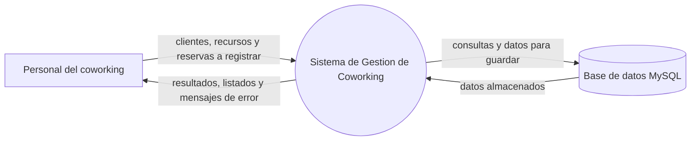

# Diagrama de contexto (nivel 0)

El diagrama de contexto muestra **el sistema entero como un único proceso**, con
las entidades externas que se relacionan con él y los datos que intercambian.
No muestra procesos internos ni almacenes de datos: esos aparecen en el
[DFD de nivel 1](./DFD.md).

## El diagrama

## Los elementos

| Elemento | Tipo | Que es |
|---|---|---|
| `Sistema de Gestion de Coworking` | Proceso | La aplicacion de escritorio completa. Se dibuja como un unico circulo: en este nivel no se muestra que tiene adentro |
| `Personal del coworking` | Entidad externa | La persona que opera el sistema: el administrador o el personal del mostrador. Es el unico actor del sistema |
| `Base de datos MySQL` | Entidad externa | Donde se persisten los datos. En el nivel 0 se ve como una entidad externa; en el nivel 1 se abre en los almacenes de datos |

## Los flujos

| Origen | Destino | Que circula |
|---|---|---|
| Personal del coworking | Sistema | Los datos que se registran: clientes, recursos y reservas, con las fechas y las caracteristicas de cada tipo de recurso |
| Sistema | Personal del coworking | La respuesta de cada operacion: confirmacion, listados, indicadores y los mensajes de error de negocio |
| Sistema | Base de datos | Las consultas y los datos que se guardan |
| Base de datos | Sistema | Los datos almacenados, que el sistema lee para validar y para mostrar |

## Dos notas que conviene tener claras en la defensa

**El cliente del coworking no es una entidad externa.** En este sistema el
cliente no usa la aplicacion: es un dato que el personal registra y administra.
Las entidades externas son las personas o sistemas que usan el sistema por
fuera de el, y aca hay una sola persona y una base de datos. Poner al cliente
como entidad externa seria dibujar el sistema de otra aplicacion.

**La base de datos es la contraparte de la persistencia.** Aparece como entidad
externa en el nivel 0 y se abre en los almacenes `D1` a `D5` en el nivel 1. Es
el balance entre los dos niveles: todo lo que entra y sale del sistema en el
nivel 0 esta repartido en los procesos del nivel 1.

## Convenciones

| Forma | Significado |
|---|---|
| Circulo | Proceso |
| Rectangulo | Entidad externa |
| Cilindro | Almacen de datos o, en el nivel 0, la base de datos completa |
| Flecha | Flujo de datos, con el nombre de lo que viaja |
