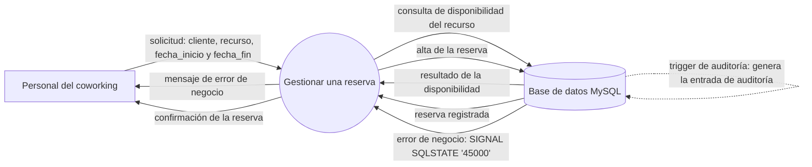

# Diagrama de contexto (nivel 0)

El diagrama de contexto muestra **el sistema entero como un único proceso**, con
las entidades externas que se relacionan con él y los datos que intercambian.
No muestra procesos internos ni almacenes de datos: esos aparecen en el
[DFD de nivel 1](./DFD.md).

## El diagrama

## Los elementos

| Elemento | Tipo | Qué es |
|---|---|---|
| `Sistema de Gestión de Coworking` | Proceso | La aplicación de escritorio completa. Se dibuja como un único círculo: en este nivel no se muestra qué tiene adentro |
| `Personal del coworking` | Entidad externa | La persona que opera el sistema: el administrador o el personal del mostrador. Es el único actor del sistema |
| `Base de datos MySQL` | Entidad externa | Donde se persisten los datos. En el nivel 0 se ve como una entidad externa; en el nivel 1 se abre en los almacenes de datos |

## Los flujos

| Origen | Destino | Qué circula |
|---|---|---|
| Personal del coworking | Sistema | Los datos que se registran: clientes, recursos y reservas, con las fechas y las características de cada tipo de recurso |
| Sistema | Personal del coworking | La respuesta de cada operación: confirmación, listados, indicadores y los mensajes de error de negocio |
| Sistema | Base de datos | Las consultas y los datos que se guardan |
| Base de datos | Sistema | Los datos almacenados, que el sistema lee para validar y para mostrar |

## Dos notas que conviene tener claras en la defensa

**El cliente del coworking no es una entidad externa.** En este sistema el
cliente no usa la aplicación: es un dato que el personal registra y administra.
Las entidades externas son las personas o sistemas que usan el sistema por
fuera de él, y acá hay una sola persona y una base de datos. Poner al cliente
como entidad externa sería dibujar el sistema de otra aplicación.

**La base de datos es la contraparte de la persistencia.** Aparece como entidad
externa en el nivel 0 y se abre en los almacenes `D1` a `D5` en el nivel 1. Es
el balance entre los dos niveles: todo lo que entra y sale del sistema en el
nivel 0 está repartido en los procesos del nivel 1.

## La operación principal: gestionar una reserva

El diagrama anterior dibuja el sistema entero. El que sigue usa la misma
notación de nivel 0 —proceso, entidad externa y base de datos— pero centrada en
una sola operación: el alta de una reserva, que es la operación central del
coworking y la que pone en juego las cuatro entidades del modelo.

### Los flujos de la operación

| Origen | Destino | Qué circula |
|---|---|---|
| Personal del coworking | Sistema | La solicitud: el administrador elige cliente, recurso, `fecha_inicio` y `fecha_fin` |
| Sistema | Base de datos | La consulta de la disponibilidad del recurso y, si la validación pasa, el alta de la reserva |
| Base de datos | Sistema | El resultado de la disponibilidad y, en el camino de rechazo, el error de negocio `SIGNAL SQLSTATE '45000'` |
| Sistema | Personal del coworking | La confirmación de la reserva, o el mensaje de error de negocio que se le muestra al usuario |
| Base de datos | Base de datos | La entrada de auditoría que el trigger de la base escribe al confirmarse el alta |

### Dos aclaraciones sobre este diagrama

**El cliente del coworking no aparece como entidad externa.** Igual que en el
nivel 0, la reserva la registra el personal: el cliente es un dato del alta, no
un actor que se conecte al sistema. La única entidad externa que manda datos en
este diagrama es la persona del mostrador.

**La validación final la hace la base de datos.** El sistema consulta la
disponibilidad del recurso antes de guardar, y esa consulta le permite avisarle
al usuario antes de escribir. Es una comprobación preventiva, no la decisión:
la que decide es la base, dentro de `sp_alta_reserva`, que vuelve a validar las
mismas reglas y levanta el `SIGNAL` cuando no se cumplen.

## Convenciones

| Forma | Significado |
|---|---|
| Círculo | Proceso |
| Rectángulo | Entidad externa |
| Cilindro | Almacén de datos o, en el nivel 0, la base de datos completa |
| Flecha | Flujo de datos, con el nombre de lo que viaja |
| Flecha punteada | Flujo generado por la base de datos, no por la aplicación |
