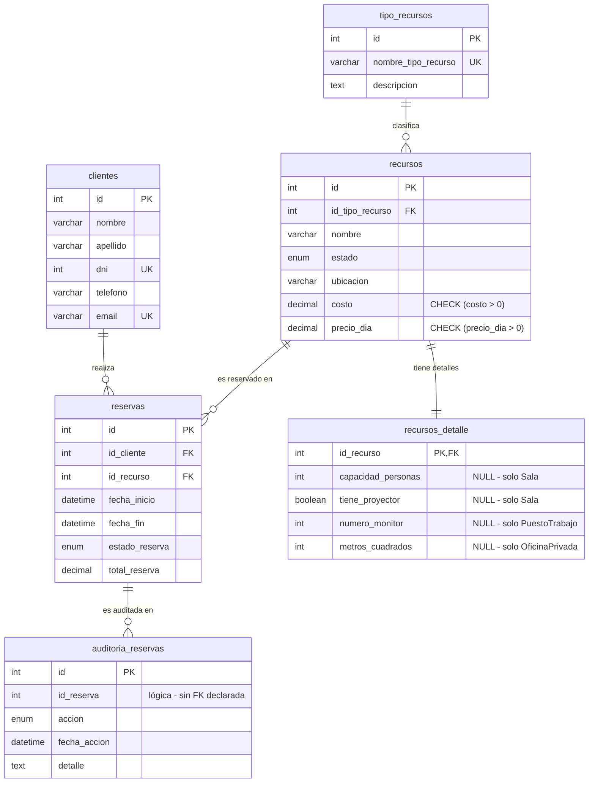

# Diagrama Entidad-Relación (DER)

## Diagrama

## Relaciones

| Origen | Cardinalidad | Destino | Descripción |
|---|---|---|---|
| clientes | 1 a N | reservas | Un cliente puede tener muchas reservas |
| tipo_recursos | 1 a N | recursos | Un tipo clasifica muchos recursos |
| recursos | 1 a N | reservas | Un recurso puede tener muchas reservas en el tiempo |
| recursos | 1 a 1 | recursos_detalle | Un recurso tiene un detalle (1:1) con campos específicos por tipo |
| reservas | 1 a N | auditoria_reservas | Una reserva genera múltiples entradas de auditoría (insert, cancel). La relación es lógica: `auditoria_reservas.id_reserva` no declara FK hacia `reservas` |

## Decisiones de diseño

### Tabla `recursos_detalle` separada

En lugar de poner todos los campos en `recursos` (lo que generaría redundancia y NULLs en todas las filas), se creó una tabla 1:1 que guarda solo los campos específicos de cada tipo de recurso:

- **Sala**: `capacidad_personas`, `tiene_proyector`
- **PuestoTrabajo**: `numero_monitor`
- **OficinaPrivada**: `metros_cuadrados`

Justificación: la FK desde `reservas` apunta a `recursos` (no a tres tablas separadas), el JOIN del DAO en C# es simple, y la validación de campos obligatorios por tipo se hace en los SPs.

### Tabla `auditoria_reservas` separada

Independiente de la tabla principal de reservas, registra automáticamente (vía trigger) las operaciones de alta y cancelación. Sirve para tener un historial sin afectar la performance de las consultas de reservas.

### La relación con `reservas` es lógica, no una FK declarada

`auditoria_reservas.id_reserva` existe como columna, pero **no** declara ninguna
constraint `foreign key` hacia `reservas`. La relación es real y es 1 a N, pero
no la impone el motor de la base de datos: la mantiene la lógica del trigger de
auditoría.

En `Scripts SQL/Coworking_db.sql` la diferencia se ve línea por línea.
`reservas` cierra su `CREATE TABLE` declarando sus dos claves foráneas:
`foreign key(id_cliente) references clientes(id)` y
`foreign key(id_recurso) references recursos(id)`.

`auditoria_reservas`, en cambio, cierra el `CREATE TABLE` sin ninguna línea
`foreign key`: declara `id_reserva int not null` y nada más.

Quién mantiene la relación, entonces, es el trigger: `trg_auditoria_reservas_insert`
y `trg_auditoria_reservas_update` escriben siempre `NEW.id`, el identificador de
la fila de `reservas` que se acaba de insertar o de actualizar.

La consecuencia de que la integridad referencial no la vigila el motor es
concreta: ante un `INSERT` directo en `auditoria_reservas`, la base no impide
dejar una fila apuntando a una reserva que no existe. En la práctica la
relación se mantiene porque los triggers son los únicos que escriben en esa
tabla: la aplicación nunca inserta ni actualiza filas de `auditoria_reservas`.

Por eso, en el diagrama, la columna queda anotada como lógica y la relación se
dibuja igual: el vínculo existe y es 1 a N, solo que no está declarado como FK.

### Estados como ENUM

Los campos `recursos.estado`, `reservas.estado_reserva` y `auditoria_reservas.accion` son ENUM para restringir los valores válidos a nivel de schema. Esto evita inserciones con estados inválidos.

## Cardinalidad completa

- `clientes` 1 --- 0..N `reservas` (un cliente puede no tener reservas o tener muchas)
- `tipo_recursos` 1 --- 0..N `recursos` (un tipo puede no tener recursos asignados, pero normalmente tendrá varios)
- `recursos` 1 --- 0..N `reservas` (un recurso puede no estar reservado nunca, o tener muchas reservas en distintos momentos)
- `recursos` 1 --- 1 `recursos_detalle` (1:1 estricto, todo recurso tiene su detalle)
- `reservas` 1 --- 0..N `auditoria_reservas` (una reserva puede tener 0 auditorías si fue creada antes de los triggers, o varias si fue creada y luego cancelada). La relación es lógica: no hay FK declarada, la mantiene el trigger de auditoría
