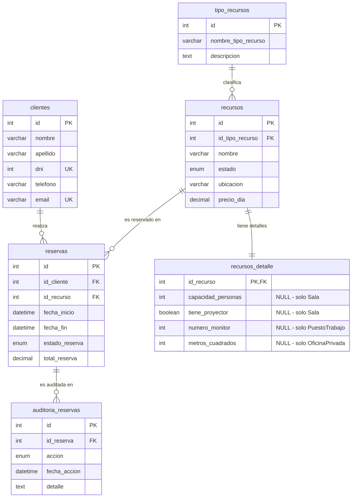

# Diagrama Entidad-Relacion (DER)

## Diagrama

## Relaciones

| Origen | Cardinalidad | Destino | Descripcion |
|---|---|---|---|
| clientes | 1 a N | reservas | Un cliente puede tener muchas reservas |
| tipo_recursos | 1 a N | recursos | Un tipo clasifica muchos recursos |
| recursos | 1 a N | reservas | Un recurso puede tener muchas reservas en el tiempo |
| recursos | 1 a 1 | recursos_detalle | Un recurso tiene un detalle (1:1) con campos especificos por tipo |
| reservas | 1 a N | auditoria_reservas | Una reserva genera multiples entradas de auditoria (insert, cancel) |

## Decisiones de diseno

### Tabla `recursos_detalle` separada

En lugar de poner todos los campos en `recursos` (lo que generaria redundancia y NULLs en todas las filas), se creo una tabla 1:1 que guarda solo los campos especificos de cada tipo de recurso:

- **Sala**: `capacidad_personas`, `tiene_proyector`
- **PuestoTrabajo**: `numero_monitor`
- **OficinaPrivada**: `metros_cuadrados`

Justificacion: la FK desde `reservas` apunta a `recursos` (no a tres tablas separadas), el JOIN del DAO en C# es simple, y la validacion de campos obligatorios por tipo se hace en los SPs.

### Tabla `auditoria_reservas` separada

Independiente de la tabla principal de reservas, registra automaticamente (via trigger) las operaciones de alta y cancelacion. Sirve para tener un historial sin afectar la performance de las consultas de reservas.

### Estados como ENUM

Los campos `recursos.estado`, `reservas.estado_reserva` y `auditoria_reservas.accion` son ENUM para restringir los valores validos a nivel de schema. Esto evita inserciones con estados invalidos.

## Cardinalidad completa

- `clientes` 1 --- 0..N `reservas` (un cliente puede no tener reservas o tener muchas)
- `tipo_recursos` 1 --- 0..N `recursos` (un tipo puede no tener recursos asignados, pero normalmente tendra varios)
- `recursos` 1 --- 0..N `reservas` (un recurso puede no estar reservado nunca, o tener muchas reservas en distintos momentos)
- `recursos` 1 --- 1 `recursos_detalle` (1:1 estricto, todo recurso tiene su detalle)
- `reservas` 1 --- 0..N `auditoria_reservas` (una reserva puede tener 0 auditorias si fue creada antes de los triggers, o varias si fue creada y luego cancelada)
