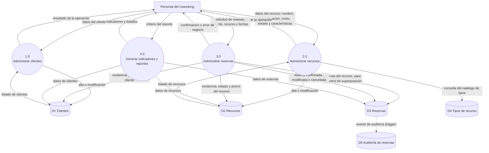
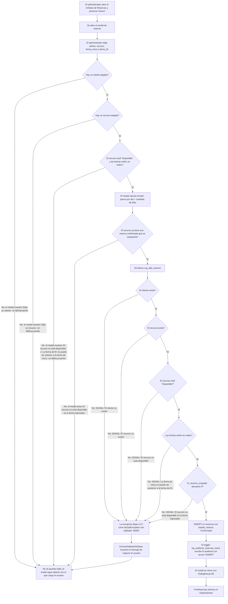
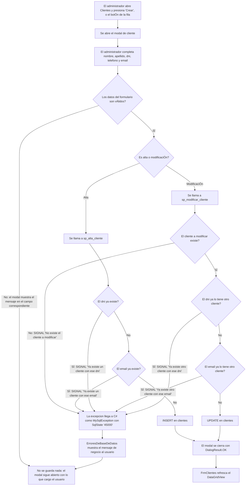
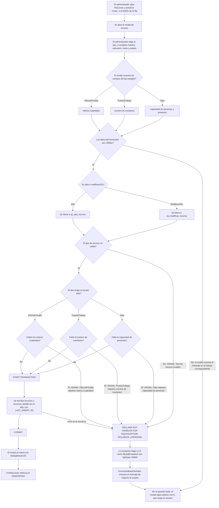
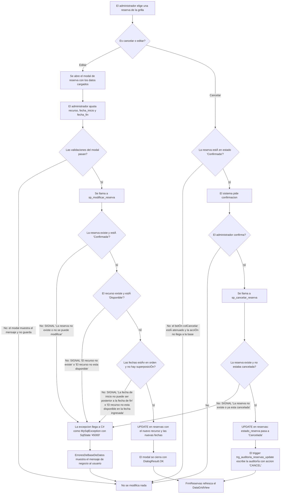

# DFD de nivel 1

El DFD de nivel 1 **abre el sistema del [diagrama de contexto](./DC.md)** y
muestra los procesos internos que lo componen, los almacenes de datos donde se
guarda la información y los flujos entre ellos.

La entidad externa `Base de datos MySQL` del nivel 0 es la que se abre aquí: se
convierte en los almacenes `D1` a `D5`.

## El diagrama

## Los procesos

| Proceso | Qué hace | Dónde está en el código |
|---|---|---|
| `1.0 Administrar clientes` | Alta y modificación de clientes, y listado para verlos | `Formularios/FrmClientes.cs` |
| `2.0 Administrar recursos` | Alta y modificación de recursos, con las características que exige cada tipo y su estado. Listado para verlos | `Formularios/FrmRecursos.cs` |
| `3.0 Administrar reservas` | Agenda, modifica y cancela reservas. Valida cliente, recurso y fechas en el modal, y la superposición la consulta a la base antes de guardar | `Formularios/FrmReservas.cs` |
| `4.0 Generar indicadores y reportes` | Dashboard con los cinco indicadores del coworking | `Formularios/FrmDashboard.cs` |

## Los almacenes de datos

| Almacén | Qué guarda | Tabla |
|---|---|---|
| `D1 Clientes` | Los clientes del coworking | `clientes` |
| `D2 Recursos` | Los recursos y el detalle que corresponde a su tipo | `recursos`, `recursos_detalle` |
| `D3 Reservas` | Las reservas, con su estado y su total | `reservas` |
| `D4 Tipos de recurso` | El catálogo de tipos de recurso | `tipo_recursos` |
| `D5 Auditoria de reservas` | El historial de altas y cancelaciones | `auditoria_reservas` |

## Los flujos que vale la pena explicar

**El proceso `3.0` es el que se apoya en los demás.** No guarda un derivado de
la reserva: la pide a `D1` y a `D2` para saber si el cliente y el recurso
existen y están disponibles, y a `D3` para saber si el recurso ya está
reservado en esas fechas. Por eso el control de superposición necesita leer
`D3` antes de escribir en `D3`. La regla de superposición está escrita una sola vez, en la base: la función `fn_recurso_ocupado`. Los procedimientos `sp_alta_reserva` y `sp_modificar_reserva` la usan para rechazar, y la aplicación la consulta antes de guardar para avisar. Por eso la base y la aplicación no pueden decidir distinto.

**La auditoría no la escribe la aplicación.** La flecha punteada de `D3` a `D5`
representa el trigger de la base: cada alta y cada cancelación se auditan sola,
sin que ningún proceso del sistema tenga que pedirlo. Por eso `D5` no tiene
ninguna flecha de entrada desde el personal.

**Los errores de negocio no son un flujo de datos, son una respuesta.** El
proceso `3.0` devuelve al personal una confirmación o el mensaje de error de
la regla que falló, y esa respuesta sale hacia la misma entidad externa que
entra. Es lo que en el nivel 0 se resume en el flujo `Sistema -> Personal`.

## Una cosa que el diagrama muestra y el código todavía no

El diagrama describe lo que el sistema **hace**, y hay un lugar donde el código
todavía no llega. No es una decisión de diseño: es un pendiente de cerrar.

**No hay búsqueda ni baja lógica.** Ninguna pantalla busca y ninguna da de
baja: el listado se muestra completo y la modificación es una edición. Por eso
los flujos de `D1` y `D2` hacia sus procesos dicen solo `listado`.

La cancelación, en cambio, ya está expuesta y coincide con el diagrama: el
botón `colCancelar` de la grilla de `FrmReservas` pide confirmación, llama a
`ReservaDAO.Cancelar(id)`, que va a `sp_cancelar_reserva`, pasa la reserva a
`Cancelada` y dispara el trigger de auditoría. El botón solo está habilitado
si la reserva está en estado `Confirmada`: en las que ya están canceladas
aparece atenuado y la acción no llega a la base. Es la misma regla que aplica
el procedimiento almacenado, resuelta en la interfaz para que el usuario no
llegue a un error.

## Balance con el nivel 0

| Flujo del nivel 0 | Dónde aparece en el nivel 1 |
|---|---|
| Personal -> Sistema: clientes, recursos y reservas | `P -> 1.0`, `P -> 2.0`, `P -> 3.0` |
| Sistema -> Personal: resultados, listados y errores | `1.0 -> P`, `2.0 -> P`, `3.0 -> P`, `4.0 -> P` |
| Sistema -> Base de datos: consultas y datos | `Procesos -> D1..D5` |
| Base de datos -> Sistema: datos almacenados | `D1..D5 -> Procesos` |

La entidad externa `Base de datos MySQL` desaparece del nivel 1 porque sus
almacenes quedan explicitados: es la diferencia entre dibujar una caja negra y
abrirla.

## Convenciones

| Forma | Significado |
|---|---|
| Círculo numerado | Proceso. El número (`1.0`, `2.0`, ...) es la convención de Gane-Sarson para identificarlo y para el balance entre niveles |
| Rectángulo | Entidad externa |
| Cilindro | Almacén de datos |
| Flecha continua | Flujo de datos |
| Flecha punteada | Flujo generado por la base de datos, no por la aplicación |

## Flujos de las operaciones de escritura

El diagrama anterior muestra **dónde** se guarda cada cosa. Los diagramas de
esta sección muestran **cómo** se llega a guardarla: el recorrido paso a paso de
cada operación de escritura, con las decisiones que se toman en el camino y la
regla que decide en cada una.

Son diagramas de flujo de actividad, no DFD: usan rombos para las decisiones y
rectángulos para las acciones. Las convenciones de forma de esta sección son:

| Forma | Significado |
|---|---|
| Rectángulo | Acción: un paso que ejecuta la aplicación o la base de datos |
| Rombo | Decisión: una regla que se evalúa y tiene dos salidas, `Sí` y `No` |
| Flecha | El recorrido de la operación |

Los mensajes de error que aparecen en los rombos y en los rectángulos son los
textuales de cada `SIGNAL`, copiados de `Scripts SQL/Procedimientos_Almacenados.sql`.

### Flujo principal: alta de una reserva

**El sistema reserva por días, no por horarios.** La comparación de fechas es
`DATE(fecha_inicio) <= DATE(fecha_fin)`: la misma fecha de inicio y de fin es
una reserva de un día completo. La misma regla aparece en tres lugares, y los
tres dicen lo mismo: el `CHECK` de la tabla `reservas`, el
`IF DATE(p_fecha_inicio) > DATE(p_fecha_fin)` de `sp_alta_reserva` y el
`Recurso.PuedeReservarse` de C#, que mira que el estado sea `Disponible` y que
las fechas no estén al revés.

**Las dos validaciones del modal se complementan, no se pisan.** La del cliente
va a su etiqueta (`lblClienteInfo`) y la del recurso a la suya (`lblRecursoInfo`):
si las dos fallan, el modal muestra los dos mensajes y no guarda.

**El precio del día lo recalcula el tipo, no se lo lee de la columna.** El modal
calcula el total con `Recurso.CalcularPrecio()`, que según el tipo aplica su
propio recargo sobre el costo base. El DAO lee `costo` de `recursos` y arma el
recurso con el tipo concreto, así que el precio que usa el modal sale siempre de
esa regla del dominio y no de la columna `precio_dia`. La cantidad de días la
cuenta `Reserva.DiasReservados`, con conteo inclusivo: del 10/03 al 12/03 son 3
días.

**La disponibilidad se consulta dos veces, y la segunda es la que manda.** El
modal consulta `fn_recurso_ocupado` antes de escribir, para avisarle al
usuario y que elija otra fecha sin llegar a un error; después `sp_alta_reserva`
la vuelve a consultar y es esa la que puede rechazar el alta. La aplicación
avisa; la base decide.

**`sp_alta_reserva` no abre transacción.** No la necesita: escribe una sola
tabla (`reservas`), y el `INSERT` es atómico por sí mismo. La transacción, con
su `ROLLBACK`, aparece en el flujo de recursos, que sí escribe en dos tablas.

**El error de negocio no cierra el modal.** El `SIGNAL` viaja como
`MySqlException` con `SqlState == "45000"`, lo captura la capa de presentación
(`ErroresDeBaseDeDatos`) y lo muestra con su mensaje textual. El modal sigue
abierto con lo que cargó el usuario, para que elija otra fecha y reintente sin
perder lo escrito.

**El camino de éxito es el que cierra el ciclo.** La reserva queda en estado
`Confirmada`, el trigger `trg_auditoria_reservas_insert` escribe la fila de
auditoría con acción `INSERT` —sin que la aplicación lo pida—, el modal se
cierra con `DialogResult.OK` y `FrmReservas` refresca el `DataGridView`.

### Flujo secundario: alta y modificación de cliente

**El `UNIQUE` de la tabla y el `SIGNAL` del procedimiento son la misma regla,
escrita en dos lugares.** `clientes.dni` y `clientes.email` tienen
restricción `UNIQUE` en el esquema, y además `sp_alta_cliente` y
`sp_modificar_cliente` las comprueban con un `SIGNAL` antes de escribir, para
devolver un mensaje de negocio en vez de un error técnico de duplicado. En la
modificación la comprobación excluye al propio registro: el cliente puede
guardarse sin cambios.

### Flujo secundario: alta y modificación de recurso

**Esta es la única escritura que toca dos tablas.** El modal escribe en
`recursos` y en `recursos_detalle`, y por eso el procedimiento sí necesita
transacción: `START TRANSACTION`, los dos `INSERT` o `UPDATE` y el `COMMIT`.
El `DECLARE EXIT HANDLER FOR SQLEXCEPTION` con `ROLLBACK` y `RESIGNAL` está
declarado al principio del procedimiento, antes de la transacción: eso
garantiza que un fallo dentro de la transacción no deje el recurso sin su fila
de detalle, y que el error llegue a la aplicación con su mensaje original.
Cuando la falla es una de las validaciones de tipo, el `ROLLBACK` no tiene
transacción activa que deshacer y lo que hace el handler es el `RESIGNAL`.

**El modal se adapta al tipo elegido.** `cmbTipo_SelectedIndexChanged` deja
visibles solo los paneles del tipo que corresponde: capacidad y proyector para
`Sala`, número de monitores para `PuestoTrabajo` y metros cuadrados para
`OficinaPrivada`. Los datos de los otros tipos van en `NULL` en
`recursos_detalle`, y los tres datos obligatorios se validan en los dos lados:
en C# (`Sala.ValidarCapacidad`, `PuestoTrabajo.ValidarMonitores`,
`OficinaPrivada.ValidarMetrosCuadrados`) y en el procedimiento almacenado, con
un `SIGNAL` por tipo.

**El precio diario se calcula antes de guardar y se persiste.** El modal lo
muestra con `Recurso.CalcularPrecio()` y el DAO lo manda como `p_precio_dia`, de
modo que la columna `precio_dia` y lo que ve el usuario no pueden quedar
desincronizados.

### Flujo secundario: cancelación y modificación de reserva

**Cancelar es baja lógica, no borrado.** `sp_cancelar_reserva` hace un `UPDATE`
y pasa `estado_reserva` de `Confirmada` a `Cancelada`: la fila y su historial
quedan. No hay ningún `DELETE` en los procedimientos de reservas.

**La cancelación se audita sola.** El `UPDATE` dispara
`trg_auditoria_reservas_update`, que escribe la entrada de auditoría con acción
`CANCEL`. La aplicación no escribe en `auditoria_reservas`: no tiene permiso
lógico para eso.

**La modificación revalida todo, como el alta.** `sp_modificar_reserva` repite
la cadena de reglas del alta: existencia y estado del recurso, orden de las
fechas y superposición. La diferencia es que, al consultar
`fn_recurso_ocupado`, excluye de la cuenta la propia reserva que se está
editando, para que una reserva no se superponga consigo misma. La modificación
tampoco cambia `estado_reserva` y por eso no dispara la auditoría: el trigger
solo escribe cuando el estado pasa de `Confirmada` a `Cancelada`.

### De dónde sale cada decisión

La tabla siguiente mapea cada decisión de los diagramas anteriores a la regla
concreta que la origina. `Donde vive` indica el archivo y el objeto donde está
escrita.

| Decision | Regla de origen | Donde vive |
|---|---|---|
| Hay un cliente elegido | Validación en C#: `Reserva.ValidarCliente` | `SistemaCoworking/Modelos/Reserva.cs` |
| Hay un recurso elegido | Validación en C#: `Reserva.ValidarReserva` | `SistemaCoworking/Modelos/Reserva.cs` |
| El recurso está `Disponible` (en el modal) | Validación en C#: `Recurso.PuedeReservarse` | `SistemaCoworking/Modelos/Recurso.cs` |
| Las fechas están en orden (en el modal) | Validación en C#: `Recurso.PuedeReservarse` | `SistemaCoworking/Modelos/Recurso.cs` |
| Las fechas están en orden (en la base) | `CHECK` de tabla: `DATE(fecha_inicio) <= DATE(fecha_fin)` en `reservas` | `Scripts SQL/Coworking_db.sql` |
| Las fechas están en orden (en el procedimiento) | Validación dentro de un procedimiento almacenado: `sp_alta_reserva` y `sp_modificar_reserva` | `Scripts SQL/Procedimientos_Almacenados.sql` |
| El total es precio por día × cantidad de días | Validación en C#: `Reserva.CalcularTotal`, `Reserva.DiasReservados` y `Recurso.CalcularPrecio` | `SistemaCoworking/Modelos/Reserva.cs`, `SistemaCoworking/Modelos/Recurso.cs` |
| No hay superposición de reservas | Validación dentro de un procedimiento almacenado: función `fn_recurso_ocupado`, usada por `sp_alta_reserva` y `sp_modificar_reserva` | `Scripts SQL/Funciones.sql`, `Scripts SQL/Procedimientos_Almacenados.sql` |
| El cliente existe (en la base) | `FK`: `reservas.id_cliente` → `clientes.id` | `Scripts SQL/Coworking_db.sql` |
| El cliente existe (validado en el procedimiento) | Validación dentro de un procedimiento almacenado: `sp_alta_reserva`, `SIGNAL 'El cliente no existe'` | `Scripts SQL/Procedimientos_Almacenados.sql` |
| El recurso existe (en la base) | `FK`: `reservas.id_recurso` → `recursos.id` | `Scripts SQL/Coworking_db.sql` |
| El recurso existe (validado en el procedimiento) | Validación dentro de un procedimiento almacenado: `sp_alta_reserva`, `SIGNAL 'El recurso no existe'` | `Scripts SQL/Procedimientos_Almacenados.sql` |
| El recurso está `Disponible` (en la base) | `ENUM`: `recursos.estado` | `Scripts SQL/Coworking_db.sql` |
| El recurso está `Disponible` (validado en el procedimiento) | Validación dentro de un procedimiento almacenado: `sp_alta_reserva` y `sp_modificar_reserva`, `SIGNAL 'El recurso no esta disponible'` | `Scripts SQL/Procedimientos_Almacenados.sql` |
| La reserva queda `Confirmada` | `ENUM`: `reservas.estado_reserva`, con valor por defecto `Confirmada` | `Scripts SQL/Coworking_db.sql` |
| La entrada de auditoría del alta | Trigger: `trg_auditoria_reservas_insert` | `Scripts SQL/Triggers.sql` |
| La entrada de auditoría de la cancelación | Trigger: `trg_auditoria_reservas_update` | `Scripts SQL/Triggers.sql` |
| La acción de la auditoría | `ENUM`: `auditoria_reservas.accion` | `Scripts SQL/Coworking_db.sql` |
| El DNI es único | `UNIQUE`: `clientes.dni` | `Scripts SQL/Coworking_db.sql` |
| El email es único | `UNIQUE`: `clientes.email` | `Scripts SQL/Coworking_db.sql` |
| El DNI duplicado se rechaza con mensaje de negocio | Validación dentro de un procedimiento almacenado: `sp_alta_cliente` y `sp_modificar_cliente`, `SIGNAL 'Ya existe un cliente con ese dni'` / `'Ya existe otro cliente con ese dni'` | `Scripts SQL/Procedimientos_Almacenados.sql` |
| El email duplicado se rechaza con mensaje de negocio | Validación dentro de un procedimiento almacenado: `sp_alta_cliente` y `sp_modificar_cliente`, `SIGNAL 'Ya existe un cliente con ese email'` / `'Ya existe otro cliente con ese email'` | `Scripts SQL/Procedimientos_Almacenados.sql` |
| El cliente a modificar existe | Validación dentro de un procedimiento almacenado: `sp_modificar_cliente`, `SIGNAL 'No existe el cliente a modificar'` | `Scripts SQL/Procedimientos_Almacenados.sql` |
| Los datos del formulario de cliente son válidos | Validación en C#: `Cliente.ValidarNombre`, `ValidarApellido`, `ValidarDni`, `ValidarTelefono`, `ValidarEmail` | `SistemaCoworking/Modelos/Cliente.cs` |
| El tipo de recurso es válido | Validación dentro de un procedimiento almacenado: `sp_alta_recurso` y `sp_modificar_recurso`, `SIGNAL 'Tipo de recurso invalido'` | `Scripts SQL/Procedimientos_Almacenados.sql` |
| Sala exige capacidad de personas | Validación dentro de un procedimiento almacenado: `sp_alta_recurso` y `sp_modificar_recurso`, `SIGNAL 'Sala requiere capacidad de personas'` | `Scripts SQL/Procedimientos_Almacenados.sql` |
| Sala exige capacidad de personas (en el modal) | Validación en C#: `Sala.ValidarCapacidad` | `SistemaCoworking/Modelos/Sala.cs` |
| PuestoTrabajo exige número de monitores | Validación dentro de un procedimiento almacenado: `sp_alta_recurso` y `sp_modificar_recurso`, `SIGNAL 'PuestoTrabajo requiere numero de monitores'` | `Scripts SQL/Procedimientos_Almacenados.sql` |
| PuestoTrabajo exige número de monitores (en el modal) | Validación en C#: `PuestoTrabajo.ValidarMonitores` | `SistemaCoworking/Modelos/PuestoTrabajo.cs` |
| OficinaPrivada exige metros cuadrados | Validación dentro de un procedimiento almacenado: `sp_alta_recurso` y `sp_modificar_recurso`, `SIGNAL 'OficinaPrivada requiere metros cuadrados'` | `Scripts SQL/Procedimientos_Almacenados.sql` |
| OficinaPrivada exige metros cuadrados (en el modal) | Validación en C#: `OficinaPrivada.ValidarMetrosCuadrados` | `SistemaCoworking/Modelos/OficinaPrivada.cs` |
| El costo es mayor a cero | `CHECK` de tabla: `costo > 0` en `recursos` | `Scripts SQL/Coworking_db.sql` |
| El costo es mayor a cero (en el modal) | Validación en C#: `Recurso.ValidarCosto` | `SistemaCoworking/Modelos/Recurso.cs` |
| El precio diario es mayor a cero | `CHECK` de tabla: `precio_dia > 0` en `recursos` | `Scripts SQL/Coworking_db.sql` |
| El recurso y su detalle se escriben juntos | Transacción en un procedimiento almacenado: `START TRANSACTION`, `COMMIT` y `DECLARE EXIT HANDLER FOR SQLEXCEPTION` con `ROLLBACK` y `RESIGNAL`, en `sp_alta_recurso` y `sp_modificar_recurso` | `Scripts SQL/Procedimientos_Almacenados.sql` |
| La reserva y su detalle referencian clientes y recursos | `FK`: `reservas.id_cliente`, `reservas.id_recurso`, `recursos.id_tipo_recurso` y `recursos_detalle.id_recurso` | `Scripts SQL/Coworking_db.sql` |
| Solo se cancela una reserva `Confirmada` | `ENUM`: `reservas.estado_reserva` | `Scripts SQL/Coworking_db.sql` |
| Solo se cancela una reserva `Confirmada` (validado) | Validación dentro de un procedimiento almacenado: `sp_cancelar_reserva`, `SIGNAL 'La reserva no existe o ya esta cancelada'` | `Scripts SQL/Procedimientos_Almacenados.sql` |
| El botón de cancelar se atenúa fuera de `Confirmada` | Validación en C#: `FrmReservas.EsCancelable` | `SistemaCoworking/Formularios/FrmReservas.cs` |
| Cancelar no borra, deja la reserva en `Cancelada` | Validación dentro de un procedimiento almacenado: `sp_cancelar_reserva` hace `UPDATE`, no `DELETE` | `Scripts SQL/Procedimientos_Almacenados.sql` |
| Solo se modifica una reserva `Confirmada` | Validación dentro de un procedimiento almacenado: `sp_modificar_reserva`, `SIGNAL 'La reserva no existe o no se puede modificar'` | `Scripts SQL/Procedimientos_Almacenados.sql` |
| La modificación excluye la propia reserva de la superposición | Validación dentro de un procedimiento almacenado: `fn_recurso_ocupado` con `p_id_reserva_excluida` | `Scripts SQL/Funciones.sql` |
| El error de negocio se muestra al usuario | Validación en C#: `ErroresDeBaseDeDatos.Mostrar`, que reconoce `SqlState == "45000"` | `SistemaCoworking/Herramientas/ErroresDeBaseDeDatos.cs` |
