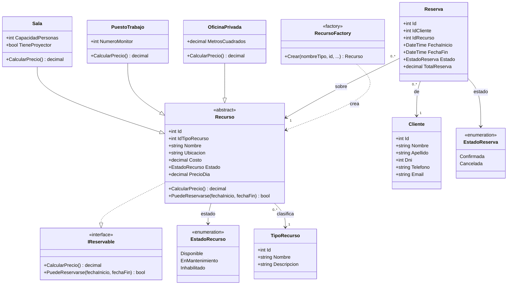

# Diagrama de clases

Diagrama de clases **simplificado** del modelo de dominio del Sistema de
Coworking, requerido por la consigna del TP Final.

Es un diagrama del **dominio**, no del código: muestra los conceptos del
negocio, cómo se relacionan y qué reglas de negocio sostienen. Los DAO, los
formularios y los helpers de interfaz no aparecen, y la sección 6 explica por
qué.

Simplificado no significa incompleto: significa que cada clase muestra **lo
que justifica su existencia** y no la lista exhaustiva de sus propiedades.

## 1. El diagrama

### Cómo leer el diagrama

- **La jerarquía es el corazón del modelo.** `Recurso` es una clase abstracta y
  sus tres derivadas existen porque el precio depende del tipo: una sala con
  proyector no cuesta lo mismo que un puesto de trabajo con dos monitores.
- **`IReservable` la implementa `Recurso`.** Define la capacidad de un recurso
  de reservarse y de calcular su precio.
- **Las relaciones son por identificador.** `Reserva` guarda `IdCliente` e
  `IdRecurso`, no referencias a objetos: el modelo no arrastra objetos ajenos
  y la base resuelve la integridad con claves foráneas.
- **`RecursoFactory` es el único punto donde un nombre de tipo se traduce en
  una clase concreta.** Es la pieza que hace que la jerarquía sea intencional
  y no decorativa.
- **Los estados son enumeraciones**, no cadenas: `EstadoRecurso` y
  `EstadoReserva` restringen los valores válidos.

## 2. Las clases

| Clase | Tipo | Qué aporta | Operaciones con significado de negocio |
|---|---|---|---|
| `Recurso` | Clase abstracta | Datos comunes de todo recurso reservable: identidad, tipo, nombre, ubicación, costo base y estado | `CalcularPrecio()` (abstracta), `PuedeReservarse(inicio, fin)` |
| `Sala` | Derivada de `Recurso` | `CapacidadPersonas`, `TieneProyector` | `CalcularPrecio()`: costo × 1,25 si tiene proyector |
| `PuestoTrabajo` | Derivada de `Recurso` | `NumeroMonitor` | `CalcularPrecio()`: costo × (1 + 0,10 × monitores extra) |
| `OficinaPrivada` | Derivada de `Recurso` | `MetrosCuadrados` | `CalcularPrecio()`: costo × 1,20 si supera los 20 m² |
| `IReservable` | Interfaz | Capacidad de reserva y cálculo de precio | `CalcularPrecio()`, `PuedeReservarse()` |
| `Cliente` | Entidad | Datos del cliente del coworking | Validadores de nombre, apellido, DNI, teléfono y email |
| `Reserva` | Entidad | Une cliente, recurso y período | `ValidarCliente()`, `ValidarReserva(recurso, inicio, fin, out mensaje)`, `DiasReservados`, `CalcularTotal(recurso)` |
| `TipoRecurso` | Entidad de catálogo | Clasificación de los recursos (lectura) | — |
| `RecursoFactory` | Fábrica estática | Nombre de tipo → clase concreta | `Crear(...)` |

`PrecioDia` es un atributo **derivado**: se calcula con `CalcularPrecio()` y no
tiene setter, así que el precio diario no puede desincronizarse del costo base
y de las características del tipo.

## 3. Herencia, clase abstracta e interfaz

La consigna evalúa explícitamente el uso de herencia, clases abstractas e
interfaces. El modelo los usa para tres cosas distintas:

| Mecanismo | Dónde | Para qué |
|---|---|---|
| **Clase abstracta** | `Recurso` | Concentra lo que todos los recursos comparten (identidad, ubicación, costo, estado) y **obliga** a cada tipo a definir su propio precio con un método abstracto. No existe un `Recurso` genérico sin tipo: el modelo no admite un recurso que no sepa cuánto vale |
| **Herencia** | `Sala`, `PuestoTrabajo`, `OficinaPrivada` | Cada derivada aporta las características que **justifican su existencia** y su recargo: capacidad y proyector, cantidad de monitores, metros cuadrados |
| **Interfaz** | `IReservable` | Declara las dos capacidades de un recurso reservable: calcular su precio y decir si se puede reservar. La implementa la clase abstracta `Recurso`, y sus tres derivadas definen el precio segun su tipo. Las dos capacidades se usan de verdad: el precio, al calcular el total de la reserva, y `PuedeReservarse()`, al validar la reserva antes de guardarla |
| **Polimorfismo** | `CalcularPrecio()` | El mismo llamador produce un precio distinto según el tipo real. Es la regla que la DAO usa al calcular `precio_dia` y la que la interfaz muestra mientras se carga un recurso |
| **Enumeraciones** | `EstadoRecurso`, `EstadoReserva` | Restringen los estados válidos sin cadenas libres |

## 4. Reglas de negocio y dónde se aplican

La consigna pide explicar el manejo de errores y las decisiones de diseño. Lo
relevante para la defensa es poder decir **dónde vive cada regla**: no todas
viven en el modelo, y eso es una decisión, no un descuido.

| Regla | Dónde vive | Cómo se garantiza |
|---|---|---|
| El precio diario depende del tipo | **Modelo** (`CalcularPrecio()`) | Método abstracto con una implementación por tipo |
| Un recurso solo se puede reservar si esta `Disponible` y las fechas son coherentes | **Modelo** (`Recurso.PuedeReservarse`) y **SP** (`sp_alta_reserva`, `sp_modificar_reserva`) | La interfaz `IReservable` declara la capacidad y el modal la consulta antes de guardar; la base la revalida al guardar: `SIGNAL 'El recurso no esta disponible'` |
| Las reservas son **por días**, no por horarios: `fechaFin >= fechaInicio` | **Modelo** (`Reserva.ValidarReserva`) y **SP** (`CHECK` + `SIGNAL`) | Con la misma fecha de inicio y de fin la reserva ocupa **un día completo**; el conteo de días es inclusivo |
| No se superponen reservas sobre el mismo recurso | **UDF** (`fn_recurso_ocupado`) y **SP** (`sp_alta_reserva`, `sp_modificar_reserva`) | La regla vive una sola vez, en la funcion: `SIGNAL 'El recurso no esta disponible en la fecha ingresada'` |
| La superposicion se avisa antes de guardar | **Aplicacion** (`ReservaModal` + `ReservaDAO.RecursoOcupado`) | El modal consulta la misma funcion de la base y avisa sin llegar al error. La base sigue validando al guardar |
| Solo una reserva `Confirmada` se puede modificar | **SP** (`sp_modificar_reserva`) | `SIGNAL 'La reserva no existe o no se puede modificar'` |
| Solo una reserva `Confirmada` se puede cancelar | **SP** (`sp_cancelar_reserva`) | `SIGNAL 'La reserva no existe o ya esta cancelada'` |
| El boton de cancelar solo esta habilitado para una reserva `Confirmada` | **Aplicacion** (`FrmReservas`) | En las reservas ya canceladas el boton aparece atenuado y la accion no llega a la base |
| El cliente y el recurso de una reserva existen | **SP** | `SIGNAL 'El cliente no existe'` / `'El recurso no existe'` |
| `dni` y `email` de cliente son únicos | **Base** (`UNIQUE`) + **SP** | Restricción del schema y `SIGNAL` |
| Cada tipo exige sus datos obligatorios | **SP** | `SIGNAL 'Sala requiere capacidad de personas'` |
| Alta de recurso y su detalle son atómicas | **SP** | `START TRANSACTION` con `ROLLBACK` ante error |
| Toda alta y toda cancelación quedan auditadas | **Base** (triggers) | `trg_auditoria_reservas_insert` / `_update` → `auditoria_reservas` |
| Los errores de negocio llegan a la aplicación con su mensaje | **Aplicación** | `MySqlException` + `ex.SqlState == '45000'` (SQLSTATE 45000) |

## 5. Lo que no está en el diagrama

| Fuera | Por qué |
|---|---|
| `ClienteDAO`, `RecursoDAO`, `ReservaDAO`, `TipoRecursoDAO`, `DashboardDAO` | Acceso a datos. Mapean filas a objetos: es infraestructura |
| `ConexionBD` | Conectividad y cadena de configuración |
| `FrmPrincipal`, `FrmClientes`, `FrmRecursos`, `FrmReservas`, `FrmDashboard` | Presentación |
| `ClienteModal`, `RecursoModal`, `ReservaModal`, `TextControl` | Controles de WinForms |
| `Herramientas/*` (`TipoEntrada`, `*Configuration`) | Appearance y filtrado de la entrada del usuario |
| `DetalleTipo` | **Proyección de persistencia**, no un concepto de negocio: se recalcula en cada lectura (`Detalle` es una propiedad calculada) y existe para que la DAO escriba la tabla `recursos_detalle` sin conocer las clases concretas. No tiene comportamiento ni identidad: dibujarla agregaría una relación 1:1 que en el modelo no existe |
| `auditoria_reservas` | Es un concepto de la base de datos, no del modelo de objetos: la auditing lo hacen los triggers y no hay clase que lo represente |

## 6. Advertencias para la defensa

Tres puntos del modelo que conviene revisar antes de la defensa, porque la
consigna pide que nada sea "únicamente para cumplir":

1. ~~**`IReservable.PuedeReservarse()` no tiene ningún punto de llamada.**~~
   **Resuelto.** `ReservaModal` valida la reserva antes de guardar y la regla
   la decide el recurso: `Reserva.ValidarReserva` llama a `PuedeReservarse` y
   traduce el resultado al mensaje que ve el usuario. La superposición la
   consulta la base con `fn_recurso_ocupado`, que es la misma función que usan
   los procedimientos almacenados: la regla esta escrita una sola vez.

2. ~~**El total de una reserva se calcula en un formulario.**~~ **Resuelto.**
   La fórmula `precio_dia × días` vivía en `ReservaModal`, duplicada. Ahora vive
   en el modelo: `Reserva.DiasReservados` y `Reserva.CalcularTotal(recurso)`, y
   el formulario solo la muestra. El cálculo de días es inclusivo, porque el
   sistema reserva por días.

3. **`precio_dia` está desnormalizado en la base.** La invariante
   `precio_dia = CalcularPrecio()` la respeta la DAO por disciplina, no una
   restricción del schema: una fila editada a mano puede quedar desincronizada.
   Es una decisión consciente (desnormalizar para no recalcular en cada
   lectura) y conviene poder justificarla.

## 7. Trazabilidad

| Clase del diagrama | Archivo |
|---|---|
| `Cliente` | `SistemaCoworking/Modelos/Cliente.cs` |
| `Recurso` (+ `EstadoRecurso`) | `SistemaCoworking/Modelos/Recurso.cs` |
| `Sala` | `SistemaCoworking/Modelos/Sala.cs` |
| `PuestoTrabajo` | `SistemaCoworking/Modelos/PuestoTrabajo.cs` |
| `OficinaPrivada` | `SistemaCoworking/Modelos/OficinaPrivada.cs` |
| `Reserva` (+ `EstadoReserva`) | `SistemaCoworking/Modelos/Reserva.cs` |
| `TipoRecurso` | `SistemaCoworking/Modelos/TipoRecurso.cs` |
| `RecursoFactory` | `SistemaCoworking/Modelos/RecursoFactory.cs` |
| `IReservable` | `SistemaCoworking/Interfaces/IReservable.cs` |

Los procedimientos almacenados, las vistas, las funciones y los triggers que
sostienen las reglas de la sección 4 están en `Scripts SQL/`, y el modelo de
datos en `Docs/DER.md`.
