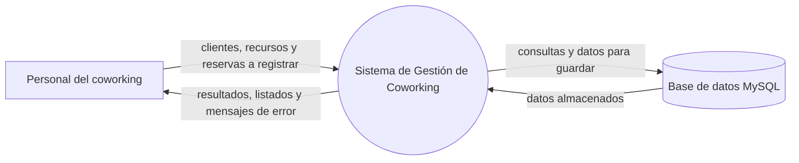
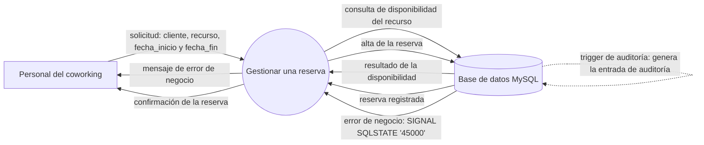
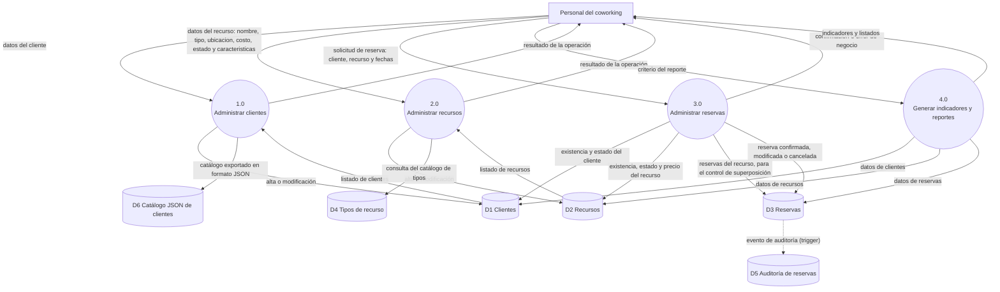
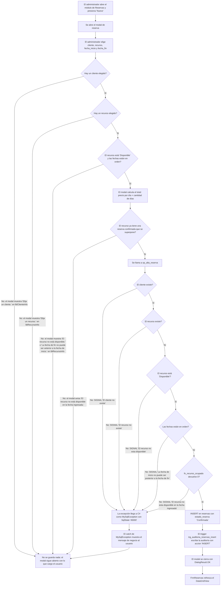
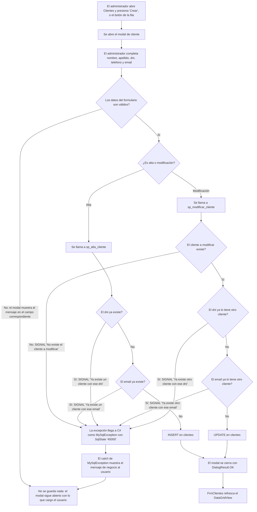
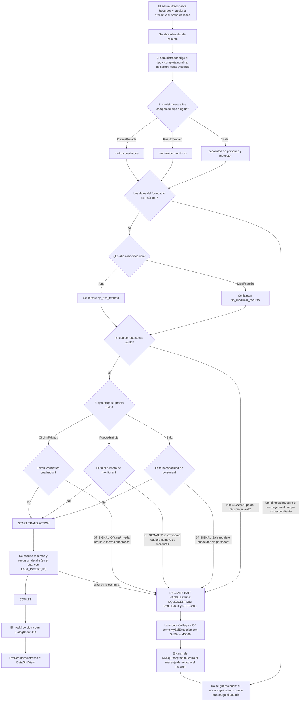
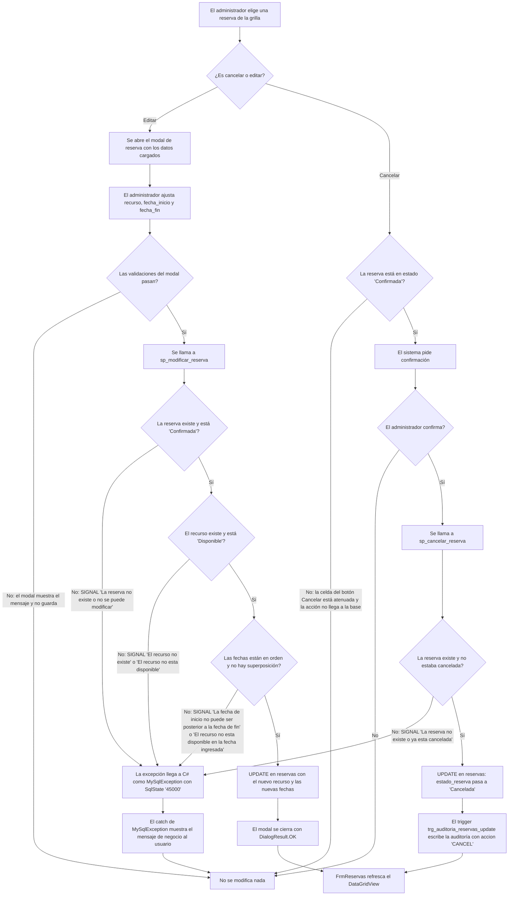
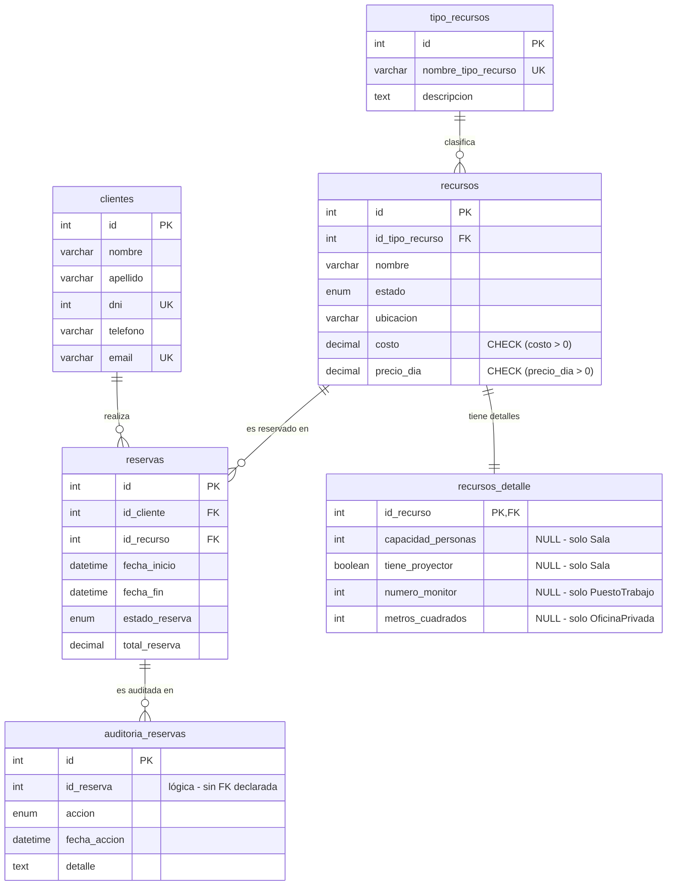
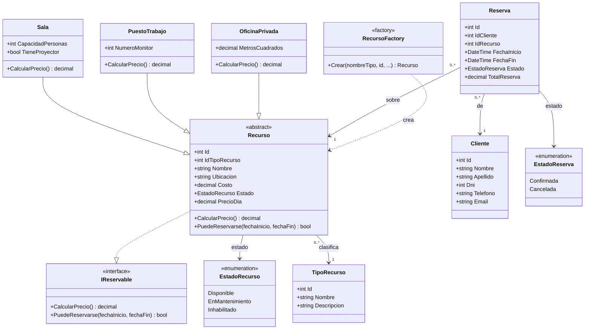

# Sistema de Gestión de Coworking y Reservas

Trabajo Práctico Final — Algoritmos II

| Dato de la portada | Valor |
|---|---|
| Título del trabajo | Sistema de Gestión de Coworking y Reservas |
| Tipo de trabajo | Trabajo Práctico Final |
| Institución | Instituto Argentino de la Empresa |
| Carrera | Analista de Sistemas de Información (2º año) |
| Asignatura | Algoritmos II |
| Docente a cargo | Prof. Lic. Adrián Aroca |
| Integrantes del grupo | Adrian Naum — Valentina Lespade — Santiago Castillo |
| Comisión / curso | 2º año |
| Ciclo lectivo | 2026 |
| Fecha de entrega | 11/11/2026 |
| Versión del documento | 1.0 |

---

## Índice

| Sección | Contenido | Página |
|---|---|---|
| 1 | Introducción y presentación del sistema | |
| 2 | Análisis funcional: diagrama de contexto y DFD | |
| 3 | Modelo de datos: diagrama Entidad-Relación | |
| 4 | Decisiones de diseño del grupo | |
| 5 | Diccionario de datos | |
| 6 | Diseño de clases y modelo de dominio | |
| 7 | Manual de usuario | |
| 8 | Referencias | |
| Anexo A | Objetos de base de datos y scripts SQL | |
| Anexo B | Estructura de la solución | |
| Anexo C | Pautas de formato para el volcado a Word | |
| Anexo D | Checklist de entrega | |

> El índice y los números de página de esta tabla son orientativos: al volcar el
> contenido a Word, el índice se regenera con Referencias → Tabla de contenido
> para que los números de página queden correctos.

---

## 1. Introducción y presentación del sistema

### 1.1 Objetivo general

El trabajo consiste en desarrollar una aplicación de escritorio en C# con Windows
Forms que permita administrar un espacio de coworking, sus recursos y las reservas
realizadas por los clientes.

La aplicación integra los contenidos trabajados durante la cursada: programación
orientada a objetos con jerarquía de clases e interfaces, persistencia en MySQL
mediante procedimientos almacenados, vistas y funciones, construcción de la
interfaz gráfica con Windows Forms, manejo de errores del proveedor de base de
datos y organización progresiva del código en capas.

El criterio de trabajo que guiou el proyecto fue que cada requerimiento de la
consigna tenga una función real dentro del sistema: no se agregaron clases,
interfaces, procedimientos ni controles únicamente para cumplir el enunciado.

### 1.2 Escenario y alcance funcional

Un espacio de coworking dispone de distintos recursos que pueden ser utilizados por
clientes mediante reservas. El sistema permite:

- Registrar y administrar los recursos del coworking (salas de reunión, puestos de trabajo y oficinas privadas).
- Administrar los clientes del coworking.
- Generar reservas con control de superposiciones.
- Consultar el estado de las reservas y cancelarlas.
- Visualizar indicadores operativos en un tablero de control.
- Exportar el catálogo de clientes en formato JSON.

El sistema impide explícitamente cinco situaciones inconsistentes: reservar un
recurso inexistente, reservar un recurso que no se encuentra disponible, superponer
reservas para el mismo recurso, registrar datos inválidos y eliminar información
necesaria para operaciones existentes.

### 1.3 Tecnologías y entorno de ejecución

| Elemento | Tecnología | Uso en el proyecto |
|---|---|---|
| Lenguaje | C# | Lenguaje principal |
| Interfaz gráfica | Windows Forms | Formularios de escritorio (.NET 10, `net10.0-windows`) |
| Runtime | .NET 10 | Entorno de ejecución |
| Base de datos | MySQL 8.0 o superior (o MariaDB 10.4 o superior) | Persistencia relacional |
| Conector | `MySqlConnector` 2.6.1 | Acceso a MySQL desde C# |
| Configuración | `Microsoft.Extensions.Configuration.Json` | Lectura de la cadena de conexión desde `appsettings.json` |
| Apariencia de la interfaz | `ReaLTaiizor` 3.8.2.1 | Controles de ventana y temas visuales |
| Entorno de desarrollo | Visual Studio 2026 (solución `.slnx`) | IDE |
| Control de versiones | Git + GitHub | Historial y trazabilidad |

La base de datos sobre la que se verificó el proyecto fue MariaDB 10.4.32 en
`localhost:3306`. Los scripts usan sintaxis compatible con ambos motores: los
`SIGNAL SQLSTATE '45000'`, los `ENUM`, las vistas y las funciones se comportan de
la misma manera en MySQL y en MariaDB.

### 1.4 Arquitectura del sistema

La aplicación sigue una arquitectura en capas con responsabilidades separadas. El
flujo de datos va siempre en un solo sentido, de la interfaz hacia la base:

```
Windows Forms → clases / lógica → acceso a datos → ConexionBD → MySQL
```

| Capa | Ubicación en el proyecto | Responsabilidad |
|---|---|---|
| Presentación | `SistemaCoworking/Formularios/`, `FrmPrincipal.cs` | Pantallas, modales y captura de excepciones del proveedor |
| Dominio | `SistemaCoworking/Modelos/`, `SistemaCoworking/Interfaces/` | Entidades, jerarquía `Recurso`, reglas de negocio y cálculo |
| Acceso a datos | `SistemaCoworking/Datos/` | Consultas, invocación de procedimientos, vistas y funciones |
| Configuración transversal | `SistemaCoworking/Herramientas/`, `Formularios/UserControls/` | Apariencia, filtrado de la entrada y control de texto reutilizable |

Dos decisiones de arquitectura sostienen el resto del sistema:

1. Los DAO no capturan excepciones. Su cabecera lo declara de forma explícita: el DAO
   lanza la excepción y la captura la capa de presentación. Esto mantiene la capa de
   datos libre de dependencias con la interfaz gráfica y hace que el error se
   muestre en el punto donde el usuario puede entenderlo.
2. El precio diario y la regla de superposición de reservas tienen un único dueño
   cada uno. El precio se calcula en el modelo, con `CalcularPrecio()`, y la
   superposición se valida en la base, dentro de `fn_recurso_ocupado`. La aplicación
   consulta esa misma función antes de escribir, para poder avisar sin esperar al
   error, pero la decisión final siempre es de la base.

### 1.5 Estructura de la solución

```
final-algoritmos/
├── README.md                       Descripción general y pasos de ejecución
├── LICENSE                         Licencia MIT del proyecto
├── Consignas/                      Requerimientos originales de la cátedra
│   ├── Consignas Propuesta de la Catedra.html
│   └── Pautas de Presentacion.html
├── Docs/                           Documentación técnica (este documento)
│   ├── DC.md                       Diagrama de contexto
│   ├── DFD.md                      DFD de nivel 1 y flujos de escritura
│   ├── DER.md                      Diagrama Entidad-Relación
│   ├── Decisiones.md               Registro de decisiones de diseño
│   ├── Diccionario-datos.md        Diccionario de datos de la base
│   ├── Diagrama-clases.md          Diagrama de clases del dominio
│   ├── catalogo-clientes.json      Ejemplo de exportación JSON
│   └── Documentacion.md            Documento final de entrega
├── Scripts SQL/                    Scripts de base de datos
│   ├── Coworking_db.sql            Base, tablas y datos iniciales
│   ├── Vistas.sql                  Las 2 vistas
│   ├── Funciones.sql               Las 6 funciones
│   ├── Procedimientos_Almacenados.sql  Los 7 procedimientos almacenados
│   └── Triggers.sql                Los 2 triggers de auditoría
├── SistemaCoworking/               Proyecto C# (Windows Forms)
└── Instalador/                     Artefactos de empaquetado (MSI y setup)
```

### 1.6 Puesta en marcha

Requisitos previos: .NET 10 SDK, un servidor MySQL 8.0 o superior (o MariaDB 10.4 o
superior), Visual Studio 2026 con la carga de trabajo ".NET desktop development" y
MySQL Workbench.

El proyecto apunta a `net10.0-windows` y la solución es un `.slnx`, el formato que
genera Visual Studio 2026. Visual Studio 2022 no abre un `.slnx` ni compila contra
.NET 10; en ese caso se puede compilar desde la terminal con
`dotnet build SistemaCoworking/SistemaCoworking.csproj`.

La aplicación usa procedimientos almacenados, vistas y funciones: no alcanza con
crear las tablas. Hay que ejecutar los cinco scripts de `Scripts SQL/`, en este
orden:

| # | Script | Qué crea |
|---|---|---|
| 1 | `Coworking_db.sql` | La base `coworking`, las 6 tablas y los datos iniciales |
| 2 | `Vistas.sql` | `vw_reservas_completas`, `vw_recursos_estado` |
| 3 | `Funciones.sql` | Las 6 funciones `fn_*` |
| 4 | `Procedimientos_Almacenados.sql` | Los 7 procedimientos `sp_*` |
| 5 | `Triggers.sql` | Los 2 triggers de auditoría |

Los cinco scripts incluyen `USE coworking;`, de modo que se pueden correr uno
detrás del otro, en cualquier cliente, sin seleccionar el esquema a mano. Para
verificar que quedaron los objetos:

```sql
SHOW PROCEDURE STATUS WHERE Db = 'coworking';
SHOW FULL TABLES WHERE Db = 'coworking';
```

La cadena de conexión es externa: `ConexionBD` lee el archivo `appsettings.json`
—copiado automáticamente al directorio de salida por el `.csproj`— mediante
`Microsoft.Extensions.Configuration`. Para apuntar a otro servidor o cambiar el
usuario se edita `SistemaCoworking/appsettings.json`:

```json
{
  "ConnectionStrings": {
    "Default": "server=localhost;port=3306;database=coworking;uid=root;pwd=;"
  }
}
```

Los valores por defecto corresponden al usuario `root` sin contraseña. Si el MySQL
local tiene otra contraseña, se cambia acá antes de ejecutar. Al arrancar, la
aplicación valida la cadena una sola vez: si el archivo falta o no tiene la clave
`ConnectionStrings:Default`, muestra un aviso y no abre la ventana principal.

Para abrir el proyecto: abrir Visual Studio 2026, abrir la solución
`SistemaCoworking/SistemaCoworking.slnx`, compilar con `Ctrl + Shift + B` y
ejecutar con `F5`.

---

## 2. Análisis funcional

El análisis funcional describe qué hace el sistema y con qué intercambia datos. Se
presenta en dos niveles: el diagrama de contexto, que muestra el sistema entero
como un único proceso, y el DFD de nivel 1, que abre ese proceso y muestra sus
procesos internos, sus almacenes de datos y los flujos entre ellos.

### 2.1 Diagrama de contexto (nivel 0)

El diagrama de contexto muestra el sistema entero como un único proceso, con las
entidades externas que se relacionan con él y los datos que intercambian. No
muestra procesos internos ni almacenes de datos: esos aparecen en el DFD de nivel 1.



Los elementos del diagrama:

| Elemento | Tipo | Qué es |
|---|---|---|
| `Sistema de Gestión de Coworking` | Proceso | La aplicación de escritorio completa. Se dibuja como un único círculo: en este nivel no se muestra qué tiene adentro |
| `Personal del coworking` | Entidad externa | La persona que opera el sistema: el administrador o el personal del mostrador. Es el único actor del sistema |
| `Base de datos MySQL` | Entidad externa | Donde se persisten los datos. En el nivel 0 se ve como una entidad externa; en el nivel 1 se abre en los almacenes de datos |

Los flujos del diagrama:

| Origen | Destino | Qué circula |
|---|---|---|
| Personal del coworking | Sistema | Los datos que se registran: clientes, recursos y reservas, con las fechas y las características de cada tipo de recurso |
| Sistema | Personal del coworking | La respuesta de cada operación: confirmación, listados, indicadores y los mensajes de error de negocio |
| Sistema | Base de datos | Las consultas y los datos que se guardan |
| Base de datos | Sistema | Los datos almacenados, que el sistema lee para validar y para mostrar |

Dos notas que conviene tener claras en la defensa.

El cliente del coworking no es una entidad externa. En este sistema el cliente no
usa la aplicación: es un dato que el personal registra y administra. Las entidades
externas son las personas o sistemas que usan el sistema por fuera de él, y acá hay
una sola persona y una base de datos. Poner al cliente como entidad externa sería
dibujar el sistema de otra aplicación.

La base de datos es la contraparte de la persistencia. Aparece como entidad externa
en el nivel 0 y se abre en los almacenes `D1` a `D5` en el nivel 1. Es el balance
entre los dos niveles: todo lo que entra y sale del sistema en el nivel 0 está
repartido en los procesos del nivel 1.

#### 2.1.1 La operación principal: gestionar una reserva

El diagrama anterior dibuja el sistema entero. El que sigue usa la misma notación
de nivel 0 —proceso, entidad externa y base de datos— pero centrada en una sola
operación: el alta de una reserva, que es la operación central del coworking y la
que pone en juego las cuatro entidades del modelo.



| Origen | Destino | Qué circula |
|---|---|---|
| Personal del coworking | Sistema | La solicitud: el administrador elige cliente, recurso, `fecha_inicio` y `fecha_fin` |
| Sistema | Base de datos | La consulta de la disponibilidad del recurso y, si la validación pasa, el alta de la reserva |
| Base de datos | Sistema | El resultado de la disponibilidad y, en el camino de rechazo, el error de negocio `SIGNAL SQLSTATE '45000'` |
| Sistema | Personal del coworking | La confirmación de la reserva, o el mensaje de error de negocio que se le muestra al usuario |
| Base de datos | Base de datos | La entrada de auditoría que el trigger de la base escribe al confirmarse el alta |

Dos aclaraciones sobre este diagrama.

El cliente del coworking no aparece como entidad externa. Igual que en el nivel 0, la
reserva la registra el personal: el cliente es un dato del alta, no un actor que se
conecte al sistema. La única entidad externa que manda datos en este diagrama es la
persona del mostrador.

La validación final la hace la base de datos. El sistema consulta la disponibilidad
del recurso antes de guardar, y esa consulta le permite avisarle al usuario antes de
escribir. Es una comprobación preventiva, no la decisión: la que decide es la base,
dentro de `sp_alta_reserva`, que vuelve a validar las mismas reglas y levanta el
`SIGNAL` cuando no se cumplen.

Convenciones de notación:

| Forma | Significado |
|---|---|
| Círculo | Proceso |
| Rectángulo | Entidad externa |
| Cilindro | Almacén de datos o, en el nivel 0, la base de datos completa |
| Flecha | Flujo de datos, con el nombre de lo que viaja |
| Flecha punteada | Flujo generado por la base de datos, no por la aplicación |

### 2.2 DFD de nivel 1

El DFD de nivel 1 abre el sistema del diagrama de contexto y muestra los procesos
internos que lo componen, los almacenes de datos donde se guarda la información y
los flujos entre ellos.

La entidad externa `Base de datos MySQL` del nivel 0 es la que se abre aquí: se
convierte en los almacenes `D1` a `D5`. El almacén `D6` es el archivo JSON que
produce la exportación del catálogo de clientes.



Los procesos:

| Proceso | Qué hace | Dónde está en el código |
|---|---|---|
| `1.0 Administrar clientes` | Alta y modificación de clientes, listado para verlos y exportación del catálogo en JSON | `Formularios/FrmClientes.cs` |
| `2.0 Administrar recursos` | Alta y modificación de recursos, con las características que exige cada tipo y su estado. Listado para verlos | `Formularios/FrmRecursos.cs` |
| `3.0 Administrar reservas` | Agenda, modifica y cancela reservas. Valida cliente, recurso y fechas en el modal, y la superposición la consulta a la base antes de guardar | `Formularios/FrmReservas.cs` |
| `4.0 Generar indicadores y reportes` | Tablero con los cuatro indicadores del coworking | `Formularios/FrmDashboard.cs` |

Los almacenes de datos:

| Almacén | Qué guarda | Tabla u objeto |
|---|---|---|
| `D1 Clientes` | Los clientes del coworking | `clientes` |
| `D2 Recursos` | Los recursos y el detalle que corresponde a su tipo | `recursos`, `recursos_detalle` |
| `D3 Reservas` | Las reservas, con su estado y su total | `reservas` |
| `D4 Tipos de recurso` | El catálogo de tipos de recurso | `tipo_recursos` |
| `D5 Auditoría de reservas` | El historial de altas y cancelaciones | `auditoria_reservas` |
| `D6 Catálogo JSON de clientes` | El archivo `catalogo-clientes.json` que produce la exportación | Archivo generado por la aplicación |

Los flujos que vale la pena explicar.

El proceso `3.0` es el que se apoya en los demás. No guarda un derivado de la
reserva: la pide a `D1` y a `D2` para saber si el cliente y el recurso existen y
están disponibles, y a `D3` para saber si el recurso ya está reservado en esas
fechas. Por eso el control de superposición necesita leer `D3` antes de escribir en
`D3`. La regla de superposición está escrita una sola vez, en la base: la función
`fn_recurso_ocupado`. Los procedimientos `sp_alta_reserva` y `sp_modificar_reserva`
la usan para rechazar, y la aplicación la consulta antes de guardar para avisar. Por
eso la base y la aplicación no pueden decidir distinto.

La auditoría no la escribe la aplicación. La flecha punteada de `D3` a `D5`
representa el trigger de la base: cada alta y cada cancelación se auditan sola, sin
que ningún proceso del sistema tenga que pedirlo. Por eso `D5` no tiene ninguna
flecha de entrada desde el personal.

Los errores de negocio no son un flujo de datos, son una respuesta. El proceso `3.0`
devuelve al personal una confirmación o el mensaje de error de la regla que falló, y
esa respuesta sale hacia la misma entidad externa que entra. Es lo que en el nivel 0
se resume en el flujo `Sistema -> Personal`.

El archivo JSON es un almacén de datos, no una entidad externa. La exportación la
dispara el usuario desde el módulo de clientes y produce un archivo que queda fuera
del sistema: por eso se dibuja como un cilindro y no como un rectángulo.

#### 2.2.1 Lo que el diagrama muestra y el código todavía no

El diagrama describe lo que el sistema hace, y hay un lugar donde el código todavía
no llega. No es una decisión de diseño: es un pendiente de cerrar.

No hay búsqueda ni baja física. Ninguna pantalla busca y ninguna borra: el listado
se muestra completo y la modificación es una edición. Por eso los flujos de `D1` y
`D2` hacia sus procesos dicen solo `listado`. El campo de búsqueda por módulo quedó
declarado explícitamente fuera del alcance de la etapa 2 de la hoja de ruta, y los
ComboBox de los modales son de lista cerrada (`DropDownStyle = DropDownList`), sin
edición ni filtro.

La cancelación, en cambio, ya está expuesta y coincide con el diagrama: el botón
`colCancelar` de la grilla de `FrmReservas` pide confirmación, llama a
`ReservaDAO.Cancelar(id)`, que va a `sp_cancelar_reserva`, pasa la reserva a
`Cancelada` y dispara el trigger de auditoría. La celda de ese botón aparece
atenuada si la reserva no está en estado `Confirmada`, y la acción no llega a la
base. Es la misma regla que aplica el procedimiento almacenado, resuelta en la
interfaz para que el usuario no llegue a un error.

Balance con el nivel 0:

| Flujo del nivel 0 | Dónde aparece en el nivel 1 |
|---|---|
| Personal -> Sistema: clientes, recursos y reservas | `P -> 1.0`, `P -> 2.0`, `P -> 3.0` |
| Sistema -> Personal: resultados, listados y errores | `1.0 -> P`, `2.0 -> P`, `3.0 -> P`, `4.0 -> P` |
| Sistema -> Base de datos: consultas y datos | `Procesos -> D1..D5` |
| Base de datos -> Sistema: datos almacenados | `D1..D5 -> Procesos` |

La entidad externa `Base de datos MySQL` desaparece del nivel 1 porque sus almacenes
quedan explicitados: es la diferencia entre dibujar una caja negra y abrirla.

Convenciones de notación:

| Forma | Significado |
|---|---|
| Círculo numerado | Proceso. El número (`1.0`, `2.0`, ...) es la convención de Gane-Sarson para identificarlo y para el balance entre niveles |
| Rectángulo | Entidad externa |
| Cilindro | Almacén de datos |
| Flecha continua | Flujo de datos |
| Flecha punteada | Flujo generado por la base de datos, no por la aplicación |

### 2.3 Flujos de las operaciones de escritura

El diagrama anterior muestra dónde se guarda cada cosa. Los diagramas de esta
sección muestran cómo se llega a guardarla: el recorrido paso a paso de cada
operación de escritura, con las decisiones que se toman en el camino y la regla que
decide en cada una.

Son diagramas de flujo de actividad, no DFD: usan rombos para las decisiones y
rectángulos para las acciones. Las convenciones de forma de esta sección son:

| Forma | Significado |
|---|---|
| Rectángulo | Acción: un paso que ejecuta la aplicación o la base de datos |
| Rombo | Decisión: una regla que se evalúa y tiene dos salidas, `Sí` y `No` |
| Flecha | El recorrido de la operación |

Los mensajes de error que aparecen en los rombos y en los rectángulos son los
textuales de cada `SIGNAL`, copiados de `Scripts SQL/Procedimientos_Almacenados.sql`.

#### 2.3.1 Flujo principal: alta de una reserva



El sistema reserva por días, no por horarios. La comparación de fechas es
`DATE(fecha_inicio) <= DATE(fecha_fin)`: la misma fecha de inicio y de fin es una
reserva de un día completo. La misma regla aparece en tres lugares, y los tres dicen
lo mismo: el `CHECK` de la tabla `reservas`, el
`IF DATE(p_fecha_inicio) > DATE(p_fecha_fin)` de `sp_alta_reserva` y el
`Recurso.PuedeReservarse` de C#, que mira que el estado sea `Disponible` y que las
fechas no estén al revés.

Las dos validaciones del modal se complementan, no se pisan. La del cliente va a su
etiqueta (`lblClienteInfo`) y la del recurso a la suya (`lblRecursoInfo`): si las
dos fallan, el modal muestra los dos mensajes y no guarda.

El precio del día lo recalcula el tipo, no se lo lee de la columna. El modal calcula
el total con `Recurso.CalcularPrecio()`, que según el tipo aplica su propio recargo
sobre el costo base. El DAO lee `costo` de `recursos` y arma el recurso con el tipo
concreto, así que el precio que usa el modal sale siempre de esa regla del dominio y
no de la columna `precio_dia`. La cantidad de días la cuenta `Reserva.DiasReservados`,
con conteo inclusivo: del 10/03 al 12/03 son 3 días.

La disponibilidad se consulta dos veces, y la segunda es la que manda. El modal
consulta `fn_recurso_ocupado` antes de escribir, para avisarle al usuario y que elija
otra fecha sin llegar a un error; después `sp_alta_reserva` la vuelve a consultar y es
esa la que puede rechazar el alta. La aplicación avisa; la base decide.

`sp_alta_reserva` no abre transacción. No la necesita: escribe una sola tabla
(`reservas`), y el `INSERT` es atómico por sí mismo. La transacción, con su
`ROLLBACK`, aparece en el flujo de recursos, que sí escribe en dos tablas.

El error de negocio no cierra el modal. El `SIGNAL` viaja como `MySqlException` con
`SqlState == "45000"`, lo captura la capa de presentación y lo muestra con su mensaje
textual. El modal sigue abierto con lo que cargó el usuario, para que elija otra
fecha y reintente sin perder lo escrito.

El camino de éxito es el que cierra el ciclo. La reserva queda en estado
`Confirmada`, el trigger `trg_auditoria_reservas_insert` escribe la fila de auditoría
con acción `INSERT` —sin que la aplicación lo pida—, el modal se cierra con
`DialogResult.OK` y `FrmReservas` refresca el `DataGridView`.

#### 2.3.2 Flujo secundario: alta y modificación de cliente



El `UNIQUE` de la tabla y el `SIGNAL` del procedimiento son la misma regla, escrita
en dos lugares. `clientes.dni` y `clientes.email` tienen restricción `UNIQUE` en el
esquema, y además `sp_alta_cliente` y `sp_modificar_cliente` las comprueban con un
`SIGNAL` antes de escribir, para devolver un mensaje de negocio en vez de un error
técnico de duplicado. En la modificación la comprobación excluye al propio registro:
el cliente puede guardarse sin cambios.

#### 2.3.3 Flujo secundario: alta y modificación de recurso



Esta es la única escritura que toca dos tablas. El modal escribe en `recursos` y en
`recursos_detalle`, y por eso el procedimiento sí necesita transacción:
`START TRANSACTION`, los dos `INSERT` o `UPDATE` y el `COMMIT`. El
`DECLARE EXIT HANDLER FOR SQLEXCEPTION` con `ROLLBACK` y `RESIGNAL` está declarado al
principio del procedimiento, antes de la transacción: eso garantiza que un fallo
dentro de la transacción no deje el recurso sin su fila de detalle, y que el error
llegue a la aplicación con su mensaje original. Cuando la falla es una de las
validaciones de tipo, el `ROLLBACK` no tiene transacción activa que deshacer y lo que
hace el handler es el `RESIGNAL`.

El modal se adapta al tipo elegido. `cmbTipo_SelectedIndexChanged` deja visibles
solo los paneles del tipo que corresponde: capacidad y proyector para `Sala`, número
de monitores para `PuestoTrabajo` y metros cuadrados para `OficinaPrivada`. Los
datos de los otros tipos van en `NULL` en `recursos_detalle`, y los tres datos
obligatorios se validan en los dos lados: en C# (`Sala.ValidarCapacidad`,
`PuestoTrabajo.ValidarMonitores`, `OficinaPrivada.ValidarMetrosCuadrados`) y en el
procedimiento almacenado, con un `SIGNAL` por tipo.

El precio diario se calcula antes de guardar y se persiste. El modal lo muestra con
`Recurso.CalcularPrecio()` y el DAO lo manda como `p_precio_dia`, de modo que la
columna `precio_dia` y lo que ve el usuario no pueden quedar desincronizados.

#### 2.3.4 Flujo secundario: cancelación y modificación de reserva



Cancelar es baja lógica, no borrado. `sp_cancelar_reserva` hace un `UPDATE` y pasa
`estado_reserva` de `Confirmada` a `Cancelada`: la fila y su historial quedan. No hay
ningún `DELETE` en los procedimientos de reservas ni en la aplicación.

La cancelación se audita sola. El `UPDATE` dispara `trg_auditoria_reservas_update`,
que escribe la entrada de auditoría con acción `CANCEL`. La aplicación no escribe en
`auditoria_reservas`: no tiene permiso lógico para eso.

La modificación revalida todo, como el alta. `sp_modificar_reserva` repite la cadena
de reglas del alta: existencia y estado del recurso, orden de las fechas y
superposición. La diferencia es que, al consultar `fn_recurso_ocupado`, excluye de la
cuenta la propia reserva que se está editando, para que una reserva no se superponga
consigo misma. La modificación tampoco cambia `estado_reserva` y por eso no dispara
la auditoría: el trigger solo escribe cuando el estado pasa de `Confirmada` a
`Cancelada`.

#### 2.3.5 De dónde sale cada decisión

La tabla siguiente mapea cada decisión de los diagramas anteriores a la regla
concreta que la origina. `Dónde vive` indica el archivo y el objeto donde está
escrita.

| Decisión | Regla de origen | Dónde vive |
|---|---|---|
| Hay un cliente elegido | Validación en C#: `Reserva.ValidarCliente` | `SistemaCoworking/Modelos/Reserva.cs` |
| Hay un recurso elegido | Validación en C#: `Reserva.ValidarReserva` | `SistemaCoworking/Modelos/Reserva.cs` |
| El recurso está `Disponible` (en el modal) | Validación en C#: `Recurso.PuedeReservarse` | `SistemaCoworking/Modelos/Recurso.cs` |
| Las fechas están en orden (en el modal) | Validación en C#: `Recurso.PuedeReservarse` | `SistemaCoworking/Modelos/Recurso.cs` |
| Las fechas están en orden (en la base) | `CHECK` de tabla: `DATE(fecha_inicio) <= DATE(fecha_fin)` en `reservas` | `Scripts SQL/Coworking_db.sql` |
| Las fechas están en orden (en el procedimiento) | Validación dentro de un procedimiento almacenado: `sp_alta_reserva` y `sp_modificar_reserva` | `Scripts SQL/Procedimientos_Almacenados.sql` |
| El total es precio por día × cantidad de días | Validación en C#: `Reserva.CalcularTotal`, `Reserva.DiasReservados` y `Recurso.CalcularPrecio` | `SistemaCoworking/Modelos/Reserva.cs`, `SistemaCoworking/Modelos/Recurso.cs` |
| No hay superposición de reservas | Validación dentro de un procedimiento almacenado: función `fn_recurso_ocupado`, usada por `sp_alta_reserva` y `sp_modificar_reserva` | `Scripts SQL/Funciones.sql`, `Scripts SQL/Procedimientos_Almacenados.sql` |
| El cliente existe (en la base) | `FK`: `reservas.id_cliente` → `clientes.id` | `Scripts SQL/Coworking_db.sql` |
| El cliente existe (validado en el procedimiento) | Validación dentro de un procedimiento almacenado: `sp_alta_reserva`, `SIGNAL 'El cliente no existe'` | `Scripts SQL/Procedimientos_Almacenados.sql` |
| El recurso existe (en la base) | `FK`: `reservas.id_recurso` → `recursos.id` | `Scripts SQL/Coworking_db.sql` |
| El recurso existe (validado en el procedimiento) | Validación dentro de un procedimiento almacenado: `sp_alta_reserva`, `SIGNAL 'El recurso no existe'` | `Scripts SQL/Procedimientos_Almacenados.sql` |
| El recurso está `Disponible` (en la base) | `ENUM`: `recursos.estado` | `Scripts SQL/Coworking_db.sql` |
| El recurso está `Disponible` (validado en el procedimiento) | Validación dentro de un procedimiento almacenado: `sp_alta_reserva` y `sp_modificar_reserva`, `SIGNAL 'El recurso no esta disponible'` | `Scripts SQL/Procedimientos_Almacenados.sql` |
| La reserva queda `Confirmada` | `ENUM`: `reservas.estado_reserva`, con valor por defecto `Confirmada` | `Scripts SQL/Coworking_db.sql` |
| La entrada de auditoría del alta | Trigger: `trg_auditoria_reservas_insert` | `Scripts SQL/Triggers.sql` |
| La entrada de auditoría de la cancelación | Trigger: `trg_auditoria_reservas_update` | `Scripts SQL/Triggers.sql` |
| La acción de la auditoría | `ENUM`: `auditoria_reservas.accion` | `Scripts SQL/Coworking_db.sql` |
| El DNI es único | `UNIQUE`: `clientes.dni` | `Scripts SQL/Coworking_db.sql` |
| El email es único | `UNIQUE`: `clientes.email` | `Scripts SQL/Coworking_db.sql` |
| El DNI duplicado se rechaza con mensaje de negocio | Validación dentro de un procedimiento almacenado: `sp_alta_cliente` y `sp_modificar_cliente`, `SIGNAL 'Ya existe un cliente con ese dni'` / `'Ya existe otro cliente con ese dni'` | `Scripts SQL/Procedimientos_Almacenados.sql` |
| El email duplicado se rechaza con mensaje de negocio | Validación dentro de un procedimiento almacenado: `sp_alta_cliente` y `sp_modificar_cliente`, `SIGNAL 'Ya existe un cliente con ese email'` / `'Ya existe otro cliente con ese email'` | `Scripts SQL/Procedimientos_Almacenados.sql` |
| El cliente a modificar existe | Validación dentro de un procedimiento almacenado: `sp_modificar_cliente`, `SIGNAL 'No existe el cliente a modificar'` | `Scripts SQL/Procedimientos_Almacenados.sql` |
| Los datos del formulario de cliente son válidos | Validación en C#: `Cliente.ValidarNombre`, `ValidarApellido`, `ValidarDni`, `ValidarTelefono`, `ValidarEmail` | `SistemaCoworking/Modelos/Cliente.cs` |
| El tipo de recurso es válido | Validación dentro de un procedimiento almacenado: `sp_alta_recurso` y `sp_modificar_recurso`, `SIGNAL 'Tipo de recurso invalido'` | `Scripts SQL/Procedimientos_Almacenados.sql` |
| Sala exige capacidad de personas | Validación dentro de un procedimiento almacenado: `sp_alta_recurso` y `sp_modificar_recurso`, `SIGNAL 'Sala requiere capacidad de personas'` | `Scripts SQL/Procedimientos_Almacenados.sql` |
| Sala exige capacidad de personas (en el modal) | Validación en C#: `Sala.ValidarCapacidad` | `SistemaCoworking/Modelos/Sala.cs` |
| PuestoTrabajo exige número de monitores | Validación dentro de un procedimiento almacenado: `sp_alta_recurso` y `sp_modificar_recurso`, `SIGNAL 'PuestoTrabajo requiere numero de monitores'` | `Scripts SQL/Procedimientos_Almacenados.sql` |
| PuestoTrabajo exige número de monitores (en el modal) | Validación en C#: `PuestoTrabajo.ValidarMonitores` | `SistemaCoworking/Modelos/PuestoTrabajo.cs` |
| OficinaPrivada exige metros cuadrados | Validación dentro de un procedimiento almacenado: `sp_alta_recurso` y `sp_modificar_recurso`, `SIGNAL 'OficinaPrivada requiere metros cuadrados'` | `Scripts SQL/Procedimientos_Almacenados.sql` |
| OficinaPrivada exige metros cuadrados (en el modal) | Validación en C#: `OficinaPrivada.ValidarMetrosCuadrados` | `SistemaCoworking/Modelos/OficinaPrivada.cs` |
| El costo es mayor a cero | `CHECK` de tabla: `costo > 0` en `recursos` | `Scripts SQL/Coworking_db.sql` |
| El costo es mayor a cero (en el modal) | Validación en C#: `Recurso.ValidarCosto` | `SistemaCoworking/Modelos/Recurso.cs` |
| El precio diario es mayor a cero | `CHECK` de tabla: `precio_dia > 0` en `recursos` | `Scripts SQL/Coworking_db.sql` |
| El recurso y su detalle se escriben juntos | Transacción en un procedimiento almacenado: `START TRANSACTION`, `COMMIT` y `DECLARE EXIT HANDLER FOR SQLEXCEPTION` con `ROLLBACK` y `RESIGNAL`, en `sp_alta_recurso` y `sp_modificar_recurso` | `Scripts SQL/Procedimientos_Almacenados.sql` |
| La reserva y su detalle referencian clientes y recursos | `FK`: `reservas.id_cliente`, `reservas.id_recurso`, `recursos.id_tipo_recurso` y `recursos_detalle.id_recurso` | `Scripts SQL/Coworking_db.sql` |
| Solo se cancela una reserva `Confirmada` | `ENUM`: `reservas.estado_reserva` | `Scripts SQL/Coworking_db.sql` |
| Solo se cancela una reserva `Confirmada` (validado) | Validación dentro de un procedimiento almacenado: `sp_cancelar_reserva`, `SIGNAL 'La reserva no existe o ya esta cancelada'` | `Scripts SQL/Procedimientos_Almacenados.sql` |
| El botón de cancelar se atenúa fuera de `Confirmada` | Validación en C#: `FrmReservas.EsCancelable` | `SistemaCoworking/Formularios/FrmReservas.cs` |
| Cancelar no borra, deja la reserva en `Cancelada` | Validación dentro de un procedimiento almacenado: `sp_cancelar_reserva` hace `UPDATE`, no `DELETE` | `Scripts SQL/Procedimientos_Almacenados.sql` |
| Solo se modifica una reserva `Confirmada` | Validación dentro de un procedimiento almacenado: `sp_modificar_reserva`, `SIGNAL 'La reserva no existe o no se puede modificar'` | `Scripts SQL/Procedimientos_Almacenados.sql` |
| La modificación excluye la propia reserva de la superposición | Validación dentro de un procedimiento almacenado: `fn_recurso_ocupado` con `p_id_reserva_excluida` | `Scripts SQL/Funciones.sql` |
| El error de negocio se muestra al usuario | Validación en C#: `catch (MySqlException ex)` con `ex.SqlState == "45000"` o `ex.Number == 1644` | `SistemaCoworking/Formularios/` y `SistemaCoworking/Formularios/Modales/` |

---

## 3. Modelo de datos: diagrama Entidad-Relación

El diagrama Entidad-Relación representa las tablas de la base `coworking`, sus
claves, sus valores enumerados y las relaciones entre ellas.

### 3.1 El diagrama



### 3.2 Relaciones

| Origen | Cardinalidad | Destino | Descripción |
|---|---|---|---|
| clientes | 1 a N | reservas | Un cliente puede tener muchas reservas |
| tipo_recursos | 1 a N | recursos | Un tipo clasifica muchos recursos |
| recursos | 1 a N | reservas | Un recurso puede tener muchas reservas en el tiempo |
| recursos | 1 a 1 | recursos_detalle | Un recurso tiene un detalle (1:1) con campos específicos por tipo |
| reservas | 1 a N | auditoria_reservas | Una reserva genera múltiples entradas de auditoría (insert, cancel). La relación es lógica: `auditoria_reservas.id_reserva` no declara FK hacia `reservas` |

### 3.3 Decisiones de diseño del esquema

Tabla `recursos_detalle` separada. En lugar de poner todos los campos en `recursos`
(lo que generaría redundancia y valores nulos en todas las filas), se creó una tabla
1:1 que guarda solo los campos específicos de cada tipo de recurso:

- Sala: `capacidad_personas`, `tiene_proyector`
- PuestoTrabajo: `numero_monitor`
- OficinaPrivada: `metros_cuadrados`

La justificación es doble. Por un lado, la clave foránea desde `reservas` apunta a
`recursos` y no a tres tablas separadas, y el `JOIN` del DAO en C# es simple. Por
otro, la validación de campos obligatorios por tipo se hace en los procedimientos
almacenados.

Tabla `auditoria_reservas` separada. Es independiente de la tabla principal de
reservas y registra automáticamente, a través del trigger, las operaciones de alta y
cancelación. Sirve para tener un historial sin afectar el rendimiento de las
consultas de reservas.

La relación con `reservas` es lógica, no una FK declarada. `auditoria_reservas.id_reserva`
existe como columna, pero no declara ninguna restricción `foreign key` hacia
`reservas`. La relación es real y es de 1 a N, pero no la impone el motor de la base
de datos: la mantiene la lógica del trigger de auditoría.

En `Scripts SQL/Coworking_db.sql` la diferencia se ve línea por línea. `reservas`
cierra su `CREATE TABLE` declarando sus dos claves foráneas:
`foreign key(id_cliente) references clientes(id)` y
`foreign key(id_recurso) references recursos(id)`. `auditoria_reservas`, en cambio,
cierra el `CREATE TABLE` sin ninguna línea `foreign key`: declara `id_reserva int not
null` y nada más.

Quién mantiene la relación, entonces, es el trigger: `trg_auditoria_reservas_insert`
y `trg_auditoria_reservas_update` escriben siempre `NEW.id`, el identificador de la
fila de `reservas` que se acaba de insertar o de actualizar.

La consecuencia de que la integridad referencial no la vigile el motor es concreta:
ante un `INSERT` directo en `auditoria_reservas`, la base no impide dejar una fila
apuntando a una reserva que no existe. En la práctica la relación se mantiene porque
los triggers son los únicos que escriben en esa tabla: la aplicación nunca inserta
ni actualiza filas de `auditoria_reservas`. Por eso, en el diagrama, la columna queda
anotada como lógica y la relación se dibuja igual: el vínculo existe y es de 1 a N,
solo que no está declarado como FK.

Estados como ENUM. Los campos `recursos.estado`, `reservas.estado_reserva` y
`auditoria_reservas.accion` son ENUM para restringir los valores válidos a nivel de
esquema. Esto evita inserciones con estados inválidos.

Índice de superposición. La tabla `reservas` declara el índice
`ix_reservas_recurso_periodo` sobre `(id_recurso, estado_reserva, fecha_inicio,
fecha_fin)`, que es exactamente el predicado que usa `fn_recurso_ocupado`.

Cardinalidad completa:

- `clientes` 1 --- 0..N `reservas` (un cliente puede no tener reservas o tener muchas)
- `tipo_recursos` 1 --- 0..N `recursos` (un tipo puede no tener recursos asignados, pero normalmente tendrá varios)
- `recursos` 1 --- 0..N `reservas` (un recurso puede no estar reservado nunca, o tener muchas reservas en distintos momentos)
- `recursos` 1 --- 1 `recursos_detalle` (1:1 estricto, todo recurso tiene su detalle)
- `reservas` 1 --- 0..N `auditoria_reservas` (una reserva puede tener 0 auditorías si fue creada antes de los triggers, o varias si fue creada y luego cancelada). La relación es lógica: no hay FK declarada, la mantiene el trigger de auditoría

---

## 4. Decisiones de diseño del grupo

Registro cronológico de las decisiones de diseño tomadas durante el desarrollo del
Sistema de Gestión de Coworking y Reservas.

Cada decisión deja por escrito el contexto, la decisión, las alternativas
descartadas y las consecuencias. Se escribe en el momento en que se decide, no de
forma retrospectiva: si más adelante una decisión se revierte, la entrada original
se marca como *Reemplazada* y se agrega la entrada nueva que la cambia.

| ID | Decisión | Fecha | Estado |
|---|---|---|---|
| D-001 | Descomponer el sistema en issues de GitHub | 02/11/2026 | Aceptada |
| D-002 | Extender `recursos` con una tabla de detalle 1:1 | 17/10/2026 | Aceptada |
| D-003 | El precio diario es un valor derivado, no un dato guardado | 04/11/2026 | Aceptada |
| D-004 | `tipo_recursos` es un catálogo fijo, de solo lectura | 17/10/2026 | Aceptada |
| D-005 | La fábrica de recursos vive en el dominio | 04/11/2026 | Aceptada |
| D-006 | Cada recurso declara sus propios datos de tipo | 04/11/2026 | Aceptada |
| D-007 | La regla de superposición de reservas vive en la base, en una función | 10/11/2026 | Aceptada |
| D-008 | Los DAO de escritura reciben la entidad, no parámetros sueltos | 11/11/2026 | Aceptada |
| D-009 | Los DAO devuelven dos cosas: la tabla plana y la lista tipada | 11/11/2026 | Aceptada |
| D-010 | El manejo de errores de la base es explícito en cada punto de captura | 11/11/2026 | Aceptada |

### 4.1 D-001 — Descomponer el sistema en issues de GitHub

Fecha: 02/11/2026. Estado: Aceptada. Ámbito: proceso de trabajo (afecta a todo el
proyecto).

Contexto. El sistema completo es grande: base de datos (modelo relacional,
procedimientos almacenados, vistas, funciones y trigger), POO con jerarquía de
clases, interfaz Windows Forms con cuatro módulos, capa de acceso a datos, manejo de
errores, intercambio JSON y configuración externa. Además son tres personas y no
todas ven todo el sistema a la vez, y la entrega tiene etapas con requisitos claros
de la cátedra.

Trabajar todo junto produce dos problemas. El primero es que es imposible de
revisar: un diff de miles de líneas no se audita, ni por el equipo ni por la
cátedra. El segundo es la falta de trazabilidad: cuando algo se rompe dos meses
después, no hay forma de saber por qué el código quedó como quedó, ni qué parte del
sistema tenía que cambiar realmente.

Decisión. El desarrollo se organiza como una descomposición del sistema en issues de
GitHub, una unidad de trabajo por issue.

- Un issue es una unidad de trabajo cohesiva y revisable. Cada issue define
  objetivo, alcance, criterio de pase y archivos a crear o modificar. Nada de "y de
  paso agrego el módulo de reservas".
- Los cuerpos de los issues se versionan en el repositorio, en `.github/issues/`,
  con el patrón `etapaN-XX-slug.md`. El issue de GitHub se crea a partir de ese
  cuerpo, así que el contenido de la tarea queda en el historial de Git y no solo en
  la plataforma.
- Cada issue se cierra con un PR cuyo body se versiona en `.github/prs/pr-N-body.md`,
  con contexto, qué incluye, verificación y pendientes.
- El seguimiento visual queda en GitHub Projects, como tablero Kanban del proyecto.
- Las etapas de la hoja de ruta son agrupamientos de contenido, no una secuencia
  bloqueante. Como los módulos del sistema no colisionan entre sí, se puede avanzar
  en paralelo sobre partes distintas. Lo que no se permite es cerrar una etapa con
  entregables a medias.

Alternativas descartadas.

- Una única entrega monolítica (un branch largo, un PR final). Se descartó porque
  elimina la revisión posible y oculta el orden real de resolución de problemas.
  Además, con la defensa oral de la cátedra, no queda material para mostrar el
  proceso de diseño.
- Trabajar directo sobre `main` sin trazabilidad de tareas. Se descartó porque las
  decisiones quedan solo en la cabeza del equipo y en los mensajes sueltos.
- Usar la hoja de ruta como lista secuencial estricta. Se descartó como unidad de
  planificación: define qué hay que entregar y en qué bloques, pero no encaja con el
  paralelismo entre módulos ni con el tamaño real de cada tarea.

Consecuencias.

A favor: cada cambio entra por un PR chico y revisable, con su criterio de pase
explícito; el historial de Git queda alineado con el historial de decisiones; el
trabajo se puede repartir entre los tres integrantes sin pisarse; y la planificación
deja de depender de una sola persona.

En contra y cómo se mitigan. El overhead de gestión es real: cada issue, body
versionado y PR agrega ceremonia. Se acepta porque el proceso ya está armado con
plantillas y porque la mayor parte del esfuerzo es de implementación. El riesgo de
fragmentación también es real: con muchas unidades chicas se puede perder de vista
el diseño global. Se mitiga con este registro de decisiones y con la hoja de ruta,
que son los lugares donde se consolida la visión del conjunto.

Referencias:

- `.github/ROADMAP.md` — plan de trabajo por etapas
- `.github/issues/` — bodies versionados de los issues
- `.github/prs/` — bodies versionados de los PRs
### 4.2 D-002 — Los atributos específicos de cada tipo viven en una tabla de extensión 1:1 (`recursos_detalle`)

Fecha: 17/10/2026 (decidida), 04/11/2026 (documentada). Estado: Aceptada. Ámbito:
base de datos, modelo relacional.

Contexto. El coworking tiene tres tipos de recurso, y cada uno tiene atributos
propios que los demás no tienen:

| Tipo | Atributos exclusivos |
|---|---|
| Sala | `capacidad_personas`, `tiene_proyector` |
| PuestoTrabajo | `numero_monitor` |
| OficinaPrivada | `metros_cuadrados` |

Aparte de los atributos comunes (`nombre`, `ubicacion`, `estado`, `precio_dia`), hay
un requisito del proyecto: el dominio tiene que estar modelado con POO —clase
abstracta `Recurso` y tres clases derivadas— y esa jerarquía tiene que quedar
reflejada en la base, no solo en el código C#. Los atributos propios de cada clase
derivada necesitan un lugar donde persistirse.

El problema de diseño concreto era: ¿cómo se guardan los atributos específicos de
cada tipo sin romper la integridad referencial de `reservas`, que necesita apuntar
a un recurso único?

Decisión. Los atributos comunes viven en `recursos`. Los atributos específicos de
cada tipo se guardan en una tabla de extensión `recursos_detalle` con relación 1:1
con `recursos`.

- `recursos_detalle.id_recurso` es PK y FK a `recursos.id`. La PK garantiza que un
  recurso tiene como máximo un detalle.
- `recursos_detalle` tiene las cuatro columnas de los tres tipos, todas anulables, y
  solo se completa la que corresponde al tipo del recurso:

| Tipo | Columnas que se completan | Columnas que quedan en NULL |
|---|---|---|
| Sala | `capacidad_personas`, `tiene_proyector` | `numero_monitor`, `metros_cuadrados` |
| PuestoTrabajo | `numero_monitor` | `capacidad_personas`, `tiene_proyector`, `metros_cuadrados` |
| OficinaPrivada | `metros_cuadrados` | `capacidad_personas`, `tiene_proyector`, `numero_monitor` |

- La regla "este recurso es una Sala, entonces `capacidad_personas` es obligatoria"
  vive en los procedimientos almacenados, no en el esquema. `sp_alta_recurso` y
  `sp_modificar_recurso` leen `tipo_recursos.nombre_tipo_recurso` y levantan
  `SIGNAL SQLSTATE '45000'` con un mensaje específico cuando falta el campo
  obligatorio del tipo.
- Toda alta o modificación de recurso escribe en dos tablas (`recursos` más
  `recursos_detalle`). Por eso esos dos procedimientos llevan `START TRANSACTION` y
  `COMMIT`, y un `DECLARE EXIT HANDLER FOR SQLEXCEPTION` que ejecuta `ROLLBACK` y
  hace `RESIGNAL`: o se escribe el recurso completo, o no se escribe nada.

Alternativas descartadas.

- Todas las columnas de detalle dentro de `recursos` (tabla única con columnas
  anulables). Se descartó porque agrega un `ALTER TABLE` sobre la tabla más
  consultada del sistema cada vez que aparece un tipo nuevo, mezcla atributos
  comunes con específicos y multiplica los valores nulos en todas las filas.
- Una tabla por tipo (`salas`, `puestos_trabajo`, `oficinas_privadas`) con
  `recursos.id_tipo_recurso` como discriminador (Table Per Type). Se descartó porque
  obliga a que toda consulta que junta recurso con detalle sea un `LEFT JOIN` de
  tres tablas, y porque `reservas` y la validación de superposiciones pasarían a
  depender del discriminador. El modelo pedido por la cátedra se resuelve con una
  sola extensión.
- Guardar los atributos específicos en una columna JSON. Se descartó porque no es
  consultable ni indexable, y porque el trabajo pide modelado relacional.

Consecuencias.

A favor: la jerarquía POO queda reflejada en la base; la FK de `reservas` sigue
apuntando a una sola tabla, de modo que ni el control de superposiciones ni los
listados necesitan saber el tipo del recurso; un único `JOIN` devuelve el recurso
completo; y agregar un cuarto tipo es un `INSERT` en `tipo_recursos` más columnas en
`recursos_detalle`, sin tocar `recursos`, ni `reservas`, ni el código de reservas.

En contra y cómo se mitigan. `recursos_detalle` no está en 3FN estricta: tiene
columnas de los tres tipos, y el esquema no impide completar una columna que no
corresponde al tipo (por ejemplo, cargar `numero_monitor` en una Sala). Hoy lo evita
el flujo de la aplicación, que solo envía los campos del tipo seleccionado; la
validación de los procedimientos cubre que el campo obligatorio del tipo esté
presente, pero no que los campos de los otros tipos estén vacíos. Mejora pendiente:
un `SIGNAL` en el procedimiento que rechace explícitamente los campos ajenos al tipo.

Además, el 1:1 no lo garantiza el esquema: la PK sobre `id_recurso` asegura que un
recurso tiene como máximo un detalle, pero nada obliga a que todo recurso tenga un
detalle. El DER afirma "1:1 estricto, todo recurso tiene su detalle" y eso hoy lo
garantiza el flujo de escritura —el procedimiento siempre inserta la fila de
detalle—, no una restricción de la base.

Por último, el costo de la escritura en dos tablas es la transacción obligatoria de
los procedimientos de recursos, que los de reservas no necesitan.

Referencias:

- `Scripts SQL/Coworking_db.sql` — creación de `recursos` y `recursos_detalle`
- `Scripts SQL/Procedimientos_Almacenados.sql` — `sp_alta_recurso`, `sp_modificar_recurso`
- Sección 3 de este documento — diagrama y tabla de relaciones
### 4.3 D-003 — El precio diario es un valor derivado, no un dato guardado

Fecha: 04/11/2026. Estado: Aceptada. Ámbito: modelo de dominio y capa de datos.

Contexto. El precio diario de un recurso depende de dos cosas: su costo base y los
atributos propios de su tipo (si tiene proyector, cuántos monitores, cuántos metros
cuadrados). La regla es distinta en cada tipo, así que la cátedra la pide como
polimorfismo: `Recurso` abstracta con `CalcularPrecio()` y tres implementaciones
(`Sala`, `PuestoTrabajo`, `OficinaPrivada`).

El problema era que esa regla estaba escrita dos veces: en el modelo, como
`CalcularPrecio()`, y en la base, como la columna `recursos.precio_dia`. Dos
representaciones del mismo valor, en dos lugares, sin ninguna garantía de que
coincidieran. Y el desajuste se agravaba por un defecto en el procedimiento
almacenado: `sp_modificar_recurso` recibía el parámetro `p_costo` y nunca lo
escribía, así que el costo base quedaba congelado en el alta mientras `precio_dia`
sí se actualizaba. Cualquier modificación dejaba el par desincronizado: la base
decía un precio que el modelo no podía reproducir.

A esto se sumaba que `CalcularPrecio()` no tenía un solo punto de llamada en toda la
aplicación: la regla de precio estaba declarada, pero no decidía nada.

Decisión.

- `costo` es el dato de entrada: el costo base del recurso. Se guarda y se modifica.
- `precio_dia` es un valor derivado: no se puede setear. En `Recurso`, `PrecioDia` es
  una propiedad calculada (`=> CalcularPrecio()`). Es imposible construir un
  `Recurso` con el precio desincronizado del costo base.
- La regla de precio vive solo en C#. No se replica en los procedimientos
  almacenados.
- La columna `recursos.precio_dia` se mantiene, porque `vw_recursos_estado` la
  expone al listado y el precio se consulta en cada fila. Es una desnormalización
  controlada: su valor es siempre `CalcularPrecio()`.
- Las dos vías de escritura del DAO (`Insertar` y `Modificar`) mandan
  `p_precio_dia = recurso.CalcularPrecio()`. La derivación es estructural, no una
  convención que hay que recordar.
- `sp_modificar_recurso` escribe `costo` junto con `precio_dia`.

Alternativas descartadas.

- Duplicar la regla de precio dentro del procedimiento almacenado, que calculase
  `precio_dia` con un `CASE` por tipo. Se descartó por dos razones concretas. La
  primera: la regla quedaría escrita en dos idiomas y divergiría con el tiempo. La
  segunda, y más importante: el redondeo no es el mismo. `Math.Round` de .NET usa
  *banker's rounding* (redondea al par) y `ROUND` de MySQL redondea hacia arriba; un
  valor como `1499.995` daría `1499.99` en C# y `1500.00` en SQL. Con la regla en un
  solo lado, ese caso no puede aparecer.
- No guardar `precio_dia` y calcularlo en la vista `vw_recursos_estado`. Se descartó
  por la misma razón que el punto anterior: la regla quedaría duplicada en SQL.
- Dejar `precio_dia` como columna editable, independiente del costo base. Se descartó
  porque vacía de sentido a `CalcularPrecio()`: el polimorfismo quedaría decorativo y
  el precio dejaría de estar relacionado con los atributos del recurso. La cátedra
  pide una jerarquía con comportamiento propio, no una etiqueta.
- Mover el cálculo al procedimiento almacenado y dejar el modelo como una copia. Se
  descartó porque la regla de negocio pertenece al modelo de dominio. El
  procedimiento almacenado es la capa que valida invariantes de datos (existencia,
  unicidad, no superposición de reservas), no la que define precios.

Consecuencias.

A favor: es imposible que `costo` y `precio_dia` queden desincronizados; el precio no
se puede setear, se calcula siempre a partir del costo base y de los atributos;
`CalcularPrecio()` deja de ser código muerto y pasa a ser la única fuente del precio,
usada en las dos vías de escritura; el polimorfismo exigido por la cátedra queda con
un efecto observable en el flujo real, y no solo declarado en la jerarquía; y los
procedimientos almacenados quedan más simples, porque validan datos y no calculan
precios.

En contra y cómo se mitigan. La columna `precio_dia` es redundante en la base: si
alguien edita la fila a mano en Workbench, puede dejarla inconsistente con `costo`,
porque el procedimiento confía en el valor derivado que le manda el DAO. Se acepta,
porque la única vía de escritura de la aplicación es el DAO. El redondeo queda en un
solo lado (C#), que es justamente lo que se buscaba, pero implica que el `precio_dia`
guardado tiene el redondeo de .NET y no el de MySQL. Por último,
`RecursoDAO.Insertar` cambió de firma: pasó de diez parámetros sueltos a
`Insertar(Recurso recurso)`, simétrico con `Modificar`.

Pendiente, resuelto en D-007 (10/11/2026): al escribir esta decisión, el total de una
reserva todavía no salía de `CalcularPrecio()`, e `IReservable.PuedeReservarse()`
seguía sin uso. Con el módulo de Reservas cableado, el total sale de
`CalcularPrecio()` (`Reserva.CalcularTotal`) y `PuedeReservarse()` decide la
disponibilidad: la interfaz tiene uso real, y la regla de superposición vive en la
base, en una función.

Referencias:

- `SistemaCoworking/Modelos/Recurso.cs` — `PrecioDia` derivado y `CalcularPrecio()` abstracto
- `SistemaCoworking/Modelos/Sala.cs`, `PuestoTrabajo.cs`, `OficinaPrivada.cs` — la regla de precio de cada tipo
- `SistemaCoworking/Datos/RecursoDAO.cs` — las dos vías de escritura
- `Scripts SQL/Procedimientos_Almacenados.sql` — `sp_alta_recurso`, `sp_modificar_recurso`
- `Scripts SQL/Coworking_db.sql` — columnas `costo` y `precio_dia`
### 4.4 D-004 — `tipo_recursos` es un catálogo fijo, de solo lectura desde la aplicación

Fecha: 17/10/2026 (decidida), 04/11/2026 (documentada). Estado: Aceptada. Ámbito:
base de datos, modelo relacional.

Contexto. El dominio tiene tres tipos de recurso, y cada uno arrastra comportamiento,
no solo datos:

| Tipo | Clase derivada | Columnas propias | Regla de precio |
|---|---|---|---|
| Sala | `Sala` | `capacidad_personas`, `tiene_proyector` | +25% con proyector |
| PuestoTrabajo | `PuestoTrabajo` | `numero_monitor` | +10% por monitor adicional |
| OficinaPrivada | `OficinaPrivada` | `metros_cuadrados` | +20% si supera los 20 m² |

Eso obliga a decidir una cosa que parece de datos pero no lo es: si `tipo_recursos` es
una tabla administrable, con su propio CRUD, o es un catálogo fijo. La diferencia
importa: si el operador pudiera inventar un tipo desde la pantalla, el sistema no
sabría qué clase instanciar, qué columnas mostrar ni con qué regla calcular el
precio.

La cátedra tampoco exige CRUD sobre tipos: la hoja de ruta lo deja asentado de forma
explícita, en el sentido de que `tipo_recursos` no tiene procedimientos almacenados
porque sus valores son fijos y se cargan en el script de inicialización.

Decisión. `tipo_recursos` es un catálogo fijo, sembrado en el script de inicialización
y de solo lectura desde la aplicación.

- La tabla tiene tres columnas: `id` (PK autoincremental), `nombre_tipo_recurso` (not
  null) y `descripcion` (informativa).
- Los valores se cargan en `Coworking_db.sql`: `Sala`, `PuestoTrabajo`,
  `OficinaPrivada`.
- No hay procedimientos almacenados para esta tabla: ni alta, ni modificación, ni
  baja.
- `TipoRecursoDAO` expone una sola operación, `ObtenerTodos()`, que sirve para
  cargar el ComboBox de tipo del formulario de Recursos.
- La FK `recursos.id_tipo_recurso` conserva la integridad referencial: ningún recurso
  puede apuntar a un tipo inexistente.
- `nombre_tipo_recurso` es el contrato que usan tanto los procedimientos almacenados
  (para validar los campos obligatorios del tipo) como `RecursoFactory` (para
  reconstruir la jerarquía de clases, D-005).

Alternativas descartadas.

- CRUD completo sobre `tipo_recursos` desde la aplicación. Se descartó porque un
  tipo no es un dato de negocio que el operador pueda inventar: es una clase
  derivada, un juego de columnas en `recursos_detalle` y una regla de precio. Un tipo
  creado desde la interfaz no tendría clase, ni columnas, ni regla, y el sistema no
  sabría ni cómo mostrarlo ni cuánto cobrar. El catálogo lo determina el diseño, no
  los datos.
- Guardar el tipo como ENUM en `recursos.id_tipo_recurso`, en lugar de una tabla. Se
  descartó por tres razones. La primera: el proyecto ya usa ENUM donde corresponde
  (`recursos.estado`, `reservas.estado_reserva`), que son valores de estado, y no
  cargan comportamiento; el tipo de recurso sí lo carga, y esa es exactamente la
  diferencia. La segunda: un ENUM exige un `ALTER TABLE` para agregar un tipo y no
  tiene dónde guardar la descripción. La tercera: la tabla da integridad
  referencial de verdad.
- Eliminar la tabla y guardar el nombre del tipo directamente en `recursos`. Se
  descartó porque se pierde la integridad referencial —el nombre se repetiría en
  cada recurso y en cada JOIN— y se pierde la descripción.

Consecuencias.

A favor: el catálogo y la jerarquía de clases quedan alineados, porque cada fila
tiene su clase derivada, sus columnas y su regla de precio; `TipoRecursoDAO` tiene
una sola responsabilidad, leer, y su API lo refleja con un único método; no existe
ningún camino de escritura que pueda dejar la base desalineada del código; y los
procedimientos almacenados pueden ramificar sobre `nombre_tipo_recurso` para
validar los campos obligatorios de cada tipo.

En contra y cómo se mitigan. Agregar un tipo nuevo no es una operación de datos, es
un cambio de diseño: nueva clase derivada, columnas nuevas en `recursos_detalle`,
una rama más en `RecursoFactory.Crear` y las validaciones del procedimiento. Es el
costo directo de que el tipo sea comportamiento.

Además, `nombre_tipo_recurso` es un contrato de código y la base lo restringe: ese
nombre se compara en los procedimientos almacenados (`IF v_tipo = 'Sala'`) y en
`RecursoFactory.Crear`, así que la tabla declara
`nombre_tipo_recurso varchar(100) not null unique`. Con esa restricción, una carga
inicial duplicada hace fallar el `INSERT` en vez de dejar que la fábrica tome la
primera fila sin avisar y el procedimiento valide mal. El último punto en contra es
que el despacho por tipo es sobre texto: `RecursoFactory.Crear` compara contra
`Sala`, `PuestoTrabajo` y `OficinaPrivada`, y el caso por defecto lanza
`InvalidOperationException`. Un error de tipeo en la carga inicial no se detecta al
compilar, sino en tiempo de ejecución.

Referencias:

- `Scripts SQL/Coworking_db.sql` — creación y carga inicial de `tipo_recursos`
- `SistemaCoworking/Datos/TipoRecursoDAO.cs` — la única operación de lectura
- `SistemaCoworking/Modelos/TipoRecurso.cs`
- `Scripts SQL/Procedimientos_Almacenados.sql` — validación por tipo en `sp_alta_recurso` y `sp_modificar_recurso`
- `.github/ROADMAP.md` — nota de que `tipo_recursos` no tiene procedimientos almacenados
### 4.5 D-005 — La fábrica de recursos vive en el dominio, no en la capa de datos

Fecha: 04/11/2026. Estado: Aceptada. Ámbito: modelo de dominio y capa de datos.

Contexto. Hay dos caminos para obtener un `Recurso` concreto, y los dos toman
exactamente la misma decisión: qué clase corresponde a qué tipo.

| Camino | Origen | Destino |
|---|---|---|
| Desde la base | el DAO lee una fila | `Sala`, `PuestoTrabajo` u `OficinaPrivada` |
| Desde el formulario | el `RecursoModal` toma lo que tipeó el usuario | las mismas tres clases |

Ese conocimiento tiene que estar en un solo lugar. Si está duplicado, un cuarto tipo
obliga a tocar los dos, y es cuestión de tiempo que uno se olvide.

La pregunta es dónde vive ese lugar. La primera implementación lo puso en
`RecursoDAO.Construir`, con un `switch` sobre `nombre_tipo_recurso`. Eso dejaba la
fábrica en la capa de datos, y el segundo camino se quedaba sin acceso: el modal no
podía usarla sin depender del DAO para armar el recurso, que es justo lo que la
decisión ya tomada para Clientes evita —para armar el cliente, el modal no necesita
el DAO.

El síntoma es concreto: el `Recurso` que entrega el modal no tenía origen. El
formulario de Recursos no podía armar el objeto sin escribir su propio `switch`, es
decir, duplicando el conocimiento en la capa de interfaz, que es el peor lugar
posible para que viva.

Decisión. La fábrica vive en el dominio, en `SistemaCoworking/Modelos/RecursoFactory.cs`,
como clase estática con un único método `Crear(...)`.

- Recibe el nombre del tipo, los datos comunes (id, idTipoRecurso, nombre, ubicación,
  costo, estado) y los datos específicos del tipo como opcionales
  (`capacidadPersonas`, `tieneProyector`, `numeroMonitor`, `metrosCuadrados`).
- Es el único lugar del sistema que sabe qué tipo se construye con qué clase.
- Devuelve `null` cuando falta el dato obligatorio del tipo. El formulario construye
  el recurso mientras el usuario escribe, y un formulario incompleto no es un error:
  es el estado normal. La excepción queda reservada para el tipo desconocido, que es
  un error de programación (una carga inicial corrupta), no del usuario. Contrato
  revisado el 06/11/2026: antes devolvía `null` en los dos casos.
- No conoce la regla de precio: esa vive en `CalcularPrecio()`, que es polimorfismo
  del modelo (D-003). La fábrica solo decide qué clase se construye.
- `RecursoDAO` dejó de instanciar clases concretas: ahora llama a
  `RecursoFactory.Crear(...)`.
- En toda la cadena se respeta la diferencia entre "no aplica" (nulo) y "vale cero":
  los helpers de lectura del DAO devuelven `null` en vez de `0` cuando la columna
  viene en NULL, porque la fábrica necesita distinguir las dos cosas.

Alternativas descartadas.

- Dejar la fábrica dentro del DAO. Se descartó porque rompe la simetría de la
  arquitectura: el formulario queda obligado a depender de la capa de datos para
  construir un objeto de dominio, que es exactamente lo que el modal de Clientes
  evita. Y habilita el camino peor, un `switch` propio en el modal, que duplica el
  conocimiento.
- Método estático de fábrica sobre la clase abstracta `Recurso`
  (`Recurso.Crear(...)`). Se descartó porque mezcla la construcción con la clase que
  describe el comportamiento: `Recurso` quedaría con la responsabilidad de saber
  instanciar sus propias subclases. Es una alternativa válida, pero la clase aparte
  deja el propósito explícito y el archivo se lee solo.
- Que cada clase concreta se construya a sí misma, con un registro de fábricas por
  tipo. Se descartó por complejidad desproporcionada para tres tipos fijos: un
  diccionario agrega indirección y un punto de falla más (registrar la fábrica) a
  cambio de nada.
- Que el modal arme la clase concreta con su propio `switch`. Se descartó porque
  duplicaría el conocimiento de "qué tipo es qué clase" en la capa de interfaz.

Consecuencias.

A favor: los dos caminos de creación usan la misma fábrica, de modo que un cuarto
tipo se agrega en un solo lugar; la capa de datos no instancia clases concretas
(`RecursoDAO` dejó de hacer `new Sala(...)`, `new PuestoTrabajo(...)` y
`new OficinaPrivada(...)`); el modal de Recursos puede armar el `Recurso` sin tocar
la capa de datos; la invariante "una `Sala` siempre tiene capacidad" se verifica al
construir el objeto, no recién cuando se escribe en la base; la regla de precio sigue
en un solo lugar; y el modal puede construir el recurso mientras el usuario escribe,
sin excepciones en el flujo normal.

Aclaración posterior: los modales reciben el DAO por constructor, pero solo para
escribir la entidad cuando el usuario guarda. Armar el objeto de dominio no pasa por
el DAO: eso lo hace la fábrica, que vive en el dominio. Que el modal escriba no mueve
la fábrica de lugar.

En contra y cómo se mitigan. La fábrica recibe once parámetros, de los cuales cuatro
son opcionales: es el precio de que los datos específicos de cada tipo no compartan
forma. Se acepta, porque los tipos son fijos y el conjunto de datos es estable. El
despacho sigue siendo sobre el texto del tipo: un error de tipeo se detecta en tiempo
de ejecución, con `InvalidOperationException`, no al compilar. Despachar por `id` no
es mejor, porque los ids son mágicos y el nombre es el que se muestra y se
documenta.

Queda además un acoplamiento residual del DAO con las clases concretas: `Insertar` y
`Modificar` tienen que extraer del objeto los datos específicos del tipo para
mandarlos al procedimiento almacenado, y lo hacen con un `switch` sobre el tipo
concreto. Resuelto en D-006: cada clase expone sus datos específicos en una forma
común y el DAO dejó de conocer las clases concretas.

Por último, la validación del dato obligatorio del tipo vive en tres capas: la
interfaz (mensaje al usuario), la fábrica (al construir el objeto) y el procedimiento
almacenado (al escribir, con `SIGNAL SQLSTATE '45000'`). No es duplicación: cada capa
protege su frontera, y las tres son exigidas por el diseño en capas que el proyecto
ya manifiesta.

Nota — revisión del contrato (06/11/2026). La fábrica nació lanzando
`InvalidOperationException` cuando faltaba el dato obligatorio del tipo. Eso se vio
al construir el modal de Recursos: el modal tiene que armar el recurso en vivo, con
el formulario a medio completar, para poder mostrar el precio mientras el usuario
escribe. Con el contrato viejo, cada tecla que dejaba el formulario incompleto
lanzaba una excepción. El contrato quedó así: si falta el dato obligatorio del tipo,
la fábrica devuelve `null`, porque es el estado normal de un formulario incompleto; si
el tipo no existe, sigue lanzando `InvalidOperationException`, porque eso es un error
de programación (o una carga inicial corrupta) y tiene que ser ruidoso. El mensaje al
usuario no lo da la fábrica: lo dan los validadores del modelo
(`Recurso.ValidarCosto`, `OficinaPrivada.ValidarMetrosCuadrados`), que son los que
la interfaz muestra. La fábrica deja de ser la capa que informa y queda como la que
construye. La consecuencia de fondo es que el objeto que calcula el precio y el
objeto que se guarda son el mismo: el modal mantiene un borrador, que se rehace en
cada cambio, y el precio sale de ese borrador. No hay dos objetos ni dos caminos que
puedan desincronizarse.

Referencias:

- `SistemaCoworking/Modelos/RecursoFactory.cs` — la fábrica
- `SistemaCoworking/Datos/RecursoDAO.cs` — la capa de datos la usa y ya no crea clases concretas
- `SistemaCoworking/Formularios/Modales/RecursoModal.cs` — el formulario la usa para armar el recurso
- `SistemaCoworking/Modelos/Recurso.cs`, `Sala.cs`, `PuestoTrabajo.cs`, `OficinaPrivada.cs` — la jerarquía y la regla de precio
### 4.6 D-006 — Cada recurso declara sus propios datos de tipo

Fecha: 04/11/2026. Estado: Aceptada. Ámbito: modelo de dominio y capa de datos.

Contexto. Con la fábrica en el dominio (D-005), `RecursoDAO` ya no creaba clases
concretas. Pero le quedaba un segundo acoplamiento: `Insertar` y `Modificar` tenían
que extraer del recurso los datos específicos del tipo para mandarlos como
parámetros al procedimiento almacenado, y lo hacían con un `switch` sobre la clase
concreta:

```csharp
switch (recurso)
{
    case Sala sala:             capacidadPersonas = sala.CapacidadPersonas; ...
    case PuestoTrabajo puesto:  numeroMonitor = puesto.NumeroMonitor; ...
    case OficinaPrivada of:     metrosCuadrados = Convert.ToInt32(of.MetrosCuadrados); ...
}
```

El efecto era concreto: agregar un cuarto tipo obligaba a tocar la capa de datos. El
conocimiento de "qué datos tiene cada tipo" estaba duplicado, en la clase que los
tiene y en el DAO que los busca, y el DAO es el peor lugar para esa copia: su
trabajo es hablar SQL, no conocer la jerarquía de clases.

Ese `switch` además escondía un problema de precisión. `OficinaPrivada.MetrosCuadrados`
es `decimal` en el modelo y la columna `metros_cuadrados` es `int`. El DAO lo
resolvía con un `Convert.ToInt32` que truncaba en silencio: quien cargaba 25,7 m²
terminaba con 25 guardados, sin ningún aviso.

Decisión. Cada recurso declara sus propios datos de tipo, con una proyección.

- `DetalleTipo` es un contenedor con los cuatro datos específicos en forma opcional:
  `CapacidadPersonas`, `TieneProyector`, `NumeroMonitor`, `MetrosCuadrados`. Las
  columnas que no aplican al tipo van en `null`.
- `Recurso` expone `public virtual DetalleTipo Detalle => new DetalleTipo();`: por
  defecto no hay datos específicos.
- Cada clase derivada sobrescribe `Detalle` y devuelve solo los suyos:

| Clase | `Detalle` devuelve |
|---|---|
| `Sala` | capacidad de personas y tiene proyector |
| `PuestoTrabajo` | cantidad de monitores |
| `OficinaPrivada` | metros cuadrados |

- El DAO llama a `AgregarParametrosDetalle(comando, recurso.Detalle)` y no nombra
  ninguna clase concreta. La conversión de `decimal` a `int` de los metros queda en el
  DAO, que es la capa que conoce la forma de la columna.
- Los metros con decimales se rechazan en vez de truncar:
  `OficinaPrivada.ValidarMetrosCuadrados` lo valida para la interfaz, y
  `RecursoFactory` devuelve `null` si el valor no es entero.

Alternativas descartadas.

- Truncar los metros en silencio, que es lo que hacía el `Convert.ToInt32`. Se
  descartó porque es pérdida de datos sin aviso: el usuario carga 25,7 m², el
  sistema guarda 25 y nadie se entera. La diferencia entre el modelo (`decimal`) y la
  columna (`int`) se resuelve rechazando el valor, no degradándolo.
- Mover el `switch` al dominio, por ejemplo a un `RecursoDetalle.De(recurso)`. Se
  descartó porque solo mueve el conocimiento: el DAO dejaría de conocer las clases,
  pero el dominio tendría un `switch` que contradice el polimorfismo que ya se usó
  para el precio (D-003). La opción virtual no tiene `switch`: cada clase declara lo
  suyo.
- Que cada clase escriba su propio procedimiento almacenado (Active Record). Se
  descartó porque invierte la dependencia: el dominio pasaría a depender del
  conector de base de datos, y se rompería el flujo
  `Form → lógica → DAO → ConexionBD → MySQL`.
- Mandar el detalle como JSON al procedimiento almacenado. Se descartó porque pierde
  el tipado de los parámetros, y la cátedra pide procedimientos con parámetros
  declarados.
- Cambiar la columna `metros_cuadrados` a `decimal`. Se descartó como alternativa
  cerrada: la columna es parte del modelo que definieron las consignas y el DER. Si
  alguna vez hace falta precisión decimal, es un cambio de modelo y no un arreglo de
  código.

Consecuencias.

A favor: la capa de datos no nombra ninguna clase concreta, y `RecursoDAO` no importa
`Sala`, `PuestoTrabajo` ni `OficinaPrivada`; agregar un tipo nuevo toca dos archivos
de código —la clase nueva con su `Detalle` y la fábrica— y ninguno de la capa de
datos; cada clase es dueña de sus datos, de modo que "qué tiene una Sala" se
responde en `Sala`; los datos del tipo dejan de duplicarse, porque la proyección se
calcula al vuelo y no se guarda; y los metros con decimales ya no se pierden en
silencio.

En contra y cómo se mitigan. Suma un tipo al dominio (`DetalleTipo`) que hay que
explicar en la defensa: es el precio de que la capa de datos no conozca la
jerarquía. El dominio replica la forma ancha de la tabla: `DetalleTipo` tiene cuatro
campos porque `recursos_detalle` tiene cuatro columnas. No es un problema nuevo, la
forma ancha ya se aceptó en D-002, pero ahora está replicada en dos lugares.

`Detalle` es una proyección duplicada: `Sala.CapacidadPersonas` sigue siendo la
fuente y `Detalle` es la copia. Si alguien modificara el `Detalle` esperando que
cambie el recurso, no va a pasar. Por eso `Detalle` es de solo lectura y se calcula
en cada acceso. Por último, la diferencia de precisión entre el modelo y la columna
no se resuelve: el dominio maneja `decimal` y la columna es `int`; se rechaza el
valor fraccionario, pero el modelo sigue siendo más preciso que la base.

Referencias:

- `SistemaCoworking/Modelos/DetalleTipo.cs` — la proyección
- `SistemaCoworking/Modelos/Recurso.cs` — `Detalle` virtual
- `SistemaCoworking/Modelos/Sala.cs`, `PuestoTrabajo.cs`, `OficinaPrivada.cs` — cada una declara los suyos
- `SistemaCoworking/Datos/RecursoDAO.cs` — `AgregarParametrosDetalle`
- `SistemaCoworking/Modelos/RecursoFactory.cs` — el rechazo de los metros fraccionarios
### 4.7 D-007 — La regla de superposición de reservas vive en la base, en una función

Fecha: 10/11/2026. Estado: Aceptada. Ámbito: base de datos y capa de presentación
(modal de reservas).

Contexto. La consigna pide "al menos una función definida por el usuario que tenga
una utilidad real" y da como ejemplo "determinar disponibilidad". El sistema no tenía
ninguna función de disponibilidad: las cinco que existían (`fn_total_clientes`,
`fn_reservas_por_finalizar`, `fn_reservas_hoy`, `fn_recursos_disponibles`,
`fn_recursos_reservados_hoy`) son todas contadores del tablero, sin parámetros.

La regla que impedía superponer reservas estaba escrita dos veces, como un
`IF EXISTS (SELECT ... FROM reservas ...)` duplicado dentro de `sp_alta_reserva` y
`sp_modificar_reserva`. Era la única regla del sistema duplicada entre la base y la
aplicación.

Mientras tanto, el modal de reservas no daba ninguna señal antes de guardar: el
usuario completaba el formulario, presionaba Guardar y recién ahí la base rechazaba
la operación con `SIGNAL 'El recurso no esta disponible en la fecha ingresada'`.

Además, el modelo tenía la misma regla escrita en dos lugares:
`Reserva.ValidarRecurso` miraba el estado del recurso y `Reserva.ValidarFechas`
miraba el orden de las fechas, que es exactamente lo que hace
`Recurso.PuedeReservarse`.

Decisión. Se agregó la función
`fn_recurso_ocupado(p_id_recurso, p_fecha_inicio, p_fecha_fin, p_id_reserva_excluida)`,
que devuelve 1 si el recurso ya tiene una reserva confirmada que se superpone con el
período, y 0 si no.

- `sp_alta_reserva` y `sp_modificar_reserva` dejan de tener el `IF EXISTS` propio y
  llaman a la función. La regla queda escrita una sola vez, en la base.
- `ReservaDAO.RecursoOcupado(...)` llama a la misma función, y el modal la consulta
  antes de guardar: si el recurso está ocupado, avisa y no llega a escribir.
- Se agregó el índice `ix_reservas_recurso_periodo` sobre
  `(id_recurso, estado_reserva, fecha_inicio, fecha_fin)`, porque la consulta de
  superposición recorría la tabla entera.
- El parámetro `p_id_reserva_excluida` existe para que, al editar, la reserva no se
  superponga consigo misma.
- `Reserva.ValidarRecurso` y `Reserva.ValidarFechas` se reemplazan por
  `Reserva.ValidarReserva`, que llama a `Recurso.PuedeReservarse` y traduce el
  resultado al mensaje del usuario. La regla de disponibilidad del recurso queda
  escrita una sola vez, en el recurso.

Alternativas descartadas.

- Escribir el predicado de superposición en C# y dejar los procedimientos como
  estaban. Se descartó porque duplicaba la regla en dos lugares: si uno cambiaba, la
  aplicación y la base decidirían distinto. Es el mismo problema que la
  desnormalización de `precio_dia` (D-003), pero con la diferencia de que acá el
  duplicado estaría en el camino de la escritura.
- Dejar la superposición solo en los procedimientos y no avisar antes. Se descartó
  porque el usuario descubría el conflicto recién después de completar el
  formulario. La preconsulta no cambia quién decide: la base sigue validando al
  guardar.
- Una función por procedimiento (`fn_recurso_ocupado_para_alta` y
  `..._para_modificar`). Se descartó porque el parámetro `p_id_reserva_excluida` ya
  resuelve la diferencia con un solo parámetro.
- Reescribir la regla en la aplicación y sacar la función de la base. Se descartó
  porque la consigna pide una función con utilidad real, y porque la base es la que
  tiene que decidir igual.

Consecuencias.

A favor: la regla de superposición existe en un solo lugar; el modal avisa antes de
escribir, y el error le llega al usuario en la etiqueta correspondiente y no como un
diálogo; la consigna pide una función con utilidad real, esta la tiene y además la
usa la propia base; y el índice evita el recorrido completo de la tabla en la
consulta de disponibilidad.

En contra y cómo se mitigan. Hay un viaje de ida y vuelta más por guardado: el modal
consulta la disponibilidad y después escribe. Es aceptable, porque el volumen es bajo
y la base sigue decidiendo. Y la consulta y el guardado no son atómicos: entre la
consulta y el `INSERT` otra sesión podría ocupar el recurso. Por eso el
procedimiento sigue validando: la preconsulta es una comodidad, no la garantía.

Referencias:

- `Scripts SQL/Funciones.sql` — `fn_recurso_ocupado`
- `Scripts SQL/Procedimientos_Almacenados.sql` — `sp_alta_reserva`, `sp_modificar_reserva`
- `Scripts SQL/Coworking_db.sql` — índice `ix_reservas_recurso_periodo`
- `SistemaCoworking/Datos/ReservaDAO.cs` — `RecursoOcupado`
- `SistemaCoworking/Formularios/Modales/ReservaModal.cs` — la preconsulta
- `SistemaCoworking/Modelos/Reserva.cs` — `ValidarReserva`
### 4.8 D-008 — Los DAO de escritura reciben la entidad, no parámetros sueltos

Fecha: 11/11/2026. Estado: Aceptada. Ámbito: capa de datos y capa de presentación
(modales).

Contexto. El spec de la etapa 3 ya pedía que los tres DAO de escritura tuvieran el
mismo contrato: `Insertar(entidad)` y `Modificar(entidad)`. `RecursoDAO` lo cumple
desde que se cambió de diez parámetros sueltos a `Insertar(Recurso recurso)`
(D-003). `ClienteDAO.Insertar` y `ReservaDAO.Insertar` quedaron con cinco
parámetros sueltos cada uno, y esa diferencia se filtraba a los modales: el modal de
reservas armaba la entidad, le calculaba el total, y después la desarmaba para pasarle
las piezas sueltas al DAO.

Un DAO que recibe la entidad tiene una ventaja que no es cosmética: el procedimiento
almacenado sigue siendo el único que decide. Si el DAO recibiera el total ya
calculado, el único que podría calcularlo sería quien conoce el recurso, y ese es el
modal.

Decisión.

- `ClienteDAO.Insertar` recibe `Cliente` y `ReservaDAO.Insertar` recibe `Reserva`.
  Los dos mapean las propiedades de la entidad a los mismos parámetros del
  procedimiento almacenado, sin cambiar nombres ni orden.
- `ClienteDAO.Modificar` pasa a llamarse con el parámetro `cliente`, como los otros
  dos DAO, para que los tres contratos se lean igual.
- El contrato queda escrito en el propio DAO, con las dos cosas que no son obvias: el
  `Id` lo asigna la base y no se pasa, y el `TotalReserva` lo calcula el modelo antes
  de guardar y el DAO no lo recalcula.
- Los modales arman la entidad y se la pasan entera. No cambian los métodos de
  validación ni los de cálculo.

Alternativas descartadas.

- Una interfaz genérica `ICrudDAO<T>` para unificar los tres DAO. Se descartó
  porque los tres contratos son genuinamente distintos: el cliente no recibe id, el
  recurso tiene datos de tipo que van en otra tabla, y la reserva trae el total ya
  calculado. Una interfaz común obligaría a cada DAO a declarar métodos que no usa,
  y la consigna no pide estructuras genéricas propias.
- Que el DAO calcule el total de la reserva. Se descartó porque el total depende del
  tipo del recurso, y el tipo vive en el modelo, no en la capa de datos. Si el DAO lo
  calculara, la regla de precio quedaría duplicada.
- Dejar los parámetros sueltos y unificar solo la forma de llamarlos. Se descartó
  porque el problema no es la forma de la llamada: es que el modal tiene que desarmar
  la entidad para poder llamar.

Consecuencias.

A favor: los tres DAO de escritura tienen el mismo contrato, que es el que pedía el
spec de la etapa 3; los modales arman la entidad y se la pasan, de modo que no hay más
mapeo de mano en la presentación; hay menos posibilidades de equivocarse al pasar los
parámetros, porque el orden y el tipo los impone el compilador; y el contrato escrito
en el DAO evita las dos trampas del dominio, que alguien espere que el DAO le asigne
el id o que le recalcule el total.

En contra y cómo se mitigan. El DAO depende de que la entidad llegue completa: si el
modal se olvida de calcular el total, el DAO escribe 0 sin avisar. Se mitiga con el
contrato escrito en el método y con que el cálculo vive en una sola línea del modal,
que es la que arma la entidad. Y el `Id` de la entidad no sirve para el alta: se
mitiga documentándolo, porque la base lo asigna y el DAO lo ignora.

Referencias:

- `SistemaCoworking/Datos/ClienteDAO.cs` — `Insertar(Cliente cliente)`, `Modificar(Cliente cliente)`
- `SistemaCoworking/Datos/RecursoDAO.cs` — `Insertar(Recurso recurso)`, `Modificar(Recurso recurso)`
- `SistemaCoworking/Datos/ReservaDAO.cs` — `Insertar(Reserva reserva)`, `Modificar(Reserva reserva)`, `Cancelar(int id)`
- `SistemaCoworking/Formularios/Modales/ClienteModal.cs` — arma el cliente y lo pasa entero
- `SistemaCoworking/Formularios/Modales/ReservaModal.cs` — arma la reserva con el total calculado
- `.github/issues/etapa3-01-integracion.md` — el spec que pedía el contrato uniforme
### 4.9 D-009 — Los DAO devuelven dos cosas: la tabla plana para la grilla y la lista tipada para los combos

Fecha: 11/11/2026. Estado: Aceptada. Ámbito: capa de datos y capa de presentación
(formularios y modales).

Contexto. `RecursoDAO` ya resolvía esto de una forma y `ClienteDAO` de otra. El DAO
de recursos tenía dos métodos de lectura: `ObtenerTodos()` devolvía la vista plana
en un `DataTable` para la grilla, y `ObtenerTodosComoLista()` devolvía los recursos
con su tipo concreto para el combo del modal de reservas. El DAO de clientes, en
cambio, tenía un solo método que devolvía una `List<Cliente>`, y la grilla lo consumía
directamente.

Eso dejaba la grilla de clientes enlazada a las propiedades del modelo: las columnas
del `DataGridView` apuntaban a `Id`, `Nombre`, `Apellido`, `Dni`, `Telefono` y
`Email`, que son los nombres de las propiedades de `Cliente`. La grilla de recursos,
en cambio, apuntaba a los nombres de las columnas de la base: `id_recurso`,
`recurso_nombre`, `recurso_ubicacion`. Dos formas de hacer lo mismo en la misma
aplicación.

La diferencia no es cosmética. Con la grilla enlazada a la entidad, cada columna del
`DataGridView` depende de una propiedad del modelo, así que cualquier cambio en el
modelo puede romper la grilla sin que el compilador se entere. Con la grilla enlazada
a la tabla, las columnas dependen de la consulta y del script, que es donde la base
ya define los nombres.

Decisión.

- `ClienteDAO.ObtenerTodos()` devuelve un `DataTable` con las columnas de la tabla
  `clientes`, igual que hace `RecursoDAO.ObtenerTodos()` con su vista.
- El listado de clientes que necesita el combo del modal de reservas pasa por un
  método nuevo, `ClienteDAO.ObtenerTodosComoLista()`, que devuelve la `List<Cliente>`.
  El nombre es el mismo que usa `RecursoDAO`, para que los dos DAO se lean igual.
- Las columnas de `dgvClientes` pasan a apuntar a los nombres de las columnas de la
  base: `id`, `nombre`, `apellido`, `dni`, `telefono` y `email`. Los encabezados no
  cambian: los que se ven siguen siendo los de siempre.
- `TipoRecursoDAO` se queda con un solo método, `ObtenerTodos()`, que devuelve la
  lista: no tiene grilla, su único consumidor es un combo.

Alternativas descartadas.

- Que `ObtenerTodos()` siguiera devolviendo la lista y que la grilla la leyera igual.
  Se descartó porque es lo que ya hacía, y por eso la grilla queda atada a las
  propiedades del modelo.
- Crear una vista `vw_clientes` para la grilla. Se descartó porque la consulta de
  clientes no necesita nada derivado: con leer la tabla alcanza. Las dos vistas que
  tiene el proyecto existen porque aportan algo (`vw_recursos_estado` suma las
  reservas activas, `vw_reservas_completas` arma el detalle). Una vista que solo
  copia la tabla no aporta nada.
- Una sola lectura que sirva para la grilla y para el combo. Se descartó porque el
  combo necesita los objetos con su tipo y su descripción, y la grilla necesita las
  columnas planas. Son dos consumidores distintos.

Consecuencias.

A favor: los dos DAO grandes tienen el mismo patrón de lectura, `ObtenerTodos()` para
la grilla y `ObtenerTodosComoLista()` para los combos; la grilla queda atada a los
nombres de las columnas de la base, que es donde la base define los datos, y no a los
nombres de las propiedades del modelo; y `Cells["colId"].Value` sigue siendo el id,
de modo que el click del botón de la fila no cambia.

En contra y cómo se mitigan. Hay un método más por DAO: se mitiga con que el nombre y
el propósito de cada uno están escritos en su documentación XML, la tabla plana para
la grilla y la lista tipada para el combo. Y si algún día el listado de clientes
necesitara algo derivado, el `DataTable` tendría que salir de una vista, como el de
recursos. Se mitiga porque el `DataTable` no promete ser la tabla: promete ser un
conjunto de filas con los nombres de las columnas.

Referencias:

- `SistemaCoworking/Datos/ClienteDAO.cs` — `ObtenerTodos()` y `ObtenerTodosComoLista()`
- `SistemaCoworking/Datos/RecursoDAO.cs` — el patrón que se copió
- `SistemaCoworking/Formularios/FrmClientes.Designer.cs` — las columnas de la grilla
- `SistemaCoworking/Formularios/FrmReservas.cs` — carga la lista de clientes para el combo
### 4.10 D-010 — El manejo de errores de la base es explícito en cada punto de captura

Fecha: 11/11/2026. Estado: Aceptada. Ámbito: capa de presentación (formularios y
modales).

Contexto. Los procedimientos almacenados levantan las reglas de negocio con
`SIGNAL SQLSTATE '45000'`. El conector expone ese SQLSTATE en la excepción, así que
un error de negocio se reconoce por ahí y su mensaje es el del dominio, que se
muestra tal cual al usuario. Cualquier otro error es técnico.

La consigna pide explícitamente `catch (MySqlException ex)` en la aplicación. Ese
`catch` estaba encapsulado en un helper que traducía la excepción a un diálogo y que
los formularios y los modales llamaban.

Decisión.

- Se elimina el helper `ErroresDeBaseDeDatos`.
- Cada punto de captura tiene su propio `catch (MySqlException ex)`, que distingue el
  error de negocio por el SQLSTATE `45000` (o por el código 1644 de
  `ER_SIGNAL_EXCEPTION`) y muestra el mensaje del dominio, y un
  `catch (Exception ex)` para el resto.
- El catch de `MySqlException` va primero: es más específico y el compilador obliga a
  ese orden.

Alternativas descartadas.

- Dejar el helper. Se descartó porque la consigna pide el `catch` explícito, y porque
  con el helper el manejo de errores queda escondido: para saber qué le pasa al
  usuario hay que abrir otro archivo.
- Un solo `catch (Exception ex)` con la distinción adentro. Se descartó porque la
  consigna pide dos catches: uno del proveedor y uno general.

Consecuencias.

A favor: el `catch (MySqlException ex)` de la consigna aparece literal en el código;
cada punto de captura muestra qué error le puede llegar al usuario y qué muestra, sin
seguir el rastro a otro archivo; y el SQLSTATE 45000 se reconoce en el sitio, que es
donde la consigna lo pide.

En contra y cómo se mitigan. Los mensajes se repiten en los 16 puntos de captura que
hay en la capa de presentación. Se acepta: es el precio de que el manejo de errores
se lea en el mismo lugar donde ocurre. Si el grupo quisiera volver a un helper, la
decisión queda registrada acá. Y la capa de presentación ahora conoce
`MySqlException`: se acepta, porque la consigna lo pide en la etapa de manejo de
errores, y no es lo mismo que acceder a la base, ya que la conexión y el SQL siguen
siendo exclusivos de los DAO.

---

Referencias:

- `SistemaCoworking/Formularios/FrmClientes.cs`, `FrmRecursos.cs`, `FrmReservas.cs` — captura en la carga de las grillas y en la lectura por id
- `SistemaCoworking/Formularios/Modales/ClienteModal.cs`, `RecursoModal.cs`, `ReservaModal.cs` — captura en el guardado
- `Scripts SQL/Procedimientos_Almacenados.sql` — los `SIGNAL SQLSTATE '45000'` que llegan como error de negocio
## 5. Diccionario de datos

Este documento describe la base de datos `coworking`: sus seis tablas, sus dos
vistas, sus seis funciones almacenadas, sus siete procedimientos almacenados y sus
dos triggers. La fuente de verdad es el esquema realmente desplegado, contrastado
contra los scripts de `Scripts SQL/`.

Cada tabla se documenta en dos niveles: primero su estructura (tipo, longitud,
nulabilidad, valor por defecto, claves y restricciones), y después su significado
(qué representa el campo en el negocio y qué componente lo escribe).

Convenciones de notación:

| Convención | Significado |
|---|---|
| `Precision` | Longitud o precisión del tipo, cuando el tipo la define. Vacío cuando no aplica |
| `Nullable` | `Si` o `No`, según admita o no valores nulos |
| `Default` | Valor por defecto literal declarado en el script. Vacío cuando la columna no lo tiene |
| `PK`, `FK`, `UNIQUE` | `Si` o el nombre de la tabla referenciada. Vacío cuando la restricción no aplica |
| `CHECK` | Condición transcrita textualmente del script. Vacío cuando la columna no tiene restricción |
| `Si` / `No` en `PK` y `UNIQUE` | La columna forma parte de la clave primaria o tiene restricción de unicidad |

Las claves primarias `id` de `clientes`, `tipo_recursos`, `recursos`, `reservas` y
`auditoria_reservas`, y la clave primaria `id_recurso` de `recursos_detalle`, son
columnas `AUTO_INCREMENT`: la base les asigna un valor correlativo al insertar la
fila, por eso no declaran valor por defecto.

### 5.1 Tabla `clientes`

Guarda los clientes del coworking. La escriben el script de carga inicial
`Coworking_db.sql` y los procedimientos `sp_alta_cliente` y `sp_modificar_cliente`;
la aplicación nunca inserta ni actualiza filas de esta tabla de forma directa.

Estructura:

| Campo | Tipo | Precision | Nullable | Default | PK | FK | UNIQUE | CHECK |
|---|---|---|---|---|---|---|---|---|
| `id` | int | | No | | Si | | | |
| `nombre` | varchar(100) | 100 | No | | | | | |
| `apellido` | varchar(100) | 100 | No | | | | | |
| `dni` | int | | No | | | | Si | |
| `telefono` | varchar(30) | 30 | No | | | | | |
| `email` | varchar(50) | 50 | No | | | | Si | |

Significado:

| Campo | Descripción funcional | Quién escribe el dato |
|---|---|---|
| `id` | Identificador interno del cliente. Lo asigna la base de forma correlativa y no se muestra al usuario | Seed inicial, sp_alta_cliente |
| `nombre` | Nombre de pila del cliente | Seed inicial, sp_alta_cliente, sp_modificar_cliente |
| `apellido` | Apellido del cliente | Seed inicial, sp_alta_cliente, sp_modificar_cliente |
| `dni` | Documento nacional de identidad. Es la clave de negocio para distinguir a un cliente de otro | Seed inicial, sp_alta_cliente, sp_modificar_cliente |
| `telefono` | Teléfono de contacto del cliente | Seed inicial, sp_alta_cliente, sp_modificar_cliente |
| `email` | Correo electrónico de contacto del cliente. Es la clave de negocio alternativa al `dni` | Seed inicial, sp_alta_cliente, sp_modificar_cliente |

### 5.2 Tabla `tipo_recursos`

Guarda el catálogo de tipos de recurso (`Sala`, `PuestoTrabajo`, `OficinaPrivada`).
Es un catálogo fijo: la única escritura es la carga inicial de `Coworking_db.sql`.
Desde la aplicación es de solo lectura (`TipoRecursoDAO.ObtenerTodos()`), y su
`nombre_tipo_recurso` es un contrato de código que comparan los procedimientos
almacenados y `RecursoFactory`.

Estructura:

| Campo | Tipo | Precision | Nullable | Default | PK | FK | UNIQUE | CHECK |
|---|---|---|---|---|---|---|---|---|
| `id` | int | | No | | Si | | | |
| `nombre_tipo_recurso` | varchar(100) | 100 | No | | | | Si | |
| `descripcion` | text | | Si | | | | | |

Significado:

| Campo | Descripción funcional | Quién escribe el dato |
|---|---|---|
| `id` | Identificador interno del tipo de recurso | Seed inicial |
| `nombre_tipo_recurso` | Nombre del tipo de recurso. Su valor exacto decide qué clase concreta se crea y qué datos son obligatorios | Seed inicial |
| `descripcion` | Descripción funcional del tipo de recurso, con las características que lo distinguen | Seed inicial |

### 5.3 Tabla `recursos`

Guarda los recursos reservables del coworking (salas, puestos de trabajo y oficinas
privadas) con su estado, su ubicación y su precio. La escriben la carga inicial y los
procedimientos `sp_alta_recurso` y `sp_modificar_recurso`.

Estructura:

| Campo | Tipo | Precision | Nullable | Default | PK | FK | UNIQUE | CHECK |
|---|---|---|---|---|---|---|---|---|
| `id` | int | | No | | Si | | | |
| `id_tipo_recurso` | int | | No | | | tipo_recursos | | |
| `nombre` | varchar(100) | 100 | No | | | | | |
| `estado` | enum('Disponible', 'EnMantenimiento', 'Inhabilitado') | | Si | 'Disponible' | | | | |
| `ubicacion` | varchar(100) | 100 | No | | | | | |
| `costo` | decimal(10,2) | 10,2 | No | | | | | costo > 0 |
| `precio_dia` | decimal(10,2) | 10,2 | No | | | | | precio_dia > 0 |

Significado:

| Campo | Descripción funcional | Quién escribe el dato |
|---|---|---|
| `id` | Identificador interno del recurso | Seed inicial, sp_alta_recurso |
| `id_tipo_recurso` | Tipo al que pertenece el recurso. `sp_modificar_recurso` no lo modifica: el tipo de un recurso es inmutable | Seed inicial, sp_alta_recurso |
| `nombre` | Nombre del recurso | Seed inicial, sp_alta_recurso, sp_modificar_recurso |
| `estado` | Situación operativa del recurso: `Disponible` (reservable), `EnMantenimiento` (fuera de servicio temporal) o `Inhabilitado` (retirado de la oferta) | Seed inicial, sp_alta_recurso, sp_modificar_recurso |
| `ubicacion` | Piso o zona del coworking donde se encuentra el recurso | Seed inicial, sp_alta_recurso, sp_modificar_recurso |
| `costo` | Costo base del recurso. Es el valor del que parte el cálculo del precio diario, que aplica el recargo propio de cada tipo | Seed inicial, sp_alta_recurso, sp_modificar_recurso |
| `precio_dia` | Precio por día del recurso, ya calculado con el recargo que corresponde a su tipo. Es el valor que multiplica la cantidad de días para obtener el total de una reserva | Seed inicial, sp_alta_recurso, sp_modificar_recurso |

### 5.4 Tabla `recursos_detalle`

Guarda los atributos específicos del tipo de cada recurso: los que corresponden a una
`Sala`, a un `PuestoTrabajo` o a una `OficinaPrivada`. La relación es 1:1 con
`recursos`: cada recurso tiene exactamente una fila de detalle y las columnas que no
aplican a su tipo quedan en `NULL`. La escriben la carga inicial y los procedimientos
`sp_alta_recurso` y `sp_modificar_recurso`, que la actualizan dentro de una
transacción junto con `recursos`.

Estructura:

| Campo | Tipo | Precision | Nullable | Default | PK | FK | UNIQUE | CHECK |
|---|---|---|---|---|---|---|---|---|
| `id_recurso` | int | | No | | Si | recursos | | |
| `capacidad_personas` | int | | Si | | | | | |
| `tiene_proyector` | bool | | Si | | | | | |
| `numero_monitor` | int | | Si | | | | | |
| `metros_cuadrados` | int | | Si | | | | | |

Significado:

| Campo | Descripción funcional | Quién escribe el dato |
|---|---|---|
| `id_recurso` | Recurso al que corresponde la fila de detalle. Es a la vez clave primaria y clave foránea | Seed inicial, sp_alta_recurso |
| `capacidad_personas` | Cantidad de personas que admite el recurso. Solo se usa en recursos de tipo `Sala` | Seed inicial, sp_alta_recurso, sp_modificar_recurso |
| `tiene_proyector` | Indica si el recurso cuenta con proyector. Solo se usa en recursos de tipo `Sala` | Seed inicial, sp_alta_recurso, sp_modificar_recurso |
| `numero_monitor` | Cantidad de monitores disponibles. Solo se usa en recursos de tipo `PuestoTrabajo` | Seed inicial, sp_alta_recurso, sp_modificar_recurso |
| `metros_cuadrados` | Superficie del recurso en metros cuadrados. Solo se usa en recursos de tipo `OficinaPrivada` | Seed inicial, sp_alta_recurso, sp_modificar_recurso |

### 5.5 Tabla `reservas`

Guarda las reservas de recursos: quién reservó, qué reservó, en qué período y a qué
precio. La escriben los procedimientos `sp_alta_reserva`, `sp_modificar_reserva` y
`sp_cancelar_reserva`; la carga inicial no inserta reservas.

Estructura:

| Campo | Tipo | Precision | Nullable | Default | PK | FK | UNIQUE | CHECK |
|---|---|---|---|---|---|---|---|---|
| `id` | int | | No | | Si | | | |
| `id_cliente` | int | | No | | | clientes | | |
| `id_recurso` | int | | No | | | recursos | | |
| `fecha_inicio` | datetime | | No | | | | | DATE(fecha_inicio) <= DATE(fecha_fin) |
| `fecha_fin` | datetime | | No | | | | | DATE(fecha_fin) >= DATE(fecha_inicio) |
| `estado_reserva` | enum('Confirmada', 'Cancelada') | | Si | 'Confirmada' | | | | |
| `total_reserva` | decimal(10,2) | 10,2 | No | | | | | |

La tabla declara además el índice `ix_reservas_recurso_periodo` sobre
`(id_recurso, estado_reserva, fecha_inicio, fecha_fin)`.

Significado:

| Campo | Descripción funcional | Quién escribe el dato |
|---|---|---|
| `id` | Identificador interno de la reserva | sp_alta_reserva |
| `id_cliente` | Cliente que realiza la reserva. `sp_modificar_reserva` no lo modifica: una reserva no cambia de cliente | sp_alta_reserva |
| `id_recurso` | Recurso reservado. Es el recurso que se libera al cancelar la reserva | sp_alta_reserva, sp_modificar_reserva |
| `fecha_inicio` | Primer día del período reservado. El sistema reserva por días, con conteo inclusivo | sp_alta_reserva, sp_modificar_reserva |
| `fecha_fin` | Último día del período reservado | sp_alta_reserva, sp_modificar_reserva |
| `estado_reserva` | Estado de la reserva: `Confirmada` (ocupa el recurso y lo bloquea) o `Cancelada` (libera el recurso) | sp_alta_reserva, sp_cancelar_reserva |
| `total_reserva` | Importe total de la reserva: precio diario del recurso por la cantidad de días reservados | sp_alta_reserva, sp_modificar_reserva |

### 5.6 Tabla `auditoria_reservas`

Guarda el historial de altas y cancelaciones de reservas. La tabla se escribe
exclusivamente mediante el trigger de auditoría: la aplicación no inserta ni actualiza
filas de esta tabla.

Estructura:

| Campo | Tipo | Precision | Nullable | Default | PK | FK | UNIQUE | CHECK |
|---|---|---|---|---|---|---|---|---|
| `id` | int | | No | | Si | | | |
| `id_reserva` | int | | No | | | | | |
| `accion` | enum('INSERT', 'CANCEL') | | Si | | | | | |
| `fecha_accion` | datetime | | No | current_timestamp() | | | | |
| `detalle` | text | | Si | | | | | |

Significado:

| Campo | Descripción funcional | Quién escribe el dato |
|---|---|---|
| `id` | Identificador correlativo de la entrada de auditoría | Trigger de auditoría |
| `id_reserva` | Reserva sobre la que se registra el evento. Es la relación lógica con `reservas` | Trigger de auditoría |
| `accion` | Tipo de evento auditado: `INSERT` por el alta de una reserva, `CANCEL` por su cancelación | Trigger de auditoría |
| `fecha_accion` | Momento en que se registró el evento. Lo completa el valor por defecto `current_timestamp()` | Trigger de auditoría |
| `detalle` | Descripción textual del evento, armada por el trigger con los datos de la reserva | Trigger de auditoría |

Nota sobre `id_reserva`. Esta columna no declara clave foránea hacia `reservas`: es
una relación lógica, y la mantiene el trigger, no el motor de la base. El motor no
impide escribir en `auditoria_reservas` un `id_reserva` que no exista en `reservas`.

### 5.7 Vistas

Las vistas no almacenan datos: derivan sus columnas de las tablas y solo se leen.
Ninguna de sus columnas se escribe.

`vw_reservas_completas`: reservas con los datos del cliente, del recurso y del tipo de
recurso, en una sola fila. La consume `ReservaDAO.ObtenerTodos()` para la grilla del
formulario de reservas (`FrmReservas`).

| Columna | Tipo | Cómo se obtiene | Quién escribe el dato | DAO que la consume | Pantalla |
|---|---|---|---|---|---|
| `id_reserva` | int | `reservas.id`, renombrado | No se escribe: es de lectura | `ReservaDAO.ObtenerTodos()` | Formulario de reservas (`FrmReservas`), grilla de reservas |
| `fecha_inicio` | datetime | `reservas.fecha_inicio` | No se escribe: es de lectura | `ReservaDAO.ObtenerTodos()` | Formulario de reservas (`FrmReservas`), grilla de reservas |
| `fecha_fin` | datetime | `reservas.fecha_fin` | No se escribe: es de lectura | `ReservaDAO.ObtenerTodos()` | Formulario de reservas (`FrmReservas`), grilla de reservas |
| `estado_reserva` | enum('Confirmada', 'Cancelada') | `reservas.estado_reserva` | No se escribe: es de lectura | `ReservaDAO.ObtenerTodos()` | Formulario de reservas (`FrmReservas`), grilla de reservas |
| `total_reserva` | decimal(10,2) | `reservas.total_reserva` | No se escribe: es de lectura | `ReservaDAO.ObtenerTodos()` | Formulario de reservas (`FrmReservas`), grilla de reservas |
| `cliente_nombre` | varchar(201) | Concatenación de `clientes.nombre` y `clientes.apellido` separados por un espacio | No se escribe: es de lectura | `ReservaDAO.ObtenerTodos()` | Formulario de reservas (`FrmReservas`), grilla de reservas |
| `dni` | int | `clientes.dni` | No se escribe: es de lectura | `ReservaDAO.ObtenerTodos()` | Formulario de reservas (`FrmReservas`), grilla de reservas |
| `recurso_nombre` | varchar(100) | `recursos.nombre` | No se escribe: es de lectura | `ReservaDAO.ObtenerTodos()` | Formulario de reservas (`FrmReservas`), grilla de reservas |
| `recurso_ubicacion` | varchar(100) | `recursos.ubicacion` | No se escribe: es de lectura | `ReservaDAO.ObtenerTodos()` | Formulario de reservas (`FrmReservas`), grilla de reservas |
| `nombre_tipo_recurso` | varchar(100) | `tipo_recursos.nombre_tipo_recurso` | No se escribe: es de lectura | `ReservaDAO.ObtenerTodos()` | Formulario de reservas (`FrmReservas`), grilla de reservas |

`vw_recursos_estado`: recursos con su tipo y la cantidad de reservas activas que
tienen. La consume `RecursoDAO.ObtenerTodos()` para la grilla del formulario de
recursos (`FrmRecursos`). La consulta de la DAO solicita seis de las siete columnas:
la columna `reservas_activas` no se pide.

| Columna | Tipo | Cómo se obtiene | Quién escribe el dato | DAO que la consume | Pantalla |
|---|---|---|---|---|---|
| `id_recurso` | int | `recursos.id`, renombrado | No se escribe: es de lectura | `RecursoDAO.ObtenerTodos()` | Formulario de recursos (`FrmRecursos`), grilla de recursos |
| `recurso_nombre` | varchar(100) | `recursos.nombre` | No se escribe: es de lectura | `RecursoDAO.ObtenerTodos()` | Formulario de recursos (`FrmRecursos`), grilla de recursos |
| `recurso_ubicacion` | varchar(100) | `recursos.ubicacion` | No se escribe: es de lectura | `RecursoDAO.ObtenerTodos()` | Formulario de recursos (`FrmRecursos`), grilla de recursos |
| `estado` | enum('Disponible', 'EnMantenimiento', 'Inhabilitado') | `recursos.estado` | No se escribe: es de lectura | `RecursoDAO.ObtenerTodos()` | Formulario de recursos (`FrmRecursos`), grilla de recursos |
| `precio_dia` | decimal(10,2) | `recursos.precio_dia` | No se escribe: es de lectura | `RecursoDAO.ObtenerTodos()` | Formulario de recursos (`FrmRecursos`), grilla de recursos |
| `nombre_tipo_recurso` | varchar(100) | `tipo_recursos.nombre_tipo_recurso` | No se escribe: es de lectura | `RecursoDAO.ObtenerTodos()` | Formulario de recursos (`FrmRecursos`), grilla de recursos |
| `reservas_activas` | bigint | Cantidad de reservas del recurso que no están canceladas y cuya fecha de fin todavía no pasó (`fecha_fin >= NOW()`) | No se escribe: es de lectura | `RecursoDAO.ObtenerTodos()` (no solicita esta columna) | Formulario de recursos (`FrmRecursos`), grilla de recursos |

### 5.8 Funciones almacenadas

Las seis funciones devuelven un valor escalar y no modifican datos.

| Función | Qué devuelve | Dónde se usa |
|---|---|---|
| `fn_total_clientes()` | `INT` con la cantidad total de clientes | `DashboardDAO.ObtenerTotalClientes()`, para el indicador de total de clientes del tablero |
| `fn_reservas_por_finalizar()` | `INT` con la cantidad de reservas `Confirmada` que ya comenzaron y que todavía no finalizaron | `DashboardDAO.ObtenerReservasPorFinalizar()`, para el indicador de reservas por finalizar |
| `fn_reservas_hoy()` | `INT` con la cantidad de reservas `Confirmada` que comienzan en la fecha actual | `DashboardDAO.ObtenerReservasHoy()`, para el indicador de reservas de hoy |
| `fn_recursos_disponibles()` | `INT` con la cantidad de recursos en estado `Disponible` | `DashboardDAO.ObtenerRecursosDisponibles()`, para el indicador de recursos disponibles |
| `fn_recursos_reservados_hoy()` | `INT` con la cantidad de recursos distintos que tienen una reserva `Confirmada` que comienza en la fecha actual | `DashboardDAO.ObtenerRecursosReservadosHoy()`, para el indicador de recursos reservados hoy |
| `fn_recurso_ocupado(p_id_recurso int, p_fecha_inicio datetime, p_fecha_fin datetime, p_id_reserva_excluida int)` | `TINYINT`: `1` si el recurso ya tiene una reserva `Confirmada` que se superpone con el período indicado, `0` si está libre | `ReservaDAO.RecursoOcupado()`, que el modal de reservas consulta antes de guardar. Es la misma función que invocan internamente `sp_alta_reserva` y `sp_modificar_reserva` |

La regla de superposición de reservas está escrita una sola vez, en
`fn_recurso_ocupado`: la usan los dos procedimientos de reserva y también la
aplicación, de modo que la base y el cliente no pueden decidir distinto. El
parámetro `p_id_reserva_excluida` permite consultar la disponibilidad al editar una
reserva sin que la reserva se superponga consigo misma; en un alta se envía `0`.

Las cinco primeras funciones se invocan desde `DashboardDAO` y alimentan las cuatro
tarjetas del tablero: la cuarta tarjeta, "Ocupación de hoy", combina las dos últimas
en un porcentaje.

### 5.9 Procedimientos almacenados

Los siete procedimientos son la única vía de escritura de la aplicación sobre los
datos de negocio. Todos validan con `SIGNAL SQLSTATE '45000'`, y el mensaje que se
muestra al usuario es el `MESSAGE_TEXT` del `SIGNAL`.

| Procedimiento | Firma de parámetros | Qué valida | Qué escribe |
|---|---|---|---|
| `sp_alta_cliente` | `IN p_nombre varchar(100)`, `IN p_apellido varchar(100)`, `IN p_dni int`, `IN p_telefono varchar(30)`, `IN p_email varchar(50)` | Que no exista otro cliente con el mismo `dni` (`Ya existe un cliente con ese dni`) y que no exista otro cliente con el mismo `email` (`Ya existe un cliente con ese email`) | Inserta una fila en `clientes` con `nombre`, `apellido`, `dni`, `telefono` y `email` |
| `sp_modificar_cliente` | `IN p_id int`, `IN p_nombre varchar(100)`, `IN p_apellido varchar(100)`, `IN p_dni int`, `IN p_telefono varchar(30)`, `IN p_email varchar(50)` | Que exista el cliente a modificar (`No existe el cliente a modificar`), que el `dni` no pertenezca a otro cliente (`Ya existe otro cliente con ese dni`) y que el `email` no pertenezca a otro cliente (`Ya existe otro cliente con ese email`) | Actualiza `clientes` (`nombre`, `apellido`, `dni`, `telefono`, `email`) del cliente cuyo `id` es `p_id` |
| `sp_alta_recurso` | `IN p_id_tipo_recurso int`, `IN p_nombre varchar(100)`, `IN p_estado enum(...)`, `IN p_ubicacion varchar(100)`, `IN p_costo decimal(10,2)`, `IN p_precio_dia decimal(10,2)`, `IN p_capacidad_personas int`, `IN p_tiene_proyector bool`, `IN p_numero_monitor int`, `IN p_metros_cuadrados int` | Que exista el tipo de recurso (`Tipo de recurso invalido`) y que se complete el dato obligatorio del tipo: capacidad de personas para `Sala` (`Sala requiere capacidad de personas`), cantidad de monitores para `PuestoTrabajo` (`PuestoTrabajo requiere numero de monitores`) y metros cuadrados para `OficinaPrivada` (`OficinaPrivada requiere metros cuadrados`) | Inserta una fila en `recursos` y una fila en `recursos_detalle` con el `id` del recurso recién insertado. Ambas inserciones van en una transacción: si alguna falla, se revierte y se re-lanza el error |
| `sp_modificar_recurso` | `IN p_id_recurso int`, `IN p_nombre varchar(100)`, `IN p_estado enum(...)`, `IN p_ubicacion varchar(100)`, `IN p_costo decimal(10,2)`, `IN p_precio_dia decimal(10,2)`, `IN p_capacidad_personas int`, `IN p_tiene_proyector bool`, `IN p_numero_monitor int`, `IN p_metros_cuadrados int` | Las mismas cuatro validaciones que `sp_alta_recurso` | Actualiza `recursos` (`nombre`, `estado`, `ubicacion`, `costo`, `precio_dia`) y `recursos_detalle` (`capacidad_personas`, `tiene_proyector`, `numero_monitor`, `metros_cuadrados`) del recurso indicado, en una transacción. No modifica `id_tipo_recurso` |
| `sp_alta_reserva` | `IN p_id_cliente int`, `IN p_id_recurso int`, `IN p_fecha_inicio datetime`, `IN p_fecha_fin datetime`, `IN p_total_reserva decimal(10,2)` | Que exista el cliente (`El cliente no existe`), que exista el recurso (`El recurso no existe`), que el recurso esté `Disponible` (`El recurso no esta disponible`), que el período sea coherente (`La fecha de inicio no puede ser posterior a la fecha de fin`) y que el recurso no tenga una reserva confirmada en ese período (`El recurso no esta disponible en la fecha ingresada`) | Inserta una fila en `reservas` con `estado_reserva` en `Confirmada`. El alta dispara el trigger de auditoría de inserción |
| `sp_modificar_reserva` | `IN p_id_reserva int`, `IN p_id_recurso int`, `IN p_fecha_inicio datetime`, `IN p_fecha_fin datetime`, `IN p_total_reserva decimal(10,2)` | Que exista la reserva y esté `Confirmada` (`La reserva no existe o no se puede modificar`), que exista el recurso (`El recurso no existe`), que el recurso esté `Disponible` (`El recurso no esta disponible`), que el período sea coherente (`La fecha de inicio no puede ser posterior a la fecha de fin`) y que el recurso no tenga otra reserva confirmada en ese período (`El recurso no esta disponible en la fecha ingresada`) | Actualiza `reservas` (`id_recurso`, `fecha_inicio`, `fecha_fin`, `total_reserva`). No modifica `id_cliente` ni `estado_reserva` |
| `sp_cancelar_reserva` | `IN p_id_reserva int` | Que exista la reserva y esté `Confirmada` (`La reserva no existe o ya esta cancelada`) | Actualiza `reservas.estado_reserva` a `Cancelada`. La cancelación dispara el trigger de auditoría de actualización |

### 5.10 Triggers

Los dos triggers de auditoría escriben en `auditoria_reservas`. MySQL limita un
trigger a una sola acción, por eso el alta y la cancelación se auditan con triggers
separados.

| Trigger | Evento | Qué registra | Con qué valores |
|---|---|---|---|
| `trg_auditoria_reservas_insert` | `AFTER INSERT` sobre `reservas`, por cada fila | Inserta una fila en `auditoria_reservas` | `id_reserva` toma el `id` de la reserva insertada, `accion` toma el valor `INSERT` y `detalle` se arma con `CONCAT('Reserva creada. Cliente: ', id_cliente, ', Recurso: ', id_recurso, ', Inicio: ', fecha_inicio, ', Fin: ', fecha_fin, ', Total: ', total_reserva)`. `fecha_accion` queda con su valor por defecto `current_timestamp()` |
| `trg_auditoria_reservas_update` | `AFTER UPDATE` sobre `reservas`, por cada fila. Solo actúa cuando el estado pasa de `Confirmada` a `Cancelada` | Inserta una fila en `auditoria_reservas` | `id_reserva` toma el `id` de la reserva, `accion` toma el valor `CANCEL` y `detalle` se arma con `CONCAT('Reserva cancelada. Estado anterior: ', estado anterior, ', Estado nuevo: ', estado nuevo, ', Cliente: ', id_cliente, ', Recurso: ', id_recurso)`. `fecha_accion` queda con su valor por defecto `current_timestamp()` |

---

## 6. Diseño de clases y modelo de dominio

El diagrama de clases simplificado del modelo de dominio es un entregable explícito
de la consigna. Se presenta aquí junto con las reglas de negocio que lo sostienen,
porque el modelo es donde vive la parte del sistema que se explica en la defensa.

El diagrama muestra el dominio, no el código: los DAO, los formularios y los helpers
de interfaz no aparecen, y la sección 6.4 explica por qué. "Simplificado" no
significa incompleto: significa que cada clase muestra lo que justifica su
existencia y no la lista exhaustiva de sus propiedades.

### 6.1 El diagrama



Cómo leer el diagrama.

La jerarquía es el corazón del modelo. `Recurso` es una clase abstracta y sus tres
derivadas existen porque el precio depende del tipo: una sala con proyector no
cuesta lo mismo que un puesto de trabajo con dos monitores.

`IReservable` la implementa `Recurso`. Define la capacidad de un recurso de
reservarse y de calcular su precio.

Las relaciones son por identificador. `Reserva` guarda `IdCliente` e `IdRecurso`, no
referencias a objetos: el modelo no arrastra objetos ajenos y la base resuelve la
integridad con claves foráneas.

`RecursoFactory` es el único punto donde un nombre de tipo se traduce en una clase
concreta. Es la pieza que hace que la jerarquía sea intencional y no decorativa.

Los estados son enumeraciones, no cadenas: `EstadoRecurso` y `EstadoReserva` restringen
los valores válidos.

### 6.2 Las clases

| Clase | Tipo | Qué aporta | Operaciones con significado de negocio |
|---|---|---|---|
| `Recurso` | Clase abstracta | Datos comunes de todo recurso reservable: identidad, tipo, nombre, ubicación, costo base y estado | `CalcularPrecio()` (abstracta), `PuedeReservarse(inicio, fin)` |
| `Sala` | Derivada de `Recurso` | `CapacidadPersonas`, `TieneProyector` | `CalcularPrecio()`: costo × 1,25 si tiene proyector |
| `PuestoTrabajo` | Derivada de `Recurso` | `NumeroMonitor` | `CalcularPrecio()`: costo × (1 + 0,10 × monitores extra) |
| `OficinaPrivada` | Derivada de `Recurso` | `MetrosCuadrados` | `CalcularPrecio()`: costo × 1,20 si supera los 20 m² |
| `IReservable` | Interfaz | Capacidad de reserva y cálculo de precio | `CalcularPrecio()`, `PuedeReservarse()` |
| `Cliente` | Entidad | Datos del cliente del coworking | Validadores de nombre, apellido, DNI, teléfono y email |
| `Reserva` | Entidad | Une cliente, recurso y período | `ValidarCliente()`, `ValidarReserva(recurso, inicio, fin, out mensaje)`, `DiasReservados`, `CalcularTotal(recurso)` |
| `TipoRecurso` | Entidad de catálogo | Clasificación de los recursos (lectura) | — |
| `RecursoFactory` | Fábrica estática | Nombre de tipo → clase concreta | `Crear(...)` |

`PrecioDia` es un atributo derivado: se calcula con `CalcularPrecio()` y no tiene
setter, así que el precio diario no puede desincronizarse del costo base y de las
características del tipo.

### 6.3 Herencia, clase abstracta e interfaz

La consigna evalúa explícitamente el uso de herencia, clases abstractas e
interfaces. El modelo los usa para tres cosas distintas:

| Mecanismo | Dónde | Para qué |
|---|---|---|
| Clase abstracta | `Recurso` | Concentra lo que todos los recursos comparten (identidad, ubicación, costo, estado) y obliga a cada tipo a definir su propio precio con un método abstracto. No existe un `Recurso` genérico sin tipo: el modelo no admite un recurso que no sepa cuánto vale |
| Herencia | `Sala`, `PuestoTrabajo`, `OficinaPrivada` | Cada derivada aporta las características que justifican su existencia y su recargo: capacidad y proyector, cantidad de monitores, metros cuadrados |
| Interfaz | `IReservable` | Declara las dos capacidades de un recurso reservable: calcular su precio y decir si se puede reservar. La implementa la clase abstracta `Recurso`, y sus tres derivadas definen el precio según su tipo. Las dos capacidades se usan de verdad: el precio, al calcular el total de la reserva, y `PuedeReservarse()`, al validar la reserva antes de guardarla |
| Polimorfismo | `CalcularPrecio()` | El mismo llamador produce un precio distinto según el tipo real. Es la regla que la DAO usa al calcular `precio_dia` y la que la interfaz muestra mientras se carga un recurso |
| Enumeraciones | `EstadoRecurso`, `EstadoReserva` | Restringen los estados válidos sin cadenas libres |

### 6.4 Reglas de negocio y dónde se aplican

La consigna pide explicar el manejo de errores y las decisiones de diseño. Lo
relevante para la defensa es poder decir dónde vive cada regla: no todas viven en
el modelo, y eso es una decisión, no un descuido.

| Regla | Dónde vive | Cómo se garantiza |
|---|---|---|
| El precio diario depende del tipo | Modelo (`CalcularPrecio()`) | Método abstracto con una implementación por tipo |
| Un recurso solo se puede reservar si está `Disponible` y las fechas son coherentes | Modelo (`Recurso.PuedeReservarse`) y procedimiento (`sp_alta_reserva`, `sp_modificar_reserva`) | La interfaz `IReservable` declara la capacidad y el modal la consulta antes de guardar; la base la revalida al guardar: `SIGNAL 'El recurso no esta disponible'` |
| Las reservas son por días, no por horarios: `fechaFin >= fechaInicio` | Modelo (`Reserva.ValidarReserva`) y base (`CHECK` + `SIGNAL`) | Con la misma fecha de inicio y de fin la reserva ocupa un día completo; el conteo de días es inclusivo |
| No se superponen reservas sobre el mismo recurso | UDF (`fn_recurso_ocupado`) y procedimiento (`sp_alta_reserva`, `sp_modificar_reserva`) | La regla vive una sola vez, en la función: `SIGNAL 'El recurso no esta disponible en la fecha ingresada'` |
| La superposición se avisa antes de guardar | Aplicación (`ReservaModal` + `ReservaDAO.RecursoOcupado`) | El modal consulta la misma función de la base y avisa sin llegar al error. La base sigue validando al guardar |
| Solo una reserva `Confirmada` se puede modificar | Procedimiento (`sp_modificar_reserva`) | `SIGNAL 'La reserva no existe o no se puede modificar'` |
| Solo una reserva `Confirmada` se puede cancelar | Procedimiento (`sp_cancelar_reserva`) | `SIGNAL 'La reserva no existe o ya esta cancelada'` |
| El botón de cancelar solo se habilita para una reserva `Confirmada` | Aplicación (`FrmReservas`) | En las reservas ya canceladas la celda del botón aparece atenuada y la acción no llega a la base |
| El cliente y el recurso de una reserva existen | Procedimiento | `SIGNAL 'El cliente no existe'` / `'El recurso no existe'` |
| `dni` y `email` de cliente son únicos | Base (`UNIQUE`) + procedimiento | Restricción del esquema y `SIGNAL` |
| Cada tipo exige sus datos obligatorios | Procedimiento | `SIGNAL 'Sala requiere capacidad de personas'` |
| Alta de recurso y su detalle son atómicas | Procedimiento | `START TRANSACTION` con `ROLLBACK` ante error |
| Toda alta y toda cancelación quedan auditadas | Base (triggers) | `trg_auditoria_reservas_insert` / `_update` → `auditoria_reservas` |
| Los errores de negocio llegan a la aplicación con su mensaje | Aplicación | `MySqlException` + `ex.SqlState == "45000"` (o `ex.Number == 1644`) |

### 6.5 Lo que no está en el diagrama

| Fuera | Por qué |
|---|---|
| `ClienteDAO`, `RecursoDAO`, `ReservaDAO`, `TipoRecursoDAO`, `DashboardDAO` | Acceso a datos. Mapean filas a objetos: es infraestructura |
| `ConexionBD` | Conectividad y cadena de configuración |
| `FrmPrincipal`, `FrmClientes`, `FrmRecursos`, `FrmReservas`, `FrmDashboard` | Presentación |
| `ClienteModal`, `RecursoModal`, `ReservaModal`, `TextControl` | Controles de WinForms |
| `Herramientas/*` (`TipoEntrada`, `*Configuration`) | Apariencia y filtrado de la entrada del usuario |
| `DetalleTipo` | Proyección de persistencia, no un concepto de negocio: se recalcula en cada lectura (`Detalle` es una propiedad calculada) y existe para que la DAO escriba la tabla `recursos_detalle` sin conocer las clases concretas. No tiene comportamiento ni identidad: dibujarla agregaría una relación 1:1 que en el modelo no existe |
| `auditoria_reservas` | Es un concepto de la base de datos, no del modelo de objetos: la auditoría la hacen los triggers y no hay clase que la represente |

### 6.6 Advertencias para la defensa

Tres puntos del modelo que conviene revisar antes de la defensa, porque la consigna
pide que nada sea "únicamente para cumplir".

1. ~~`IReservable.PuedeReservarse()` no tiene ningún punto de llamada.~~ Resuelto.
   `ReservaModal` valida la reserva antes de guardar y la regla la decide el recurso:
   `Reserva.ValidarReserva` llama a `PuedeReservarse` y traduce el resultado al
   mensaje que ve el usuario. La superposición la consulta la base con
   `fn_recurso_ocupado`, que es la misma función que usan los procedimientos
   almacenados: la regla está escrita una sola vez.

2. ~~El total de una reserva se calcula en un formulario.~~ Resuelto. La fórmula
   `precio_dia × días` vivía en `ReservaModal`, duplicada. Ahora vive en el modelo:
   `Reserva.DiasReservados` y `Reserva.CalcularTotal(recurso)`, y el formulario solo la
   muestra. El cálculo de días es inclusivo, porque el sistema reserva por días.

3. `precio_dia` está desnormalizado en la base. La invariante
   `precio_dia = CalcularPrecio()` la respeta la DAO por disciplina, no una
   restricción del esquema: una fila editada a mano puede quedar desincronizada. Es
   una decisión consciente (desnormalizar para no recalcular en cada lectura) y
   conviene poder justificarla. Es la misma decisión que se registra en D-003.

### 6.7 Trazabilidad entre clases y archivos

| Clase del diagrama | Archivo |
|---|---|
| `Cliente` | `SistemaCoworking/Modelos/Cliente.cs` |
| `Recurso` (+ `EstadoRecurso`) | `SistemaCoworking/Modelos/Recurso.cs` |
| `Sala` | `SistemaCoworking/Modelos/Sala.cs` |
| `PuestoTrabajo` | `SistemaCoworking/Modelos/PuestoTrabajo.cs` |
| `OficinaPrivada` | `SistemaCoworking/Modelos/OficinaPrivada.cs` |
| `Reserva` (+ `EstadoReserva`) | `SistemaCoworking/Modelos/Reserva.cs` |
| `TipoRecurso` | `SistemaCoworking/Modelos/TipoRecurso.cs` |
| `RecursoFactory` | `SistemaCoworking/Modelos/RecursoFactory.cs` |
| `IReservable` | `SistemaCoworking/Interfaces/IReservable.cs` |

Los procedimientos almacenados, las vistas, las funciones y los triggers que
sostienen las reglas de la sección 6.4 están en `Scripts SQL/`, y el modelo de datos
en la sección 3.

---

## 7. Manual de usuario

### 7.1 A quién está dirigido y qué cubre

Este manual describe el uso de la aplicación de escritorio del Sistema de Gestión de
Coworking y Reservas. Está dirigido al personal del coworking que administra los
recursos, los clientes y las reservas del espacio.

El manual recorre las cuatro pantallas del sistema: el tablero de indicadores, el
módulo de clientes, el módulo de recursos y el módulo de reservas, más la operación
de exportación del catálogo en JSON. Todas las pantallas tienen la misma estructura:
una grilla de datos y un formulario emergente (modal) para el alta y la modificación.

### 7.2 Requisitos para usar el sistema

- Sistema operativo Windows.
- .NET 10 instalado (o la aplicación ya compilada y empaquetada, disponible en la
  carpeta `Instalador/`).
- Un servidor MySQL 8.0 o superior (o MariaDB 10.4 o superior) con la base
  `coworking` creada y cargada, según los pasos de la sección 1.6.

Si la aplicación no abre y muestra el aviso "No se pudo leer la configuracion de la
base de datos", el problema es el archivo `appsettings.json`: no se encontró en el
directorio de ejecución o no tiene la clave `ConnectionStrings:Default`.

### 7.3 La ventana principal y la navegación

Al abrir la aplicación aparece la ventana principal. Arriba, una barra con el título
"GESTION DE RESERVAS COWORKING" y los botones de minimizar, maximizar y cerrar. A la
izquierda, un menú lateral con cuatro botones: Dashboard, Clientes, Recursos y
Reservas.

> **[FIGURA 1]** Ventana principal del sistema, con el menú lateral desplegado a la izquierda y el tablero de indicadores cargado en el panel central.

El botón de la barra superior con el ícono de menú contrae el menú lateral, para
dejar más espacio al contenido. Volver a presionarlo lo despliega.

La navegación se hace exclusivamente con esos cuatro botones: no hay barra de menú
tradicional. El módulo que está abierto se destaca con un fondo distinto, y el
módulo anterior se cierra.

> **[FIGURA 2]** Ventana principal con el menú lateral contraído, mostrando el módulo de Reservas en el panel central.

### 7.4 Tablero de indicadores (Dashboard)

El tablero muestra el título "Metricas del sistema" y cuatro tarjetas con los
indicadores del coworking. En el extremo superior derecho está el botón "Actualizar",
que vuelve a consultar los valores en la base.

| Tarjeta | Indicador | Qué mide | Origen del dato |
|---|---|---|---|
| 1 | Total de clientes | Cantidad de clientes registrados | `fn_total_clientes()` |
| 2 | Reservas por finalizar | Reservas `Confirmada` que ya comenzaron y todavía no finalizaron | `fn_reservas_por_finalizar()` |
| 3 | Reservas de hoy | Reservas `Confirmada` que empiezan en la fecha de hoy | `fn_reservas_hoy()` |
| 4 | Ocupación de hoy | Porcentaje de recursos reservados hoy sobre los recursos disponibles | `fn_recursos_disponibles()` y `fn_recursos_reservados_hoy()` |

> **[FIGURA 3]** Tablero de indicadores con las cuatro tarjetas cargadas y el botón "Actualizar" en la esquina superior derecha.

El color de la cuarta tarjeta acompaña el resultado: rojo cuando la ocupación supera
el 80 %, naranja cuando supera el 50 % y verde en el resto de los casos.

Los valores se consultan al abrir el módulo y cada vez que se presiona "Actualizar".
Si la consulta falla, las cuatro tarjetas muestran un guion y se informa el error.

### 7.5 Módulo de clientes

La pantalla muestra la grilla de clientes con las columnas Id, Nombre, Apellido, Dni,
Telefono, Email y Acciones. En la esquina superior derecha está el botón "Nuevo", que
abre el formulario de alta, y en la inferior derecha el botón "Exportar Cliente".

> **[FIGURA 4]** Módulo de clientes con la grilla cargada, el botón "Nuevo" arriba a la derecha y el botón "Exportar Cliente" abajo a la derecha.

#### 7.5.1 Alta de un cliente

1. Presionar "Nuevo".
2. Completar los cinco campos: Nombre, Apellido, Dni, Telefono y Email.
3. Presionar "Guardar".

> **[FIGURA 5]** Modal de alta de cliente con los cinco campos vacíos y los botones "Guardar" y "Cancelar".

Si algún dato no es válido, el campo correspondiente se marca con un borde rojo y un
ícono de error: al pasar el cursor por encima aparece el motivo. En ese caso la
operación no se guarda y el formulario permanece abierto con lo que ya se había
cargado.

> **[FIGURA 6]** Modal de cliente con un campo marcado en rojo por error y el mensaje explicativo en el globo de ayuda.

Los mensajes que puede mostrar la validación del formulario son:

| Campo | Mensaje | Condición |
|---|---|---|
| Nombre | "Ingrese un nombre." | El campo está vacío |
| Nombre | "Ingrese un nombre menor a 100 caracteres" | Más de 100 caracteres |
| Apellido | "Ingrese un apellido." | El campo está vacío |
| Apellido | "Ingrese un apellido menor a 100 caracteres" | Más de 100 caracteres |
| Dni | "Ingrese un dni." | El campo está vacío |
| Dni | "Ingrese un dni menor a 18 caracteres." | Más de 18 caracteres |
| Dni | "Ingrese un dni con caracteres numericos." | El contenido no es un número entero |
| Telefono | "Ingrese un telefono." | El campo está vacío |
| Telefono | "Ingrese un telefono menor a 30 caracteres" | Más de 30 caracteres |
| Email | "Ingrese un email." | El campo está vacío |
| Email | "Ingrese un email menor a 50 caracteres." | Más de 50 caracteres |
| Email | "Formato de email invalido." | El correo no tiene el formato esperado |

#### 7.5.2 Modificación de un cliente

Presionar el botón "Editar" de la fila correspondiente. Se abre el mismo formulario con
los datos cargados, y el título del formulario cambia de "Crear" a "Editar". El
procedimiento de guardado es el mismo.

El Dni y el Email son únicos en el sistema. Si se intenta guardar un cambio con un
Dni o un Email que pertenece a otro cliente, la base rechaza la operación y se
muestra el mensaje "Ya existe otro cliente con ese dni" o "Ya existe otro cliente con
ese email". Si el cliente no llegara a existir en la base, el mensaje es "No existe el
cliente a modificar".

#### 7.5.3 Exportación del catálogo en JSON

1. Presionar el botón "Exportar Cliente".
2. Elegir la carpeta y el nombre del archivo. El nombre sugerido es
   `catalogo-clientes.json` y el filtro permite elegir archivos `.json`.
3. Presionar "Guardar" en el diálogo.

> **[FIGURA 7]** Diálogo de guardado de la exportación, con el nombre de archivo sugerido "catalogo-clientes.json".

Al terminar, la aplicación confirma la cantidad de clientes exportados y la ruta del
archivo.

> **[FIGURA 8]** Aviso de "Exportacion correcta", indicando la cantidad de clientes exportados y la ruta del archivo.

El archivo generado es un JSON con formato indentado, con un objeto por cliente y las
propiedades `Id`, `Nombre`, `Apellido`, `Dni`, `Telefono` y `Email`. Un ejemplo real
está en `Docs/catalogo-clientes.json`.

### 7.6 Módulo de recursos

La pantalla muestra la grilla de recursos con las columnas Id, Nombre, Ubicacion,
Estado, Precio Dia, Tipo Recurso y Acciones. En la esquina superior derecha está el
botón "Nuevo".

> **[FIGURA 9]** Módulo de recursos con la grilla cargada y el botón "Nuevo" arriba a la derecha.

#### 7.6.1 Alta de un recurso

1. Presionar "Nuevo".
2. Elegir el Tipo Recurso en la lista desplegable: Sala, PuestoTrabajo u
   OficinaPrivada.
3. Elegir el Estado: Disponible, EnMantenimiento o Inhabilitado.
4. Completar Nombre, Ubicacion y Costo Base.
5. Completar el dato que corresponde al tipo elegido.
6. Presionar "Guardar".

> **[FIGURA 10]** Modal de alta de recurso con el tipo "Sala" seleccionado y los campos "Capacidad" y el casillero "Proyector" visibles.

El formulario se adapta al tipo elegido: solo muestra los campos que ese tipo
necesita.

| Tipo | Campos que se muestran | Regla |
|---|---|---|
| Sala | Capacidad, casillero "Proyector" | La capacidad debe ser mayor a cero |
| PuestoTrabajo | Monitores | La cantidad de monitores debe ser mayor a cero |
| OficinaPrivada | Metros Cuadrados | Debe ser mayor a cero y un número entero (no se aceptan decimales) |

El campo "Precio Diario" no se completa: se calcula solo, a partir del Costo Base y
del recargo que corresponde al tipo. El recargo se aplica mientras se escribe y se
muestra actualizado en vivo.

| Tipo | Recargo sobre el costo base |
|---|---|
| Sala | +25 % si tiene proyector |
| PuestoTrabajo | +10 % por cada monitor adicional al primero |
| OficinaPrivada | +20 % si supera los 20 m² |

> **[FIGURA 11]** Modal de recurso con el precio diario calculado en vivo, después de completar el costo base y el proyector.

Los mensajes de validación del formulario de recurso son:

| Campo | Mensaje | Condición |
|---|---|---|
| Nombre | "Ingrese un nombre." / "Ingrese un nombre menor a 100 caracteres" | Vacío / más de 100 caracteres |
| Ubicacion | "Ingrese la ubicacion." / "Ingrese una ubicacion menor a 100 caracteres" | Vacío / más de 100 caracteres |
| Costo Base | "Ingrese un numero para el costo." | El contenido no es un número |
| Costo Base | "El costo debe ser mayor a cero." | El costo es cero o negativo |
| Capacidad | "La capacidad de personas debe ser mayor a cero." | La capacidad es cero o negativa |
| Monitores | "La cantidad de monitores debe ser mayor a cero." | La cantidad es cero o negativa |
| Metros Cuadrados | "Ingrese los metros cuadrados." | El campo está vacío o es cero o negativo |
| Metros Cuadrados | "Los metros cuadrados deben ser un numero entero." | El valor tiene decimales |

#### 7.6.2 Modificación de un recurso

Presionar el botón "Editar" de la fila. El formulario se abre con los datos cargados
y el tipo de recurso no se puede cambiar: el tipo de un recurso es inmutable. El
resto del procedimiento es igual que en el alta.

Si a un recurso se le cambia el tipo en la base de datos por fuera de la aplicación,
la operación falla con el mensaje "Tipo de recurso invalido". Si falta el dato
obligatorio del tipo, los mensajes son "Sala requiere capacidad de personas",
"PuestoTrabajo requiere numero de monitores" u "OficinaPrivada requiere metros
cuadrados".

### 7.7 Módulo de reservas

La pantalla muestra la grilla de reservas con las columnas Inicio, Fin, Estado, Total,
Cliente, Dni y Recurso, más los botones "Editar" y "Cancelar" de cada fila. En la
esquina superior derecha está el botón "Nuevo".

> **[FIGURA 12]** Módulo de reservas con la grilla cargada, la columna "Estado" y los botones de acción por fila.

#### 7.7.1 Alta de una reserva

1. Presionar "Nuevo".
2. Elegir el cliente en la lista desplegable. Cada opción muestra el nombre, el
   apellido y el DNI del cliente.
3. Elegir el recurso. Cada opción muestra el nombre y la ubicación del recurso.
4. Elegir la Fecha Inicio y la Fecha Fin.
5. Revisar el precio por día, la cantidad de días y el total calculados.
6. Presionar "Guardar".

> **[FIGURA 13]** Modal de alta de reserva con el cliente, el recurso y las fechas cargados, y el total calculado en la parte inferior.

El total se calcula solo: es el precio diario del recurso multiplicado por la cantidad
de días. La cantidad de días es inclusiva, es decir, del 10/03 al 12/03 son tres
días, y una reserva con la misma fecha de inicio y de fin ocupa un día completo.

Si falta el cliente o el recurso, o las fechas están invertidas, o el recurso no está
disponible, el formulario muestra el motivo en la etiqueta correspondiente y no
guarda nada:

| Situación | Mensaje | Dónde se muestra |
|---|---|---|
| No se eligió cliente | "Elija un cliente." | Etiqueta bajo la lista de clientes |
| No se eligió recurso | "Elija un recurso." | Etiqueta bajo la lista de recursos |
| El recurso no está en estado `Disponible` | "El recurso no está disponible." | Etiqueta bajo la lista de recursos |
| La fecha de fin es anterior a la de inicio | "La fecha de fin no puede ser anterior a la fecha de inicio." | Etiqueta bajo la lista de recursos |
| El recurso ya tiene una reserva confirmada en ese período | "El recurso no está disponible en la fecha ingresada." | Etiqueta de la línea del total |

> **[FIGURA 14]** Modal de reserva con el aviso "El recurso no está disponible en la fecha ingresada." en la etiqueta del total.

La última situación es una comprobación preventiva: la aplicación consulta la misma
función de la base que usa el procedimiento almacenado, para avisar antes de
escribir. Si la reserva se creara de todas formas, la base la rechazaría con el mismo
mensaje.

#### 7.7.2 Modificación de una reserva

Presionar el botón "Editar" de la fila. Se abre el formulario con los datos cargados,
incluido el estado actual de la reserva. Se pueden ajustar el recurso y las fechas;
el cliente de una reserva no se puede cambiar. Al guardar, la base vuelve a validar
todas las reglas y, si la reserva se superpone con otra, la rechaza.

Una reserva en estado `Cancelada` no se puede modificar: el mensaje de la base es "La
reserva no existe o no se puede modificar".

#### 7.7.3 Cancelación de una reserva

1. Presionar el botón "Cancelar" de la fila.
2. Confirmar la cancelación en el diálogo.

> **[FIGURA 15]** Diálogo de confirmación de cancelación de reserva.

Cancelar no borra la reserva: la deja en estado `Cancelada`, de modo que la fila
sigue visible en la grilla y el historial se conserva. La confirmación es
explícita: el diálogo avisa "La reserva queda cancelada, no se elimina".

Cuando el botón "Cancelar" se presiona sobre una reserva que ya está cancelada, la
aplicación informa "Solo se pueden cancelar las reservas en estado Confirmada." y la
petición no llega a la base. Visualmente, la celda del botón aparece atenuada
(gris) en las reservas que no están en estado `Confirmada`.

> **[FIGURA 16]** Grilla de reservas con el botón "Cancelar" atenuado en la fila de una reserva ya cancelada y activo en la de una reserva confirmada.

### 7.8 Mensajes de error

La aplicación distingue dos tipos de error y los trata de manera distinta.

Error de negocio: es una regla del sistema que no se cumple. La base lo levanta con
`SIGNAL SQLSTATE '45000'` y la aplicación lo reconoce por ese código, de modo que el
usuario ve el mensaje del dominio tal como fue escrito, sin agregados técnicos.

> **[FIGURA 17]** Mensaje de error de negocio, con el texto del procedimiento almacenado y el título "No se pudo completar la operacion".

Error técnico: es cualquier otra falla de la base. En ese caso se muestra un mensaje
genérico con el detalle técnico de la excepción, para que el usuario pueda informar
el problema sin ver información que no le corresponde.

Los tres diálogos que la aplicación puede mostrar son:

| Título del diálogo | Cuándo aparece | Contenido |
|---|---|---|
| "No se pudo completar la operacion" | Error de negocio (SQLSTATE 45000) | El mensaje de la regla, textual |
| "Error de base de datos" | Otro error del proveedor | "Ocurrio un error al trabajar con la base de datos. Intente de nuevo." más el detalle técnico |
| "Error" | Error inesperado de la aplicación | "Ocurrio un error inesperado. Intente de nuevo." más el detalle técnico |

Cuando el error ocurre dentro de un formulario de alta o modificación, el formulario
no se cierra: la información cargada por el usuario se conserva y se puede corregir y
reintentar.

### 7.9 Reglas de uso resumidas

- No hay búsqueda en las pantallas: el listado se muestra completo y el scroll se usa
  para recorrerlo. El campo de búsqueda por módulo quedó fuera del alcance de la
  entrega.
- No hay borrado de información. La cancelación de una reserva es una baja lógica: la
  fila queda con estado `Cancelada`.
- El tipo de un recurso no se puede cambiar una vez creado.
- El cliente de una reserva no se puede cambiar una vez creada.
- El precio diario de un recurso no se escribe a mano: se calcula a partir del costo
  base y del recargo del tipo.
- Toda alta y toda cancelación de reservas queda registrada automáticamente en la
  tabla de auditoría de la base.

---

## 8. Referencias

Instituto Argentino de la Empresa. (2026). *Algoritmos II: Pautas de presentación de
trabajos prácticos* [Documento de la asignatura]. Instituto Argentino de la Empresa.

Instituto Argentino de la Empresa. (2026). *Algoritmos II: Trabajo práctico final
2026 — Sistema de gestión de coworking y reservas* [Consigna de cátedra]. Instituto
Argentino de la Empresa.

Microsoft. (2026). *Windows Forms documentation*. Microsoft Learn.
https://learn.microsoft.com/dotnet/desktop/winforms/

Microsoft. (2026). *C# programming guide*. Microsoft Learn.
https://learn.microsoft.com/dotnet/csharp/

Microsoft. (2026). *Configuration providers: JSON configuration provider*. Microsoft
Learn. https://learn.microsoft.com/dotnet/core/extensions/configuration-providers

MySQL. (2026). *MySQL 8.0 reference manual*. Oracle Corporation.
https://dev.mysql.com/doc/refman/8.0/en/

MySQL. (2026). *MySQL Connector/NET*. Oracle Corporation.
https://dev.mysql.com/doc/connector-net/en/

MariaDB Foundation. (2026). *MariaDB Server documentation*. MariaDB Foundation.
https://mariadb.com/kb/en/documentation/

MySqlConnector. (2026). *MySqlConnector: MySQL connector for .NET* [Software].
https://github.com/mysql-net/MySqlConnector

Taiizor. (2026). *ReaLTaiizor: .NET WinForms control library* [Software].
https://github.com/Taiizor/ReaLTaiizor

---

## Anexo A. Objetos de base de datos y scripts SQL

Los cinco scripts de base de datos se entregan como archivos separados, en la carpeta
`Scripts SQL/` del repositorio, y deben ejecutarse en el orden indicado en la
sección 1.6.

| Script | Contenido | Objetos que crea |
|---|---|---|
| `Coworking_db.sql` | Creación de la base y de las tablas, restricciones e índices, más la carga de datos iniciales | Base `coworking`; tablas `clientes`, `tipo_recursos`, `recursos`, `recursos_detalle`, `reservas`, `auditoria_reservas`; índice `ix_reservas_recurso_periodo`; 5 clientes, 3 tipos de recurso, 8 recursos y sus 8 filas de detalle |
| `Vistas.sql` | Definición de las dos vistas de lectura | `vw_reservas_completas`, `vw_recursos_estado` |
| `Funciones.sql` | Definición de las seis funciones | `fn_total_clientes`, `fn_reservas_por_finalizar`, `fn_reservas_hoy`, `fn_recursos_disponibles`, `fn_recursos_reservados_hoy`, `fn_recurso_ocupado` |
| `Procedimientos_Almacenados.sql` | Definición de los siete procedimientos | `sp_alta_cliente`, `sp_modificar_cliente`, `sp_alta_recurso`, `sp_modificar_recurso`, `sp_alta_reserva`, `sp_modificar_reserva`, `sp_cancelar_reserva` |
| `Triggers.sql` | Definición de los dos triggers de auditoría | `trg_auditoria_reservas_insert`, `trg_auditoria_reservas_update` |

Catálogo de mensajes de error de negocio. Son los `MESSAGE_TEXT` de todos los
`SIGNAL SQLSTATE '45000'` de los procedimientos almacenados, y son los textos que el
usuario ve en pantalla:

| Procedimiento | Mensaje | Situación |
|---|---|---|
| `sp_alta_cliente` | Ya existe un cliente con ese dni | El DNI ya está registrado |
| `sp_alta_cliente` | Ya existe un cliente con ese email | El email ya está registrado |
| `sp_modificar_cliente` | No existe el cliente a modificar | El cliente fue borrado de la base |
| `sp_modificar_cliente` | Ya existe otro cliente con ese dni | El DNI pertenece a otro cliente |
| `sp_modificar_cliente` | Ya existe otro cliente con ese email | El email pertenece a otro cliente |
| `sp_alta_recurso`, `sp_modificar_recurso` | Tipo de recurso invalido | El tipo no existe en `tipo_recursos` |
| `sp_alta_recurso`, `sp_modificar_recurso` | Sala requiere capacidad de personas | Falta la capacidad de una Sala |
| `sp_alta_recurso`, `sp_modificar_recurso` | PuestoTrabajo requiere numero de monitores | Falta la cantidad de monitores |
| `sp_alta_recurso`, `sp_modificar_recurso` | OficinaPrivada requiere metros cuadrados | Faltan los metros cuadrados |
| `sp_alta_reserva` | El cliente no existe | La FK del cliente no se satisface |
| `sp_alta_reserva`, `sp_modificar_reserva` | El recurso no existe | La FK del recurso no se satisface |
| `sp_alta_reserva`, `sp_modificar_reserva` | El recurso no esta disponible | El recurso no está en estado `Disponible` |
| `sp_alta_reserva`, `sp_modificar_reserva` | La fecha de inicio no puede ser posterior a la fecha de fin | El período está invertido |
| `sp_alta_reserva`, `sp_modificar_reserva` | El recurso no esta disponible en la fecha ingresada | Hay superposición de reservas |
| `sp_modificar_reserva` | La reserva no existe o no se puede modificar | La reserva no está en estado `Confirmada` |
| `sp_cancelar_reserva` | La reserva no existe o ya esta cancelada | La reserva no está en estado `Confirmada` |

Fragmento de la función que concentra la regla de superposición:

```sql
CREATE FUNCTION fn_recurso_ocupado(
    p_id_recurso int,
    p_fecha_inicio datetime,
    p_fecha_fin datetime,
    p_id_reserva_excluida int
)
RETURNS TINYINT
NOT DETERMINIC
READS SQL DATA
BEGIN
    DECLARE v_ocupado TINYINT;

    SELECT COUNT(*)
    INTO v_ocupado
    FROM reservas
    WHERE
        id_recurso = p_id_recurso
        AND estado_reserva = 'Confirmada'
        AND fecha_inicio <= p_fecha_fin
        AND fecha_fin >= p_fecha_inicio
        AND (p_id_reserva_excluida = 0 OR id != p_id_reserva_excluida);

    IF v_ocupado > 0 THEN
        RETURN 1;
    END IF;

    RETURN 0;
END
```

---

## Anexo B. Estructura de la solución

```
SistemaCoworking/
├── SistemaCoworking.slnx
├── SistemaCoworking.csproj
├── Program.cs
├── appsettings.json
├── FrmPrincipal.cs / .Designer.cs / .resx
├── Datos/
│   ├── ClienteDAO.cs
│   ├── ConexionBD.cs
│   ├── DashboardDAO.cs
│   ├── RecursoDAO.cs
│   ├── ReservaDAO.cs
│   └── TipoRecursoDAO.cs
├── Formularios/
│   ├── FrmClientes.cs / .Designer.cs / .resx
│   ├── FrmDashboard.cs / .Designer.cs / .resx
│   ├── FrmRecursos.cs / .Designer.cs / .resx
│   ├── FrmReservas.cs / .Designer.cs / .resx
│   ├── Modales/
│   │   ├── ClienteModal.cs / .Designer.cs / .resx
│   │   ├── RecursoModal.cs / .Designer.cs / .resx
│   │   └── ReservaModal.cs / .Designer.cs / .resx
│   └── UserControls/
│       └── TextControl.cs / .Designer.cs / .resx
├── Herramientas/
│   ├── ButtonConfiguration.cs
│   ├── ComboBoxConfiguration.cs
│   ├── DataGridViewConfiguration.cs
│   ├── InputConfiguration.cs
│   ├── ModalConfiguration.cs
│   └── TipoEntrada.cs
├── Interfaces/
│   └── IReservable.cs
├── Modelos/
│   ├── Cliente.cs
│   ├── DetalleTipo.cs
│   ├── OficinaPrivada.cs
│   ├── PuestoTrabajo.cs
│   ├── Recurso.cs
│   ├── RecursoFactory.cs
│   ├── Reserva.cs
│   ├── Sala.cs
│   └── TipoRecurso.cs
└── Recursos/Iconos/
```

Los DAO no contienen SQL fuera de `Datos/`. Ninguna cadena de conexión está escrita
en el código: todas se leen de `appsettings.json` a través de `ConexionBD`.

---

## Anexo C. Pautas de formato para el volcado a Word

Este anexo traduce las pautas de presentación de la cátedra a los ajustes concretos
que hay que aplicar en Word una vez volcado el contenido de este documento.

| Requisito de las pautas | Cómo se cumple |
|---|---|
| Hoja A4 (210 × 297 mm) | Diseño → Tamaño de página → A4 |
| Márgenes de 2,54 cm en los cuatro lados | Diseño → Márgenes → Normales |
| Orientación vertical | Diseño → Orientación → Vertical |
| Arial en todo el documento | Inicio → Fuente → Arial; aplicar a todo el texto con Ctrl + E |
| Texto principal 11 pt e interlineado 1,5 | Inicio → Tamaño 11; párrafo → Interlineado 1,5 |
| Texto justificado | párrafo → Alineación → Justificado |
| Título principal 18 pt, negrita, centrado | Estilo Título 1 |
| Sección principal 16 pt, negrita | Estilo Título 2 |
| Subsección 13 pt, negrita | Estilo Título 3 |
| Tercer nivel 11 pt, negrita | Estilo Título 4 |
| Máximo tres niveles de títulos | La estructura de este documento usa `#`, `##` y `###`, más un cuarto nivel puntual |
| Numeración coherente de secciones | Los títulos ya están numerados en el texto |
| Índice o tabla de contenidos | Referencias → Tabla de contenido, sobre los estilos Título |
| Páginas numeradas | Insertar → Número de página → Pie de página |
| Saltos de página al empezar una sección importante | Insertar → Salto de página, antes de cada capítulo |
| No completar espacios con líneas en blanco | El contenido no usa separaciones manuales |
| Imágenes y diagramas legibles y relacionados con el contenido | Los diagramas se renderizan desde los bloques Mermaid y las capturas se toman de la aplicación |
| Lenguaje técnico, claro y formal | Revisión ortográfica y de puntuación antes de exportar |
| Las decisiones de diseño deben justificarse | Sección 4 |
| Citas y referencias según APA 7.ª edición | Sección 8 |
| Scripts SQL completos y ordenados | Se entregan como archivos separados, en el orden de la sección 1.6 |
| Nombre de archivo claro | `TP_Final_AlgoritmosII_Grupo2.pdf` |

Sobre los diagramas. Cada bloque de código etiquetado `mermaid` es una figura de la
documentación. Para obtener la imagen: copiar el bloque en un editor de Mermaid
(por ejemplo, mermaid.live), exportar el resultado como PNG o SVG y pegarlo en el
punto del documento donde está el bloque, reemplazándolo por la figura. El orden de
las figuras es el siguiente:

| Figura | Contenido | Sección |
|---|---|---|
| Figura 1 | Ventana principal con el menú lateral desplegado | 7.3 |
| Figura 2 | Ventana principal con el menú lateral contraído | 7.3 |
| Figura 3 | Tablero de indicadores | 7.4 |
| Figura 4 | Grilla de clientes | 7.5 |
| Figura 5 | Modal de alta de cliente | 7.5.1 |
| Figura 6 | Validación de un campo de cliente | 7.5.1 |
| Figura 7 | Diálogo de guardado de la exportación JSON | 7.5.3 |
| Figura 8 | Confirmación de exportación correcta | 7.5.3 |
| Figura 9 | Grilla de recursos | 7.6 |
| Figura 10 | Modal de recurso con los campos de Sala | 7.6.1 |
| Figura 11 | Precio diario calculado en vivo | 7.6.1 |
| Figura 12 | Grilla de reservas | 7.7 |
| Figura 13 | Modal de alta de reserva | 7.7.1 |
| Figura 14 | Aviso de recurso no disponible en la fecha | 7.7.1 |
| Figura 15 | Confirmación de cancelación | 7.7.3 |
| Figura 16 | Botón Cancelar atenuado en una reserva cancelada | 7.7.3 |
| Figura 17 | Mensaje de error de negocio | 7.8 |

Los diagramas del documento que se renderizan desde bloques Mermaid son:

| Diagrama | Sección |
|---|---|
| Diagrama de contexto, nivel 0 | 2.1 |
| Diagrama de contexto de la operación "gestionar una reserva" | 2.1.1 |
| DFD de nivel 1 | 2.2 |
| Flujo de alta de una reserva | 2.3.1 |
| Flujo de alta y modificación de cliente | 2.3.2 |
| Flujo de alta y modificación de recurso | 2.3.3 |
| Flujo de cancelación y modificación de reserva | 2.3.4 |
| Diagrama Entidad-Relación | 3.1 |
| Diagrama de clases | 6.1 |

---

## Anexo D. Checklist de entrega

- [ ] Portada completa, con todos los integrantes del grupo.
- [ ] Formato A4 y márgenes de 2,54 cm.
- [ ] Arial 11 e interlineado 1,5.
- [ ] Texto justificado.
- [ ] Títulos y secciones con formato consistente.
- [ ] Páginas numeradas.
- [ ] Índice regenerado con los números de página correctos.
- [ ] Imágenes, tablas y diagramas legibles.
- [ ] Citas y referencias según APA 7.ª edición.
- [ ] Código y scripts correctamente presentados y adjuntos.
- [ ] Ortografía y redacción revisadas.
- [ ] Archivos finales abiertos y verificados antes de entregar.

Lista de archivos que acompañan la entrega:

- [ ] Solución completa de Visual Studio (`SistemaCoworking/SistemaCoworking.slnx`).
- [ ] Scripts SQL capaces de crear la base desde cero (carpeta `Scripts SQL/`).
- [ ] Datos mínimos de prueba (incluidos en `Coworking_db.sql`).
- [ ] Procedimientos, vistas, funciones y triggers utilizados (carpeta `Scripts SQL/`).
- [ ] Archivo JSON de ejemplo (`Docs/catalogo-clientes.json`).
- [ ] Documentación final en PDF, con el nombre `TP_Final_AlgoritmosII_Grupo2.pdf`.


